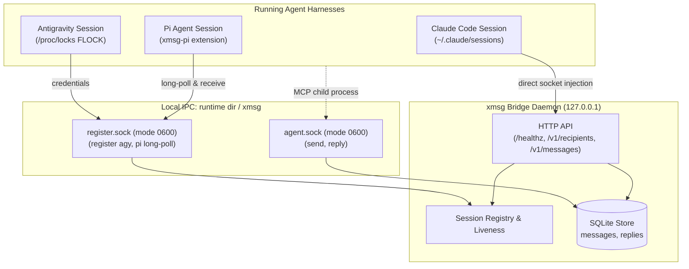

# xmsg: Local Inter-Agent Messaging & Coordination Bridge

`xmsg` is a fast, lightweight local messaging bridge connecting running AI agent sessions across harnesses (Claude Code, Antigravity, and Pi) on the local host. It provides direct, zero-overhead inbox delivery, attested caller identification, persistent reply threading, and MCP tooling.

---

## 1. Security Architecture & Trust Model

### 1.1 Same-UID Trust Boundary

All local IPC in `xmsg` relies on Unix domain sockets located in `$XDG_RUNTIME_DIR/xmsg/` (`http.sock`, `agent.sock`, `register.sock` in mode `0700` directory, socket mode `0600`, owned by the running user's UID). On macOS, when `XDG_RUNTIME_DIR` is unset, the runtime dir is the per-user Darwin temp dir (`getconf DARWIN_USER_TEMP_DIR`, also a `0700` directory):

- Sockets authenticate connected peers via kernel-attested credentials (`SO_PEERCRED` on Linux, `getpeereid` and `LOCAL_PEEREPID` on macOS). On macOS the peer PID is the last process to use the socket, not the one that connected as with `SO_PEERCRED`; they differ only when a connected socket is shared between processes before `accept`, and the UID check is unaffected.
- Any process executing under the **same local UID** is within the trust boundary and may connect to the Unix sockets.
- Sockets are protected against symlink attacks and race conditions on startup by verifying directory ownership and permissions prior to binding.
- All HTTP API endpoints are exposed over `$XDG_RUNTIME_DIR/xmsg/http.sock` by default. Every connection undergoes a peer UID check (`peer_uid == server_uid`) before HTTP framing, dropping connections from other UIDs immediately.
- **Caller identity is attribution, not a boundary (A15).** Within one UID, identifying a caller by its process ancestry (on `agent.sock` and `http.sock`) protects against mistakes and attributes senders; it does not stop a same-UID process that sets out to impersonate a session. The boundaries that hold are separate UIDs (each genie tier runs its own `xmsg`), certificates, and a peer's `allow`. Anyone who sees a message ID (in a log, in a forwarded label) can read its replies.

### 1.2 No-Authentication HTTP Posture & Unix-Socket Default

> [!WARNING]
> **No-Auth HTTP Service**: The `xmsg` HTTP server provides **no application-level authentication mechanisms**. It relies on Unix domain socket peer credentials (`SO_PEERCRED` / `getpeereid`) for access control.
>
> By default, `xmsg serve` binds **no TCP port whatsoever**. It listens solely on the local Unix domain socket `$XDG_RUNTIME_DIR/xmsg/http.sock`.
>
> A TCP loopback listener is available **only** when explicitly requested via the `--listen <IP:PORT>` CLI flag or `XMSG_LISTEN` environment variable. This is intended strictly for clients that explicitly configure `XMSG_URL` or for container / Kubernetes pod environments where loopback is an isolated, private network namespace. Never bind TCP to external or shared interfaces.

### 1.3 Attestation & Identity Derivation

`xmsg` prevents cross-session and cross-harness impersonation among non-adversarial same-UID processes:

- **Claude Sessions:** Discovered via configured session directories (defaulting to `~/.claude/sessions`). In multi-tenant setups (such as `genie` running one `CLAUDE_CONFIG_DIR` per subscription token, where each user has separate session directories), `xmsg` accepts multiple session directories via repeatable `--sessions-dir` flags or colon-separated paths in `XMSG_SESSIONS_DIR`. Process liveness and starttime continuity are verified via `/proc/<pid>/stat` (on macOS via `proc_pidinfo`, matching to the second the UTC `ps -o lstart` text Claude Code records as `procStart`; local-time renderings are rejected). When multiple live processes present the same conversation ID `X` (whether in the same session directory or across multiple tenant directories), they are managed via the SQLite persistent claim table (`instance_claims`). The first live process presenting `X` receives plain `X` (suffix 1); subsequent live processes receive monotonic suffixes `X~2`, `X~3`, ... in observation order, broken by `(procStart, pid)` within the same scan. Suffixes are persistent across server restarts and are never promoted while live. When a process exits or `<pid>.json` stops naming the ID, the claim is released. If plain `X` is released, a newly observed process can claim it; previously used numeric suffixes are never reused while records exist. When a node observes a second live process for an already-live ID, it sends exactly one fork notice to each process informing them of both addresses and routing.
- **Antigravity Sessions:** Verified via dual attestation: the registering peer's ancestor chain is traversed to find a process matching a configured trusted executable (`--agy-exe`) that has the presence lock file descriptor `<presence_dir>/<conversation_id>.lock` open (matched by canonical device and inode numbers). The session ID is the Antigravity conversation UUID, and subsequent liveness is tracked by PID and start time. On Linux, `/proc/locks` is checked additionally to confirm exclusive FLOCK ownership. On macOS, Darwin XNU kernel does not expose unprivileged APIs to identify the holder of a BSD `flock(2)` lock (`proc_pidfdinfo` has no lock state, and while `fcntl(F_GETLK)` queries the per-vnode lock list and can detect conflicting `F_FLOCK` locks via `lf_getlock` in `bsd/kern/kern_lockf.c`, it sets `fl->l_pid = -1` because non-POSIX flock locks record no owner PID). Thus Darwin provides no unprivileged API to attribute `flock(2)` ownership to a specific PID or distinguish the active holder from an exec-inheritor. macOS operates under Option B: verifying the trusted executable (`proc_pidpath`) and open file descriptor vnode `(vst_dev, vst_ino)` without FLOCK holder verification, accepting that inherited descriptors across exec satisfy the check (documented in `docs/probes/macos-agy.md`).
- **Pi Sessions:** Session identity is a **server-minted UUID v4**. Caller-asserted session IDs in registration payloads are completely ignored.
- **Service Sessions:** Services register bare names (e.g. `dispatcher`, dropping legacy `svc:` prefixes). Service names are validated: they cannot equal `xmsg`, cannot be UUID-shaped, and cannot contain `@`, `·`, `~`, or `.`.
- **Process Verification (Pi):** Pi sessions register via Unix domain socket (`register.sock`, mode 0600 in a 0700 runtime directory) and are admitted on the peer UID check alone (`SO_PEERCRED` / `LOCAL_PEERCRED`). Because `register.sock` is accessible only by the owning user, who already possesses permissions to inspect or trace processes on their own bus, executable and script attestation add no trust on a user's own bus. The server verifies that the peer UID matches the server UID, records process starttime for lifecycle tracking, and mints a fresh UUID v4 as `sessionId`.
- **Fail-Closed Executable Resolution:** Executable path resolution fails closed on deleted binaries (`<path> (deleted)`) and upgraded profile symlinks where the canonical target has changed or no longer exists.
- **The sender label (A12):** every sender is shown with one render:
  ```text
  instance:   label · id@node      (id@node alone when it has no label)
  service:    name@node            (all of it attested)
  anonymous:  from · anon@node     (an unattested HTTP sender)
  ```
  `id@node` is attested by `xmsg`: `id` is the sender's instance address, a fork's `~n` included (so the `X~2` fork of a conversation sends as `X~2`, never as plain `X`), and `node` is the node's own name (Section 7.0), or the reader's nickname for a peer it has one for. The label is the sender's own description (a Claude session's name, a pi session's name) and is shown apart from it. The harness is not shown. A label containing `@` or `·` is dropped whole, so it can never imitate the attested part; the session stays listed and addressable by its ID, with no label. Only the label is bounded (64 characters); the attested part is always emitted whole, however long the node's name is.
- **Ancestor Process Walk:** For calls to `agent.sock` (such as MCP tools spawned in child shells) and to `http.sock` (A15), `xmsg` traverses parent PIDs upwards through `/proc/<pid>/stat` (`proc_pidinfo` on macOS) to identify the originating session or service, reading the claim table, so a fork acts as `X~n`. A caller on `http.sock` that traces to none is anonymous. A caller on the TCP `--listen` listener carries no peer credentials and is anonymous, except in leaf mode, where it is the leaf principal (AM-2).
- **Symmetric Reply Authorization (XU1 Gate 3):** `reply(message_id=m)` answers $m$'s other party. If the caller is $m$'s recipient, the reply goes to $m$'s sender; if the caller is $m$'s sender, it goes to $m$'s recipient as a follow-up in the same exchange (`in_reply_to = m`). A caller who is neither party is refused with `not_recipient` (`denied`). Every envelope footer carries `[xmsg] ref=<id>@<node> message_id=... — reply with the xmsg reply tool (tools: send, reply, list, replies)`.
- **Principal-Scoped Idempotency:** Idempotency keys are partitioned by sender principal: an attested caller's instance address (a fork's `~n` included) or service name, and an anonymous HTTP caller's `anon:<from>`, from the caller-declared `from` field. Anonymous callers choosing the same `from` share that key namespace.

### 1.4 Envelope Sanitization & Breakout Protection

- **Printable-ASCII Sender Enforcement:** HTTP sender names are strictly restricted to printable ASCII characters (`0x20` to `0x7E`) and cannot contain `:`, `/` or `@`. An unauthenticated caller therefore cannot write an `@`, so its `from` can never imitate an attested `id@node`; its label always ends ` · anon@<node>`.
- **Attested Labels:** the `id@node` part of a label (Section 1.3) is generated internally from the claim table and the node's name; a sender chooses only its label.
- **Sender Sanitization:** Labels are stripped of quotes, angle brackets, control characters, and newlines, non-ASCII characters become `_`, and the label (never the attested part) is capped at 64 characters across all sinks (`assemble_envelope`, inbox headers, and UI titles).
- **XML Breakout Defense:** The transport envelope escapes attribute double quotes (`&quot;`), guaranteeing that the `<cross-session-message>` XML tag cannot be broken out of.

---

## 2. IPC Sockets & Components



`xmsg` operates three Unix domain sockets in `$XDG_RUNTIME_DIR/xmsg/`, or the Darwin user temp dir on macOS (created with file permissions mode `0600`, restricted to same-UID callers):

### 2.1 `http.sock`

Serves the HTTP API directly over a local Unix domain socket. Peer credentials (`SO_PEERCRED` / `getpeereid`) are checked on every connection, refusing any non-matching UID prior to HTTP framing.

**Who is calling (A15).** The caller's process ancestry is walked from its peer PID, as on `agent.sock`. A caller that traces to a Claude, agy or pi session or a registered service acts as that sender: its sends are attributed (`label · id@node`, and the `from` it supplies is ignored), the replies to them are pushed into its inbox, and it may `reply` to what it received. A caller that traces to none is **anonymous**:

- it may send, labelled `<from> · anon@<node>`, with `from` unattested;
- it reads the replies to its messages with `GET /v1/messages/{id}/replies`, the message ID being the key;
- it may not `reply` (`denied`): it has received nothing;
- its idempotency principal is `anon:<from>`, which a peers-file `principals` filter can name.

`curl --unix-socket` from a Claude session's shell is therefore that session. The TCP `--listen` listener has no peer credentials: its callers are anonymous, or the leaf principal in leaf mode (AM-2).

### 2.2 `agent.sock`

Used by agent sessions, MCP tool instances and registered services. One JSON frame per line; each mirrors an MCP tool field for field, with `idempotency_key` added on `send` and `reply` (AM-4; Section 4, Idempotency). **Every frame refuses a field it does not know** with `bad_request` naming every unknown field (an old client's `{"action":"send","ref":…,"push_replies":…}` is refused naming `ref` and `push_replies`).

| frame                                                                   | answer                                                                         |
| ----------------------------------------------------------------------- | ------------------------------------------------------------------------------ |
| `{"action":"list","name"?,"node"?,"kind"?,"status"?,"within"?}`         | `{"status":"ok","recipients":[…],"nodes":[…]}` (§4)                            |
| `{"action":"send","to","text","idempotency_key"?,"as_agent"?}`          | `{"status":"ok","message_id","address","outcome"}`                             |
| `{"action":"reply","message_id","text","idempotency_key"?,"as_agent"?}` | `{"status":"ok","reply":{…}}`                                                  |
| `{"action":"replies","message_id","wait"?,"after"?}`                    | `{"status":"ok","replies":[…]}`                                                |
| `{"action":"inbox","wait"?,"as_agent"?}`                                | `{"status":"ok","address":"<P>/<child>@<node>","messages":[…]}`                |
| `{"action":"subagent","event","agent_id",…}`                            | `{"status":"ok",…}` (subagent lifecycle and name binding for Claude and `agy`) |

`send`, `reply` and `inbox` are attributed to the caller by its process ancestry (`SO_PEERCRED`): a Claude, agy or pi session, or a registered service (a service sends over `agent.sock`, attributed by its pid). When `as_agent` is set on `send`, `reply` or `inbox` (stamped by the harness's `PreToolUse` hook), the call acts as the bound subagent `<P>/<child>@<node>` under the caller's parent session `P` (or as `P` itself when `as_agent` equals `P`'s own session ID). The sender's label is `label · id@node` (or `label · id/child@node` for a subagent) for an instance and `name@node` for a service; callers cannot supply a sender or a return address. Errors are `{"status":"error","error","detail"}` with the codes of §4.

### 2.3 `register.sock`

Used by non-Claude harnesses for registration and polling, and by services:

- **Antigravity Registration:** `xmsg register agy` sends session credentials (`conversation_id`, `ls_address`, `csrf_token`) over this socket to enable outbound HTTP message injection into Antigravity.
- **Pi Registration & Polling:** The Pi extension registers its process and enters an event-driven long-poll loop to receive inbound messages (`poll`, `ack`).
- **Services:** a registration's `ok` frame is `{"status":"ok","address":"<name>@<node>","node":"<node>"}`. A service then uses `poll`, `ack` and `reply` here; it runs `list`, `send` and `replies` over `agent.sock`. `register.sock` carries registration, `poll`, `ack` and `reply` only, and its frames refuse unknown fields too.
- **Plugin harnesses (opencode, hermes):** see 2.3.1.

#### 2.3.1 Plugin registration: many sessions on one connection

A plugin harness (opencode, hermes) runs many sessions in one process, so its plugin holds **one** `register.sock`
connection and registers each session on it; each gets its own server-minted address. The plugin's
tools travel on the same connection, as frames naming the session they act as, so a call is attributed to that
session's address and to no other.

The connection opens with `{"harness":"opencode"}` or `{"harness":"hermes"}`, answered `{"status":"ok","node":"<node>"}`. Every later frame
carries a `request_id` of the plugin's choosing, and its answer carries it back: answers to tool frames and the
delivery that ends a pending `poll` arrive on one connection, in whatever order they are ready, and **a tool frame
is answered while a `poll` is pending**. Every frame refuses unknown fields (`bad_request`, naming them).

| frame                                                                                            | answer                                                                                                                                                                                                  |
| ------------------------------------------------------------------------------------------------ | ------------------------------------------------------------------------------------------------------------------------------------------------------------------------------------------------------- |
| `{"action":"register","session":S,"reclaim"?:{…}}`                                               | `{"status":"ok","address":"<id>@<node>","reclaim":{…}}`, a fresh or reclaimed address; `conflict` if S is already registered on this connection                                                         |
| `{"action":"release","session":S}`                                                               | `{"status":"ok"}`; S's address answers `gone` from then on                                                                                                                                              |
| `{"action":"continues","from":S1,"to":S2}`                                                       | `{"status":"ok","address":…}`: S1's address now belongs to S2; `conflict` if S2 is registered on this connection                                                                                        |
| `{"action":"subagent","event":"start"\|"stop"\|"end","session"?:S,"agent_id":C,"agent_type"?:…}` | `{"status":"ok",…}`: binds child session C under root S (`<P>/<C>@<node>`), marks its turn active (`start`) or inactive (`stop`), or unbinds it (`end`)                                                 |
| `{"action":"list"\|"send"\|"reply"\|"replies"\|"inbox","session":S,"as_agent"?:C,…}`             | `agent.sock`'s frames and answers (2.2) field for field, acting as S (or `<P>/<C>@<node>` when `as_agent` is set on `send`, `reply` or `inbox`)                                                         |
| `{"action":"poll","wait":N}`                                                                     | `{"action":"deliver","session":S,"address":"<id>@<node>","message_id":…,"from_name":…,"text":…,"envelope":…}` for any session on the connection, or `{"action":"timeout"}` after N seconds (at most 60) |
| `{"action":"ack","session":S,"message_id":M}`                                                    | `{"status":"ok"}` once the harness accepted M, which then reads `delivered`; an unacked message is offered again                                                                                        |

One `poll` is pending per connection at a time, and a second is refused `conflict`, so a message is never handed
to two polls. The sessions on a connection take turns: a session's unacked head is offered again only after the
other sessions' heads, so one refused message does not hold back the rest.

A frame naming a session this connection does not hold, `continues` and `subagent` included, is refused `denied`: only the
connection that registered a session can speak for it, bind or stop its subagents, or move its address. A released session's address
answers `gone` permanently; a connection that closes without `release` detaches its addresses so the plugin can reclaim them within the reply TTL. A plugin process maps to no
address, so any other caller in it or under it (a shell tool's `curl` to `http.sock`, an `xmsg mcp` child) is
anonymous.

### 2.4 Replies: stored always, pushed by sender kind (A10)

- **Every reply is stored**, and read with `replies` (MCP, `agent.sock`, or `GET /v1/messages/{id}/replies`) by anyone holding the message ID.
- **It is also pushed when the original sender has an inbox:** a Claude, agy or pi session, or a registered service (whose push lands in the inbox it long-polls, with `inReplyTo` naming the message answered). An anonymous HTTP caller has no inbox and reads with `replies`. There is no per-message opt-out; `push_replies` is gone from every frame, the storage and the node-to-node envelope.
- **Strictly Derived Return Address:** the server derives the return address from the attested caller; anything the caller supplies is refused.
- **Envelope Header & Threading:** a pushed reply is a first-class message with a new ULID, a return address and a `thread_id` pointing at the original. Its envelope begins:
  ```text
  [xmsg] reply to message_id=<orig_id> — message_id=<new_id>; reply with the xmsg reply tool
  ```
- **Push Outcomes**, recorded with the reply: `pushed`, `sender_gone`, `push_failed`, or `stored` (the origin is a leaf that pulls its replies). A reply to a sender with no inbox records none.
- A reply to a message from another node always travels back to that node, which decides how it reaches the sender (A-2).

---

## 3. Interfaces & Tooling

### 3.1 Model Context Protocol (MCP) Server: `xmsg mcp`

`xmsg` provides a stdio MCP server for agent harnesses:

```json
{
  "mcpServers": {
    "xmsg": {
      "command": "xmsg",
      "args": ["mcp"]
    }
  }
}
```

Exposes five tools (all execute autonomously without user interaction prompts):

- **`list(name?, node?, kind?, status?, within?)`:** the recipients the caller may see: each entry's address (`id@node` for an instance, `id/child@node` for a subagent, `name@node` for a service), kind (`service`, `instance` or `subagent`), label and status (`live`, `parked` or `closed`). `node` lists a federated peer. (Passing `host` is refused with a migration hint to use `node`).
- **`send(to, text, as_agent?)`:** `to` is an instance ID (a UUID, optionally `~n`), a sub-address (`<P>/<child>`), a service name or an instance label, optionally followed by `@node` (one `@` at most). Returns the message ID, the resolved address and the outcome; follow-ups to the address cannot drift to another instance. The caller's identity is derived (or attested as `<P>/<child>` when `as_agent` is stamped by the harness hook); passing `ref` or `from` is refused with a migration hint (`use 'to' instead`). Passing a label containing `' · '` in `to` is refused with a hint to use the header's `ref=` address. MCP carries no `idempotency_key` on `send` or `reply`: agents do not retry by accident, and programs that retry use HTTP, `agent.sock` or `register.sock`.
- **`reply(message_id, text, as_agent?)`:** answers the exchange's other party symmetrically (if received, answers the sender; if sent, follow-up to the recipient). Reshaped for MCP callers to return `{bytes, messageId, inReplyTo, outcome}`, where `messageId` is the new reply's ID and `inReplyTo` is the answered ID.
- **`replies(message_id, wait?)`:** the stored replies to a message the caller sent, waiting up to `wait` seconds (at most 60) for the first.
- **`inbox(wait?, as_agent?)`:** drains unexpired messages queued for a bound subagent's `<P>/<child>@<node>` turn mailbox while its turn is active, waiting up to `wait` seconds (at most 60) for the first message, and marks drained messages `delivered`. Returns `{address, messages: [{id, from, body, created_at}]}`.

#### Reply-Only Mode (`--reply-only`)

For restricted subagent or responder-only sessions where the model should only be able to answer incoming messages rather than discovering or initiating new conversations, run MCP with `--reply-only` (or set `XMSG_REPLY_ONLY=1`):

```json
{
  "mcpServers": {
    "xmsg": {
      "command": "xmsg",
      "args": ["mcp", "--reply-only"]
    }
  }
}
```

In reply-only mode, `tools/list` returns `[reply, replies]`. The `list`, `send` and `inbox` tools are omitted from the catalog and any direct JSON-RPC calls to them fail closed with an error.

### 3.1.1 Delegated Sub-Addresses (`<P>/<child>@<node>`), `inbox`, and Parent Fallback

In harnesses that spawn in-process or child subagents under a parent conversation `P`, each bound child gets a delegated sub-address so external sessions and services can message or reply to the subagent directly and see its sends attributed to it:

- **Address form (`<P>/<child>@<node>`):** `<P>` is the parent instance's ID (a UUID, or `X~n` fork) and `<child>` is either the subagent's bound name (when one is given) or its harness `agent_id` / child session ID. Both `<P>/<name>` and `<P>/<agent_id>` resolve to the same bound subagent, and `list` includes live bound subagents with `kind: "subagent"` and `address: "<P>/<child>@<node>"`. When the subagent sends or replies, its sender label is `label · <P>/<child>@<node>`.
- **Turn mailbox (`inbox`):** While a subagent's turn is active (`turn_pid` live with matching start time), messages and replies sent to `<P>/<child>@<node>` queue in its turn mailbox (`outcome: "queued"`). The subagent drains them during its turn by calling **`inbox`** (optionally with `wait` up to 60 seconds), which returns `{address, messages: [{id, from, body, created_at}]}` and marks each drained message `delivered`.
- **Parent fallback (`to=<P>/<child> agent_id=<id>`):** When the subagent's turn is not active (between turns or after `SubagentStop` / `Stop`), messages and replies addressed to `<P>/<child>@<node>` fall back to the parent session `P` with a `to=<P>/<child> agent_id=<agent_id>` header prepended to the message body. If `P` is currently parked, the message stays queued on `<P>/<agent_id>` and is either drained by the subagent on its next `inbox` call or delivered to `P` with the fallback header when `P` returns.
- **Per-harness sub-address support:**
  - **Claude Code (`claude`):** Full delegated sub-addresses (`<P>/<name>@<node>` and `<P>/<agent_id>@<node>`), `inbox`, and parent fallback via `xmsg register claude --hook` on `SubagentStart`, `PostToolUse` (`Agent` and `SendMessage`), `SubagentStop`, and `PreToolUse` on `mcp__xmsg__*` / `mcp__plugin_hm_xmsg__*` (which stamps `as_agent` into the tool input).
  - **opencode 1.x and 2.x (`opencode`):** Full delegated sub-addresses (`<P>/<child_ses>@<node>`), `xmsg_inbox`, and parent fallback on both 1.x and 2.x plugin APIs. Child sessions (`task` or `subagent` children with a `parentID`) walk `parentID` to their root conversation `P`, bind via `subagent` (`start`/`stop`/`end`) on `register.sock`, and pass `as_agent: <child_ses>` on `xmsg_send`, `xmsg_reply` and `xmsg_inbox`.
  - **Antigravity (`agy`):** Full delegated sub-addresses (`<P>/<child_uuid>@<node>`), `inbox`, and parent fallback while parent `P` is registered. Children spawned via `invoke_subagent` are admitted from `P`'s `brain/<P>/.system_generated/logs/transcript.jsonl` and tracked across turns by `xmsg register agy --hook` (`--event pre-invocation`, `--event pre-tool-use` stamping `as_agent`, and `--event stop`).
  - **Hermes (`hermes`):** `delegate_task` subagents act as their root conversation `P` and do not bind separate `<P>/<child>` sub-addresses.
  - **Pi (`pi`):** Single-session process; no subagent sub-addresses.

### 3.2 Pi Coding Agent Extension: `extensions/pi/`

TypeScript extension for Pi (`@earendil-works/pi-coding-agent`):

- Connects to `register.sock`, receives server-derived session ID, and long-polls for inbound messages.
- Defaults session display name to the directory basename of the working directory.
- Delivers incoming messages into Pi with `expandPromptTemplates: false` to prevent remote command or prompt template injection.
- Registers three tools (`list`, `send`, `reply`); Pi has no subagent sub-addresses or `inbox` tool:
  - **`list`:** Queries active sessions over `$XDG_RUNTIME_DIR/xmsg/http.sock` via Unix domain socket (or `XMSG_URL` when explicitly configured as an override).
  - **`send`:** Sends messages over `agent.sock` to ensure kernel attestation of peer PID and return address.
  - **`reply`:** Sends replies over `agent.sock`.

### 3.2.1 opencode plugin: `extensions/opencode/xmsg.ts`

opencode loads `<config>/opencode/plugin/xmsg.ts` on start. The file's default export serves both plugin APIs:
opencode 1.x calls its `server` function, opencode 2.x its `setup`. On 1.x the plugin holds one `register.sock`
connection per opencode process (2.3.1). On 2.x the plugin runs in the opencode server, by default a background
service (`opencode service`) that every TUI attaches to (`--standalone` gives a TUI a server of its own). The server
sets the plugin up once per project directory, so it holds one connection per directory it serves, each carrying
that directory's sessions:

- **Registration.** A session registers at its first user prompt (1.x `chat.message`, 2.x the session `prompt`
  hook), so a session started in this process, or resumed with `-s`, gets an address once it is used, and the many
  stored sessions an opencode server can reach do not. Registration finishes before the turn's first tool call is
  answered.
- **Tools.** `xmsg_list`, `xmsg_send`, `xmsg_reply`, `xmsg_replies` and `xmsg_inbox`, sent as frames under the
  calling session (`ToolContext.sessionID`). On 2.x they are kept out of Code Mode, so the model calls them by
  name. The arguments are required, except `xmsg_list`'s filters (`name`, `node`, `kind`, `status`, `within`) and
  `xmsg_inbox`'s `wait`: `xmsg_replies` takes `wait` (0 for none).
- **Child sessions** (a `task` or `subagent` child) bind a delegated sub-address `<P>/<child_ses>@<node>` under
  their root conversation `P` (found by walking `parentID`) via `subagent` (`start`/`stop`/`end`) and send
  `as_agent: <child_ses>` on `xmsg_send`, `xmsg_reply` and `xmsg_inbox`. While a child is in a turn, messages to
  `<P>/<child_ses>` queue for its `xmsg_inbox`; otherwise they fall back to `P` with a `to=<P>/<child_ses> agent_id=<child_ses>` header. Registration, reclaim, push delivery (`pi_pending_messages`), `xmsg_list`,
  `xmsg_replies` and root release stay rooted.
- **Push.** A delivered message goes into its session as a user prompt (1.x `promptAsync`, 2.x `session.prompt`),
  which starts the session if it is idle; in a running turn, opencode takes it as it takes any mid-turn prompt. The
  plugin acks only after opencode accepted the prompt.
- **Release.** Deleting a session releases its address. Switching sessions in the TUI does not: the opencode server
  can still deliver to every session it registered. On 2.x a session also outlives its TUI: quitting the TUI leaves
  it registered, and a message delivered to it starts a turn in the service, which runs and can answer with no TUI
  attached; the turn shows when the session is opened again. Only deleting the session releases it. Stopping the
  service, or reloading the plugin (opencode watches the file), closes the connection, which detaches every address
  on it: each session reclaims its own address at its next prompt.

There is no MCP entry for opencode: the plugin's tools are the attested path.

### 3.2.2 hermes plugin: `extensions/hermes/`

hermes loads the plugin directory (`plugin.yaml`, `__init__.py`) from `$HERMES_HOME/plugins/` when
`plugins.enabled` names it, by its manifest name `xmsg`. The plugin holds one `register.sock` connection per
hermes process (2.3.1):

- **Registration.** A session registers at the first `pre_llm_call` hook or xmsg tool call that carries its
  `session_id`. A delegate (a `delegate_task` subagent, whose `pre_llm_call` names its parent) acts as its root
  conversation and is never registered.
- **Tools.** `xmsg_list`, `xmsg_send`, `xmsg_reply` and `xmsg_replies`, in the toolset `xmsg`, sent as frames under
  the calling session (the tool's `session_id`). hermes defers plugin tools behind its Tool Search bridge by default
  (`tools.tool_search`), so the model reaches them through `tool_search` and `tool_call`.
- **Ending a session.** A session that ends has its address released (hermes's `on_session_finalize`): a desktop
  session closed, or the CLI's `/new` or exit. A send to it then answers `gone`, and it holds up no other session on
  the connection. A tool call acting as an ended session answers `gone` and registers nothing: a background delegate
  keeps running after `/new`, and registering its root again would release the live session.
- **Switching sessions (the classic CLI).** One session is live per CLI process. `/new` ends the old session and
  registers the new one (`on_session_reset`). `/resume` and `/branch` fire no plugin hook, so the plugin sees the
  switch at the next hook, tool call or push, by the CLI's `session_id`, releases the old address then, and never
  injects one session's message into another.
- **Compression.** With `compression.in_place: false`, a compression continues the conversation under a new
  session id; the plugin then moves the address with `continues`. It reads hermes's session store for this
  (`SessionDB(read_only=True).get_compression_chain`), which is internal hermes API: a change there breaks
  continuation, and CI's `hermes-plugin` check pins it. hermes's default, in-place compaction keeps the session id,
  and the address with it.
- **Push, in the classic CLI.** While a turn runs, a delivered message goes through the CLI's own handling of a
  line typed while busy, so `display.busy_input_mode` (or `/busy`) decides exactly as for typed input: `queue` runs
  it as the next turn, `interrupt` redirects the running turn, and `steer` adds it to the running turn after its
  current tool call. When no turn runs it starts one. This uses hermes's private CLI names (`_manager._cli_ref`,
  `_agent_running`, `_tui_enter_while_busy`, and `session_id` for the switch above), which the CI check pins.
- **Push, on the TUI and desktop host.** hermes's `inject_message` queues the message on its session in every busy
  mode ("a notice must not cancel in-flight work"), so there `interrupt` and `steer` behave as `queue`. It needs
  `plugins.entries.xmsg.allow_gateway_injection: true`, which the switch sets; without it hermes refuses every
  injection and the message stays pending.
- **Acks.** The plugin acks a message only once hermes accepted it; a refused one is offered again.

The messaging gateway is not covered: its `session_key` differs from the tools' `session_id`.

### 3.3 Antigravity Integration: Automatic Registration & Hooks

Antigravity (`agy`) session credentials (`ANTIGRAVITY_LS_ADDRESS`, `ANTIGRAVITY_CSRF_TOKEN`, `ANTIGRAVITY_CONVERSATION_ID`) exist only inside the interactive harness process and in the tool subshells spawned by its language server. Neither MCP server children nor external hook commands inherit these variables directly, and no on-disk credential publication exists.

#### Linux In-Process Command Watcher (Arm A) & Darwin Fallback (Arm B′)

On Linux, `xmsg` registers `agy` conversations itself by actively watching descendant processes spawned by the attested `agy` process holding the conversation's presence lock. Because Antigravity injects `ANTIGRAVITY_LS_ADDRESS` and `ANTIGRAVITY_CSRF_TOKEN` solely into the environment of the tool commands executed by the model (`run_command`), and offers no other credential publication channel, `xmsg` reads `/proc/<pid>/environ` of the attested `agy` process's descendants.

The watcher runs only for an armed conversation: one whose presence lock is held by the attested `agy` and that has no credentials, armed when `xmsg serve` starts and whenever the hook's check finds it unregistered. While nothing is armed it does no work. An armed conversation's subtree is scanned every 100ms until it registers or its lock is released; 100ms catches every command that runs at least that long, and a missed shorter command costs one turn, after which the hook request fires.

Strict scope rules are enforced in code:

- **Subtree Boundary:** `xmsg` descends from the attested `agy` process through `/proc/<pid>/task/<tid>/children`. Per scan it reads `/proc/locks`; the attested `agy`'s `exe`, `fd/`, `stat` and `task/*/children`; and for each process listed in a `children` file of the attested `agy` or of a process already found in its subtree, that process's `stat`, and only once the `stat` confirms the listing parent, its `environ` and `task/*/children`. Verification then reads `stat`, `exe` and `fd/` along the chain from the supplying process up to the attested `agy`. No other process is read. Where the attested `agy` has no `children` file (`CONFIG_PROC_CHILDREN` off, or the process is gone) nothing is read, the check reports the conversation as not watched, and the hook request fires from the first turn.
- **Variable Whitelist:** `xmsg` reads *only* `ANTIGRAVITY_LS_ADDRESS` and `ANTIGRAVITY_CSRF_TOKEN`, ignoring all other environment variables.
- **Zero Logging/Persistence:** Credential values are passed directly into registration memory and are never written to logs or disk.
- **PID Recycling Guard:** A process's start time is read before its ancestry is checked and again after its `environ` is read, and the attested `agy`'s start time is re-checked, so a recycled PID is never read past its ancestry check nor trusted.
- **Unreadable `environ`:** where `/proc/<pid>/environ` cannot be read (a sandbox, EACCES), `xmsg` logs it once per conversation at debug level, without values, and leaves the conversation to the hook request.

On Darwin and in sandboxes without accessible `/proc`, `xmsg` falls back to the PreInvocation hook request (Arm B′). While Arm A is actively watching an unregistered conversation on Linux, the PreInvocation hook stands down on the first turn (emitting `{}`), allowing Arm A to register silently when the model's first command executes. If the conversation remains unregistered on later turns (e.g. no command was run or `/proc` was unreadable), or if Arm A is not watching (Darwin/sandboxes), the hook injects an `ephemeralMessage` asking the model to run `xmsg register agy`.

`xmsg` implements a two-stage automatic registration lifecycle:

1. **Identity at MCP Start:**
   When `xmsg mcp` starts as an `agy` child, the server attests the ancestor process chain (verifying a trusted `agy` executable and an open presence lock held via Linux `FLOCK` in `presence_dir`). The session immediately becomes addressable as `agy:<pid>:<starttime>` without credentials (`status: "idle"`, `registered: false`). Messages sent to it are queued in its inbox (`outcome: "queued"`).

2. **Hooks (`xmsg register agy --hook`):**
   Configured in `hooks.json` under `PreInvocation`, `PreToolUse` and `Stop`:

   ```json
   {
     "xmsg-register": {
       "PreInvocation": [
         {
           "type": "command",
           "command": "/path/to/xmsg register agy --hook --event pre-invocation"
         }
       ],
       "PreToolUse": [
         {
           "matcher": "call_mcp_tool|mcp_xmsg_.*",
           "hooks": [
             {
               "type": "command",
               "command": "/path/to/xmsg register agy --hook --event pre-tool-use",
               "timeout": 5
             }
           ]
         }
       ],
       "Stop": [
         {
           "type": "command",
           "command": "/path/to/xmsg register agy --hook --event stop",
           "timeout": 5
         }
       ]
     }
   }
   ```

   - **`PreInvocation` (`--event pre-invocation`, default):** On each turn, `agy` passes hook JSON on stdin containing `conversationId`. First, the hook sends a `subagent` `start` frame on `agent.sock`: if the caller is a subagent spawned via `invoke_subagent` under a registered parent `P` (admitted from `P`'s `brain/<P>/.system_generated/logs/transcript.jsonl`), the server binds `<P>/<conversationId>@<node>`, records the subagent's active turn against `P`'s process and start time, answers `{"status":"ok","role":"subagent"}`, and the hook prints `{}` so the child never gets a registration prompt. For a parent session:
     - If push credentials are already registered, `xmsg` prints `{}`.
     - If push credentials are not yet registered: when Arm A is watching and this is the first turn since becoming unregistered, `xmsg` prints `{}` (stand-down); on subsequent turns, or when Arm A is not watching (Darwin/sandboxes), `xmsg` emits an `ephemeralMessage` instructing the model to run `xmsg register agy` before anything else.
     - On any error (malformed stdin, missing fields, or connection failure), `xmsg` logs a notice to stderr, prints `{}`, and exits 0.
   - **`PreToolUse` (`--event pre-tool-use`):** Matches `call_mcp_tool` and `mcp_xmsg_*` calls and returns `{"decision":"allow","overwrite":{…}}` stamping `as_agent: <conversationId>` into the tool arguments (for non-`xmsg` `call_mcp_tool` invocations it returns `{"decision":"ask"}` without modifying arguments; if `conversationId` or the tool payload cannot be parsed it fails closed with `{"decision":"deny"}`). When the caller is a bound subagent, `send`, `reply` and `inbox` act as `<P>/<conversationId>@<node>`; when the caller is the parent (`as_agent == P`), they act as `P`.
   - **`Stop` (`--event stop`):** Sends a `subagent` `stop` frame on `agent.sock` for `conversationId`, clearing the subagent's active turn and sweeping any remaining messages queued in its turn mailbox to the parent `P` with a `to=<P>/<conversationId> agent_id=<conversationId>` header.

3. **Credential Registration & FIFO Queue Flush:**
   Credentials can register either automatically via Arm A's proc watcher or via the model running `<exe_path> register agy`. In both paths, credentials are authenticated through `verify_registration`, `xmsg` rescans the parent's `transcript.jsonl` to admit its subagents, and all queued parent and subagent fallback messages are flushed to the session in FIFO order (`outcome: "delivered"`). Subsequent turns find credentials active and emit `{}`.

4. **Error Reporting Invariance:**
   Sending to a live PID that has no attested agent session returns `unregistered` (`process <pid> has no attested agent session`). The outdated text `"process exited"` appears nowhere for live processes.

#### Hook Injection & Scrubbing Findings (Step 0)

Reverse engineering of `agy` (v1.3.1) revealed that in `HookInjectedStep`, field 1 (`tool_call`) has protobuf option `(google.protobuf.field_options).internal_only = true` and `deprecated = true`. When a hook attempts to return a tool call injection, `utils.ScrubInternalFields` zeroes the field to `nil`, causing `hooks.InjectSteps` to panic with `unknown injected step type: <nil>`. Conversely, field 3 (`ephemeralMessage`) is public and non-internal, making prompt injection the only reliable automatic path.
See [docs/probes/agy-hook-injection.md](docs/probes/agy-hook-injection.md) for full disassembly and probe details.

#### Server Restart Resilience & Stage-1 Re-registration

When `xmsg serve` restarts while an `agy` session remains active, in-memory registration state is discarded, but the running `xmsg mcp` child process automatically re-establishes stage-1 registration. By holding a persistent connection to `agent.sock` and reconnecting with backoff whenever connection to the server is lost and restored, `xmsg mcp` kernel-attests itself to the restarted server within a bounded time. The session is restored to the session catalog as addressable with `registered: false` (queuing inbound messages and replies without dropping them). On the session's next turn, the `PreInvocation` hook detects that push credentials are not yet registered and triggers `xmsg register agy`, promoting the session back to `registered: true` and flushing all queued messages in FIFO order. A restarted server does not list sessions whose `xmsg mcp` child has exited, preventing ghost sessions.

#### Unregistered Session Message Queuing (Unit X20)

When an Antigravity session is live (its presence lock is held by a running process) but unregistered (e.g. before initial credential registration or immediately following an `xmsg` restart prior to the session's next turn):

- Inbound messages addressed either to the session's conversation ID or to its previous `agy:<pid>:<starttime>` key (verified against the live process's PID and start time) are accepted (`202 Accepted`) and stored in `agy_pending_messages` under the conversation ID (`outcome: "queued"`).
- Target resolution verifies that the presence lock is actively held by a running process and that any supplied start time matches the current process start time, refusing recycled PIDs (`not_found`).
- As soon as the session registers credentials via `xmsg register agy`, all pending messages queued under its conversation ID or session key are flushed and delivered in FIFO order exactly once (`outcome: "delivered"`).
- Both local HTTP/agent sends and federated inbound messages share this target resolution and queuing behavior.

### 3.4 Multi-Directory Claude Session Discovery (`--sessions-dir`)

In multi-tenant setups where multiple Claude configurations exist on the same host (such as `genie` running one `CLAUDE_CONFIG_DIR` per subscription token, giving each user or agent instance separate session directories), `xmsg` accepts multiple session directories:

- **Command Line:** Repeatable `--sessions-dir` flags or colon-separated paths:
  ```bash
  xmsg serve --sessions-dir /path/one/sessions --sessions-dir /path/two/sessions
  # or colon-separated:
  xmsg serve --sessions-dir /path/one/sessions:/path/two/sessions
  ```
- **Environment Variable:** `XMSG_SESSIONS_DIR` (or `XMSG_SESSIONS_DIRS`):
  ```bash
  export XMSG_SESSIONS_DIR="/path/one/sessions:/path/two/sessions"
  xmsg serve
  ```
- **Default:** `~/.claude/sessions`.
- **Instance Claims & Multi-Instance Resolution:** Discovery, liveness verification, listing, and delivery inspect all configured directories. When the same conversation ID appears across multiple directories or in multiple concurrent processes, `xmsg` assigns instance claims deterministically via the persistent `instance_claims` table. The first observed live process retains plain `X`, and subsequent instances receive monotonic fork addresses `X~2`, `X~3`, etc., accompanied by fork notices.
  - **Address Lifespan:** An Antigravity session address lasts across restarts that resume with `--conversation=<id>` (the conversation UUID is preserved). A Claude session address lasts across a resumed session when the harness keeps it (a resumed session may retain its sessionId across process restarts, but a new session ID will mint a new claim).
  - **Cost:** across session directories (tenants sharing one xmsg, §1.3), the plain ID goes to whichever directory's process registers X next (first observed), where previously the duplicate ID was excluded entirely.

#### Claude Code Subagent Hooks (`xmsg register claude --hook`)

Claude Code subagents spawned in-process via the `Agent` tool share the parent's `session_id` and MCP server process, while Claude Code's hook stdin supplies `agent_id` and `agent_type` on subagent events. `xmsg register claude --hook` wires four Claude Code hook events to `agent.sock`:

- **`SubagentStart`:** Sends `{"action":"subagent","event":"start","agent_id":…,"agent_type":…}` on `agent.sock`, binding `<P>/<agent_id>@<node>` under the parent session `P` and recording the parent's PID and start time as the subagent's active turn.
- **`PostToolUse` (matcher `^(Agent|SendMessage)$`):**
  - On `Agent`, reads `tool_input.name` and `tool_response.agentId` (or `subagents/agent-<id>.meta.json` next to `transcript_path`) and sends a `subagent` `bind` frame so the subagent is addressable by both `<P>/<name>@<node>` and `<P>/<agent_id>@<node>`.
  - On `SendMessage`, when `tool_input.to` targets a bound subagent whose in-memory teammate channel is unreachable after a restart, sends a `subagent` `send` frame so the message queues in the subagent's `xmsg` mailbox.
- **`PreToolUse` (matcher `^mcp__(plugin_hm_)?xmsg__(send|reply|inbox|list|replies)$`):** Returns `hookSpecificOutput.updatedInput` with `as_agent` set to the hook payload's `agent_id` (when called by a subagent) or `session_id` (when called by the parent), overwriting any model-supplied value. `send`, `reply` and `inbox` then act as `<P>/<child>@<node>` for a subagent or as `P` for the parent.
- **`SubagentStop`:** Sends `{"action":"subagent","event":"stop","agent_id":…}` on `agent.sock`, clearing the subagent's active turn so subsequent messages to `<P>/<child>@<node>` fall back to the parent session `P` with a `to=<P>/<child> agent_id=<agent_id>` header.

### 3.5 Daemon Harness Integration: Long-Poll & Attestation

`xmsg` supports long-running daemon harnesses and headless service workers using bare service names (e.g. `genie-expert` or `dispatcher`). Unlike interactive assistants (such as Claude or Antigravity), daemons connect directly to `register.sock`, attest their executable path, and pull inbound messages using a long-polling loop with explicit acknowledgment.

#### Configuration & Trust Model (`--svc-exe`)

To prevent arbitrary processes from intercepting daemon traffic or squatting service names, `xmsg serve` requires trusted executable paths per service name:

- **Command Line:** Repeatable `--svc-exe <NAME=PATH>` flags or comma-separated pairs:
  ```bash
  xmsg serve \
    --svc-exe genie-expert=/nix/store/.../bin/genie-dispatcher \
    --svc-exe worker=/usr/local/bin/my-worker
  ```
- **Environment Variable:** `XMSG_SVC_EXE`:
  ```bash
  export XMSG_SVC_EXE="genie-expert=/nix/store/.../bin/genie-dispatcher,worker=/usr/local/bin/my-worker"
  xmsg serve
  ```
- **Attestation:** On connection to `register.sock`, `xmsg` queries kernel credentials (`SO_PEERCRED`) to verify the peer process runs under the same UID as `xmsg`. It canonicalizes `/proc/<pid>/exe` and verifies that it strictly matches the configured trusted path for `NAME`. Untrusted executables or UID mismatches are rejected immediately (`status: "error"`).
- **Single Live Registration:** A second registration for an already-active service name is refused while the initial process remains alive. Once a daemon process exits, a replacement daemon can register immediately.

#### Registration Frame

The daemon connects to `$XDG_RUNTIME_DIR/xmsg/register.sock` and sends a JSON registration frame:

```json
{
  "harness": "svc",
  "name": "genie-expert",
  "cwd": "/optional/working/dir"
}
```

The server responds with the registration's address and this node's name (AM-4):

```json
{
  "status": "ok",
  "address": "genie-expert@sini.cortex",
  "node": "sini.cortex"
}
```

Registered services appear in `list` / `/v1/recipients` as `<name>@<node>` with kind `service`, and are addressable by the bare `<name>` (A11; the `svc:` prefix is gone).

#### Long-Poll & Explicit Acknowledgment Semantics

Communication over the registration socket uses a JSON-lines streaming protocol:

1. **Long-Poll (`action: "poll"`):**

   ```json
   { "action": "poll", "waitSecs": 30 }
   ```

   If a message is queued or arrives within `waitSecs` (clamped between 0 and 60 seconds), `xmsg` pushes:

   ```json
   {
     "action": "deliver",
     "messageId": "01M4FG...",
     "fromName": "sender · 6f1c2a7e-...@sini.cortex",
     "origin": {
       "id": "6f1c2a7e-...",
       "node": "sini.cortex",
       "label": "sender"
     },
     "text": "Task payload...",
     "envelope": "[xmsg] from=... message_id=...\n\nTask payload...",
     "inReplyTo": null
   }
   ```

   The `origin` object provides structured sender attestation resolved at enqueue time, one shape for every sender (A12): the sender's instance `id` or `service` name, the `node` that attests it, and the sender's own `label`:

   - `{"id": <instance_id>, "node": <node>, "label": <label>}`: an instance (`label` is omitted when it has none).
   - `{"service": <name>, "node": <node>}`: a registered service.
   - `{"node": <node>, "label": <from>}`: an anonymous sender (e.g. a plain HTTP send); `label` is its unattested `from`.

   `node` is this node's name for a local sender. For a message that arrived over mTLS federation it is the sending node's canonical name (Section 7.0): `<user>.<host>` or `<sa>.<ns>` for a CA peer, the 16-character key-derived name for a pinned peer, never a local nickname. A federated origin is asserted by the authenticated peer, gated by `principals` filters, and not proven end to end. `inReplyTo` names the message a delivered reply answers.

   Daemons and services must use `origin` rather than parsing display strings (`fromName` or `envelope`) for security and authorization decisions.

   If no message arrives within `waitSecs`, `xmsg` responds with `{"action": "timeout"}`.

2. **Explicit Acknowledgment (`action: "ack"`):**

   ```json
   { "action": "ack", "messageId": "01M4FG..." }
   ```

   Server responds: `{"status": "ok"}`. The message's record then reads `delivered`: a send to a service answers
   `queued` until its ack (Section 4, Delivery and the queue).

   A reply is `{ "action": "reply", "messageId": "01M4FG...", "text": "...", "idempotencyKey": "..." }` (the key optional, Section 4, Idempotency); the server responds `{"status": "ok", "messageId": <the pushed reply's ID, or null>}`.

3. **At-Least-Once Delivery & Per-Connection In-Flight Tracking (XF6):**
   A message's queue row is stamped `delivered` **only** upon receiving an explicit `ack` frame. On a live `register.sock` connection, `xmsg` tracks the message IDs already handed out on that connection (`in_flight`), so a subsequent `poll` while an earlier delivery is still unacked hands out the next pending message in FIFO order rather than redelivering the unacked head. If the daemon crashes, disconnects, or terminates before sending an `ack`, the connection's `in_flight` set is dropped and every unacknowledged message remains in the queue to be redelivered in FIFO order when the daemon reconnects and polls again. A serial `poll` → `ack` → `poll` consumer receives one message at a time in order, unchanged.

---

## 4. HTTP API Reference

The HTTP API is bound by default to the local Unix domain socket `$XDG_RUNTIME_DIR/xmsg/http.sock` (mode `0600`, peer UID checked). If an explicit `--listen <IP:PORT>` (or `XMSG_LISTEN`) flag was provided on startup, it is also served over TCP.

### Accessing the Unix Socket via cURL

```bash
# Health check
curl --unix-socket "${XDG_RUNTIME_DIR:-/run/user/$(id -u)}/xmsg/http.sock" http://localhost/healthz

# List the recipients you can message
curl --unix-socket "${XDG_RUNTIME_DIR:-/run/user/$(id -u)}/xmsg/http.sock" http://localhost/v1/recipients
```

### Migration Note (`matrix-xmsg`, `xmsg-pi`, and External Clients)

- **Default Socket Shift:** `xmsg serve` no longer binds loopback TCP port `7787` by default. Local clients and background daemons (such as `matrix-xmsg` and `xmsg-pi`) connect via Unix domain socket (`http.sock`). TCP (`--listen`) is now only for clients that explicitly configure `XMSG_URL` or run in container/pod environments with isolated namespaces.
- **Container / Pod Deployments:** In Kubernetes pods or containerized setups where clients and `xmsg` share an isolated pod network namespace and use TCP via `XMSG_URL`, start `xmsg` with `--listen 127.0.0.1:7787` (or `XMSG_LISTEN="127.0.0.1:7787"`) to bind the loopback TCP port.

### Addresses and how a `to` resolves

An address is `<id or name>[@<node>]`, with at most one `@`. A UUID, optionally followed by `~n`, is an instance; `<P>/<child>` (where `<P>` is an instance ID and `<child>` is a bound subagent name or `agent_id`) is a delegated sub-address; anything else is a name. There are no kind prefixes (`svc:`, `claude:`, …) and no pid refs. A `to` with more than one `@` is refused `bad_request`: the route is the server's, and the explicit hop `x@dest@hub` is not in the grammar. `@node` names this node or a peer.

One order, for every surface that takes a target (`POST /v1/messages`, the `agent.sock` `send` frame, the MCP `send` tool, and a federated send arriving at this node):

1. **An instance ID or delegated sub-address (`<P>/<child>`).** A Claude conversation's `X~n` or bare `X`, then an agy, plugin or pi session's ID; or a sub-address `<P>/<child>` bound under `P` (where `<child>` matches either the subagent's bound `name` or its `agent_id`). When a subagent is in an active turn, the message queues in its turn mailbox (`outcome: "queued"`) for `inbox`; when its turn is not active, the message falls back to parent `P` with a `to=<P>/<child> agent_id=<agent_id>` header prepended. A bare `X` while the plain ID is free and only `X~n` forks are live is `ambiguous`, listing each fork as `X~n@<node>`; it is never taken as not running.
2. **A name, among services first.** If a registered service has the name, the send goes to it, whatever any instance is labelled. A session labelled `genie-guard` can never shadow or block the service `genie-guard`; it is reachable only by its ID.
3. **Instance labels, only when unique.** Only when no service has the name are instance labels (a Claude or pi session's name) considered, and the send resolves only when exactly one live instance carries the label. Two or more give `409 ambiguous`, whose detail lists each candidate as `id@<node>`. Nothing is guessed.
4. **An instance observed here before and not running now** (see the queue, below): a Claude or agy conversation is `queued`; a pi ID is `410 gone`, never queued (its ID is bound to its process). An `X~n` whose process exited is `410 gone`.
5. Otherwise `404 not_found`, which is also the answer for an ID no process here ever presented.

A federated send arriving at this node takes the same steps, the queue included, except that a send routed by a cached location (below) is never queued: for an instance that is parked here it is refused `not_live`.

#### A bare reference resolves over the view (XA6)

A `to` with `@node` is resolved by that node alone (`@` this node: the steps above, here). A bare `to` on a node with peers resolves over the send's **view**: this node and every node in its peers file, direct peers and dial-out clients alike. Each is asked for its `list` at once, within the 5 s list timeout (Section 7.3), and the answers decide:

- **The sender's user** is this node's own: its certificate's user (A9), `<sa>.<ns>` for a pod (D-8), the node itself for a key-derived node, and `<user>` of `<user>.<host>` for a node with no federation identity. It is the same for every caller of this node: instances, services and anonymous HTTP callers alike.
- **Over the view, an instance ID is UUID-shaped** (A11): a UUID, optionally `~n`. Any other `to` is a name, even where a node lists an instance under that string as its ID, so another node's listing can never capture a name.
- **A bare instance ID, own user first** (A17). This node first awaits the answers of the sender's user's nodes in view (this one, and the peers whose entry names an identity of that user), and only those. One live listing of the ID is the destination; two or more are `ambiguous`, naming each `id@node`; with none live, a parked listing is the destination and the send returns `queued` there (A14, A16). Other users' nodes are not consulted, so what they list and whether they answer does not matter.
- **Otherwise, the full view.** A bare instance ID listed by no node of the sender's user, and every bare name, resolve over every node in view:
  - **Fail closed.** If a node could not be asked, the send is `503 unavailable`, naming it: it is unreachable, timed out, a dial-out client that is not connected (D-6), or it withholds `list` from this node (gate v0 C4). For a bare instance ID only, a node of the same user as the match does not block it (P-1). Address it with `@node` to send anyway.
  - **An ID** listed under two users is `ambiguous` (A8a). Within one user, a live listing beats a parked one, two live listings are `ambiguous`, and parked-only listings are one destination, queued at (A16).
  - **A name** goes to a service carrying it anywhere in view first (A11), and only when no service has it, to an instance labelled with it. It resolves only when exactly one recipient in view carries it; otherwise `ambiguous`, with `name@node` or `id@node` for each candidate (A7).
  - Nothing in view carries it: `not_found`.
- **"Who holds this ID"** is that same `/fed/v2` `list`, read for the ID: a send by name or by an uncached ID costs one list fan-out (A-12).
- **The location cache.** A bare instance ID listed live on a peer, and delivered or queued there (a pi or plugin session awaiting its ack), is cached on this node, keyed by the ID, for 60 s from that resolution (A-12); a delivery the cache routed does not extend it, so a location is never more than 60 s old. The next bare send to it goes straight there, marked live-only (gate v0 C9): a node that now holds the ID only parked answers `not_live` and queues nothing, and so does any failed delivery to a cached location: the entry is dropped and the send is resolved again over the view, where a live listing elsewhere wins and parked-only listings queue. Without the mark, the old node would queue the send and the cache would keep routing to it.
- **"In view" stops at the peers file.** Until the hub's roster (H5) and routing (H6), a node that is not in this node's peers file is not in view: it is neither asked nor waited for, so a bare reference can resolve while a recipient of the same name or ID exists out of the mesh (D-6's residual). Use `@node` for such a recipient.

**A17's trust basis, and its residual** (gate v0 P1). A17 trusts any node of the sender's user that lists an ID over every other user's listings, and a receiver's user check (P-3) does not bind an ID to a user. So a node of the sender's user that lists another user's ID captures the sender's bare send to it. That is inside A16's same-user trust: the user's nodes are one principal, and only the sender's own principal can misdirect the sender. The same holds for a parked listing, and a send to one's own parked conversation never learns that another user's node also claims the ID.

**The cost of failing closed.** While any node in view is down, every bare name, and every bare ID no node of the sender's user lists, is `unavailable`: on a node whose view includes another user's pod, a restart of the pod blocks those sends (plan §8). `@node` sends are not affected.

### Delivery and the queue (A14)

- **Outcomes.** A send returns `delivered` (it reached a live recipient) or `queued` (it is held for an instance that is not running, or for a live pi or plugin session (opencode, hermes) or a registered service until its harness or the service acks it, HA3). A held message's record (`GET /v1/messages/{id}`, and a keyed send's replay) reads `delivered` once it is delivered or acked. Across nodes, the receiving node's record follows the ack; the sending node's stays at the answer it got, since no `/fed/v2` exchange reports a later delivery.
- **What queues.** A send to an instance ID this node has observed, while it is not running: a closed Claude conversation, or an agy conversation between turns. "Observed" is the claim table (a Claude process presenting the ID) plus agy registrations. A pi ID, a released or closed plugin session's address (opencode, hermes) and an exited `X~n` are `gone`, never queue and are never listed `parked`.
- **How long.** A message is held for the reply TTL (`--reply-ttl`, 7 days by default) and dropped unread after it. The ID stays parked, so sends to it queue, for the reply TTL after the conversation was last live, or as long as its queue holds a message, whichever is longer; after that it is `not_found` (D-1's lifetime). Discovery is on demand, so for Claude "last live" is the scan that found the conversation gone, and for agy its last registration.
- **Delivery.** The queue drains when the conversation is next observed: a new Claude process presenting the ID (the next scan of the session files, which every `list`, `send` and MCP start runs), or an agy registration. Each message is delivered once, in the order sent, and shows when it was sent: `[xmsg] message_id=<id> sent=<RFC 3339 UTC time>`. Its outcome then reads `delivered`.
- **Across nodes.** A send from another node to a conversation parked here queues here, as a local one does (XA6's resolution picks the node). The queue then follows the conversation across the user's machines, below.

#### The queue across a user's machines (XA7)

A user's nodes are one principal (A16), so a Claude conversation that moves between them (`~/.claude` synced between two machines) keeps its bare ID, and its queue follows it.

- **Parked here and there is one destination.** When every listing of an ID by one user is parked, a sender queues at any one of them (this node if it is one, else the smallest node name), never `ambiguous`. The next registration collects them all.
- **The node that gains the conversation asks** (D-1). A parked node cannot see the conversation go live elsewhere, so when a scan here newly observes a Claude process holding a plain ID, this node asks each of its user's other nodes that it can dial (peers whose entry names an identity of its user), all at once, for that ID's queue over `POST /fed/v2/handoff`. What they hand over is delivered here at once, within that one registration.
- **A holder hands over only to the one live listing.** It hands its queue over when the asker is the only live listing of the ID in a complete view of the user's nodes: every peer of its user, and the asker. If any of them cannot be asked, the queue stays where it is (`503 unavailable`). Two live listings take nothing (`409 ambiguous`), and a send to the ID is `ambiguous` too. A node of another user is refused (`403 denied`), whatever it lists.
- **Transfer, then acknowledge.** The holder keeps its queue and its parked listing until the asker acknowledges on `POST /fed/v2/handoff/ack`, and only then drops what was acknowledged. The asker stores each message under its message ID, so a transfer repeated after a lost acknowledgement, or after the holder crashed, delivers nothing twice (X1). An asker whose holder could not answer for sure asks again every second, for a minute.
- **An owed acknowledgement is kept.** The asker records each ask, and the acknowledgement it owes, in its database before it acts on them. It retries an owed acknowledgement with no limit on the count, backing off to 30 seconds, until it lands or the messages it names expire, and it resumes asks and acknowledgements it had not settled when it restarts. Otherwise the holder would hand the same messages to the next node the conversation goes live on.
- **Paged, and asked again while anything is left.** A transfer holds what fits the asker's limit (64 times its `--max-body`), and at least one message. The answer to an acknowledgement counts what the holder still holds for the ID, and the asker asks again while that is not zero. So a queue larger than one transfer moves whole, and so does a message queued at the holder between its transfer and the acknowledgement.
- **A reply travels by message ID** (A8a). The transfer carries the holder's record of each message, and the asker records the holder as where its reply goes. At the acknowledgement the holder records each message as forwarded to the asker, as a hub records a forward (X26). The conversation's reply on its new node goes to the holder, which authorizes it as the recipient's and passes it on to the sender: to the sender's node, or to the sender itself when it is local to the holder. The sender sees nothing new.
- **The lifetime travels.** A handed-over message keeps its expiry, so it is held no longer than the reply TTL after it was sent, on whichever node holds it. Once no node in view lists the ID, a send to it is `not_found`.
- **Not covered.** Only the Claude queue moves; agy's stays on its node. A dial-out client is not asked (it cannot be dialled), and neither is a node outside the peers file; the hand-off through the hub is H5's and H6's. A reply to a handed-over message needs the holder reachable when it is sent. An acknowledgement that cannot land before the conversation moves on (the holder unreachable from the asker, but not from the next node) lets the holder hand the same messages over again, and so does a holder that comes back while the next node is already asking it. A message larger than the asker's transfer limit on its own does not move.

### Errors

One vocabulary on every surface, as `{"error": <code>, "detail": …}` (HTTP) or `{"status":"error","error","detail"}` (sockets):

- addressing: `not_found` (404; an unknown node too), `ambiguous` (409, with the candidates), `denied` (403: a peer's rights refuse it, a reply by a non-recipient or an anonymous caller, a forward the hub refuses), `gone` (410), `unavailable` (503: a bare reference with a node in view that could not be asked, naming it), and between nodes `not_live` (409: a cache-routed send reached a node holding the ID only parked);
- transport: `bad_request` (400, naming any unknown field), `bad_sender` (400), `payload_too_large` (413), `rate_limited` (429), `service_unavailable` (503), and the inbox and peer transport errors.

### Routes

- `GET /healthz`: Server health check.
- `GET /v1/recipients?name=&node=&kind=`: the recipients the caller may see on this node and on every peer (A4): `{"recipients": [{"address","kind","label"?,"status","node","user"}], "nodes": [{"node","status","detail"?}]}`. `address` is `id@node` for an instance and `name@node` for a service; `kind` is `service` or `instance`; `label` is an instance's own description (none for a service, and none for a label containing `@` or `·`); `status` is `live`, or `parked` for an instance observed here that is not running now and would be queued for (A14); `user` is the user the recipient belongs to (A16, Section 7.3). `nodes` says how each node asked answered: `ok`, `unreachable` or `timeout` (a direct peer that did not answer within the 5 s list timeout). A node that withholds `list` from this one could not be asked, so it is `unreachable` with the detail `withholds list` (a direct peer's own reason follows it), and so is a dial-out client that does not answer within the list timeout (A-1). A node that did not answer `ok` contributes no recipients. `name` matches a label or a service name, `kind` filters by kind, and `node` asks only that node (this one, or a peer by canonical name or local nickname). The `agent.sock` `list` frame answers `{"status":"ok","recipients","nodes"}`.
- `POST /v1/messages`: send.
  ```json
  {
    "to": "genie-guard",
    "text": "Hello, please review unit tests.",
    "from": "alice-orchestrator",
    "idempotency_key": "optional-key-1-to-128-chars"
  }
  ```
  `from` is an anonymous caller's own description, shown as `<from> · anon@<node>`. Returns `202 Accepted`:
  ```json
  { "message_id": "01J9XYZ...", "address": "genie-guard@sini.cortex", "outcome": "delivered" }
  ```
  `address` is the resolved address; send follow-ups to it, so they cannot drift to another instance. `outcome` is `delivered` or `queued` (Section 4, Delivery and the queue).
- `POST /v1/messages/{id}/replies` `{"text","idempotency_key"?}`: reply to a message the caller received; returns `200` with the stored reply `{"seq","messageId","createdAt","replierSessionId","text","pushOutcome","pushedMessageId"}`. A caller traced on `http.sock` replies as its session or service; an anonymous caller has received nothing and is `denied` (A15). On TCP in leaf mode, the caller is the leaf principal (AM-2).
- `GET /v1/messages/{id}/replies?after={seq}&wait={seconds}`: the stored replies to a message, waiting up to `wait` seconds (capped at 60; at most 128 concurrent waiters) for the first. Anyone holding the message ID may read them.
- `GET /v1/messages/{id}`: a message's record and its replies (kept; not part of A13's surface).

`/v1/sessions`, `/v1/sessions/{ref}`, `/v1/sessions/{ref}/messages` and `?peer=` are removed with no alias (A1). Every request body refuses unknown fields.

#### Idempotency

- **Semantics**: Providing `idempotency_key` on a `send` or a `reply` (HTTP, `agent.sock`, and `register.sock`'s service and plugin frames, where a service's frame spells it `idempotencyKey`; not MCP) makes retries, concurrent ones included, deliver at most once, except in the residues named below. The key is reserved, and the message ID (a reply's ID) minted, in one transaction before anything is delivered, so one key is one message. A send's message record is written before it is delivered, so a failure to write it fails the send with nothing delivered; once a message is delivered, a failure of the bookkeeping after it is logged, and the send still answers its delivered outcome:
  - a send with the key and the identical body, once the first has settled, returns the first send's result, its `message_id` included, with no second delivery;
  - while the first is still being delivered, it waits up to 2 seconds for it to settle, and otherwise returns `{"message_id": <the first send's ID>, "address": "", "outcome": "pending"}` (HTTP `202`; on `agent.sock` with `"status":"ok"`), delivering nothing. `pending` says the outcome is not known yet, not that the send failed; send again with the same key to read the outcome. The first send runs to its outcome even if its caller hung up;
  - a send whose delivery failed (an error was returned) leaves the key free to be delivered again by the next send with it, under the same message ID, so a peer that did receive the first copy deduplicates it by that ID, and a peer that recorded a failure delivers it (Between nodes, below);
  - a reply's key names one reply to one message: a retry returns the stored reply (the same `seq` and `pushedMessageId`), or while the first is still being pushed `{"seq": 0, "messageId", "createdAt", "replierSessionId", "text", "pushOutcome": "pending", "pushedMessageId": <its reply ID>}`;
  - the same key with an altered body, or to another `to` (compared as given), or on a reply to another message, returns `409 conflict`;
  - a send or reply interrupted by the server stopping is settled when the server starts again, before it serves: a send whose message record shows it delivered or queued takes that outcome, and a reply that was stored takes it; any other is settled as failed, so the next send with the key delivers it.
- **Residues** (delivery and its record are not one act, and these recipients do not deduplicate by message ID): a retry can deliver twice when
  - a Claude inbox write timed out part-way (more than about 200 KB unread for 5 s): the send failed, the inbox may hold the partial line, and the retry writes it again;
  - a live agy delivery timed out after agy accepted it;
  - the server stopped after a Claude or live agy delivery wrote the message but before the outcome was recorded: the restart settles the key as failed;
  - storing a reply failed after it was pushed to a local inbox: the key is failed, and the retry pushes it again.
- **Between nodes** (X1): message-ID deduplication means a message was delivered once. A node that recorded an ID as `delivered`, `queued` or being delivered (`accepted`) answers a repeat of it from that record and delivers nothing; an ID it recorded as a failure (`not_found`, `gone`, `ambiguous`, `failed`, `delivery_failed`) was not delivered, so a repeat is delivered again, on `/fed/v2/messages` and on a leaf's pull alike. That is how a keyed retry, which keeps its message ID, reaches a recipient whose node failed it the first time.
- **Scoping**: keys are scoped to the sender, a send's and a reply's apart: an attested session by its instance ID (a fork's `~n` included), a service by its name, and an anonymous HTTP caller by `anon:<from>` (A15).
- **Limitation**: anonymous callers choose their own `from`, so two HTTP clients using the same `from` share a key namespace. Callers that need isolation send over `agent.sock`, attributed by process.

### Persisted state and the schema version

The database (`--db-path`; default `$XDG_STATE_HOME/xmsg/xmsg.db`, else `~/.local/state/xmsg/xmsg.db`) records its schema version in `PRAGMA user_version`. This schema is version 3. At startup:

- a database at version 3 is opened with its rows, so queued messages, stored replies and outbound records survive a restart, and it gains any table version 3 has since been extended with;
- a database below it (every build up to and including the deployed `ee1b6ca`, none of which recorded a version, reads 0; and version 2, an unreleased build whose `outbound` has no `resolved` column) has its message state dropped (`messages`, `outbound`, `replies`, the `*_pending_messages` queues, `instance_queue`, `idempotency_keys`, `reply_idempotency_keys`, `peer_mailbox`, `location_cache`, and `forwarded_messages` where it exists) and is recreated at version 3, in one transaction. The claim table is kept;
- a database above it is refused, naming both versions.

So the first start after the upgrade from `ee1b6ca` loses messages queued before it, and a reply to a message sent before it fails as unknown. To roll back, copy the database before the upgrade and restore it with the previous binary.

---

## 5. OCI Container Image

An unprivileged, minimal OCI container image is built via `dockerTools.buildLayeredImage` and published to `ghcr.io/sini/xmsg`.

### 5.1 Security Properties

- **Non-root Execution:** Runs under UID/GID `10001:10001`.
- **No Shell:** The image contains only CA certificates (`/etc/ssl/certs/ca-bundle.crt`) and the `xmsg` static binary; no shell (`/bin/sh`) or auxiliary utilities are present in any layer.
- **Entrypoint:** Preconfigured entrypoint `xmsg` with default command `serve` and working directory `/var/lib/xmsg`.

### 5.2 Building & Verification

```bash
# Build the OCI image archive
nix build .#image

# Run the image oracle check (asserts non-root user, xmsg binary entrypoint, no /bin/sh in layers)
nix build -L .#checks.x86_64-linux.image
```

---

## 6. Building & Verification

```bash
# Run Rust test suite
cargo test --all-targets

# Run Clippy lints
cargo clippy --all-targets -- -D warnings

# Check code formatting
cargo fmt -- --check

# Test Pi extension (test.mjs needs a node-based pi install; test-paths.mjs runs anywhere)
node extensions/pi/test.mjs
node extensions/pi/test-paths.mjs

# Build Nix package
nix build .#default --no-link

# Build OCI image package
nix build .#image --no-link

# Run OCI image oracle check
nix build -L .#checks.x86_64-linux.image --no-link

# Run Nix CI checks
nix flake check ./ci
```

---

## 7. Cross-Host Federation

`xmsg` supports secure, direct host-to-host messaging across machines over mutual TLS (mTLS) with pinned self-signed Ed25519 certificates and optional source-address bindings.

### 7.0 Node names

A node's name is derived from its identity; nothing assigns it by hand, and `xmsg serve` refuses the old `--host-label` flag (and the `XMSG_HOST_LABEL` variable) by name.

- **CA identity:** from the URI SAN of the node's own leaf certificate (`--fed-cert`). `spiffe://<trust-domain>/host/<host>/user/<user>` is `<user>.<host>` (e.g. `sini.bitstream`); `spiffe://<trust-domain>/ns/<ns>/sa/<sa>` is `<sa>.<ns>` (e.g. `genie-guard.genie`). A `.` inside a user, host, namespace or service-account name is refused.
- **Pinned key:** a certificate with no URI SAN names its node by its key: the first 16 characters of the lowercase RFC 4648 base32 of the SHA-256 of the key's SubjectPublicKeyInfo DER, which is the pin (e.g. `k5x3q7mzv2ndp4ha`). The name proves itself: only the key's holder can present it.
- **No federation identity:** a node with no `--fed-cert` is `<user>.<host>` from its uid's user name and the OS host name cut at the first `.` (as `hostname -s` does; macOS commonly reports `<name>.local`). This name never goes on the wire.

**Names on the wire and when typed.** Envelopes carry canonical names. The receiving node attests the sender's node itself (N-2): it attributes a message to the canonical name of the peer entry that authenticated it, whatever node the envelope's origin claims. Only a forwarded envelope's origin node is read, and it is the forwarding hub's attestation (Section 7.7). A typed `@node` takes either the canonical name or this node's local nickname for the peer (the key of a pinned entry), translated through the local peers file. A message from a peer this node has a nickname for shows `... @<nickname>` in its label; one from a node it has no nickname for shows the canonical name.

### 7.1 Security Architecture & Identity

Federated connections establish peer identity using cryptographic certificate pinning rather than central Certificate Authorities:

- **Pinned mTLS:** Each peer generates a self-signed Ed25519 TLS certificate and computes its SHA-256 fingerprint pin (`sha256:...`). Peers must explicitly configure each other's pin in their `peers.json` configuration.
- **Identity = Pin:** A peer's cryptographic identity is solely established by its certificate pin matching the configured peer record during TLS client authentication.
- **Optional Source-Address Binding (`from`):** Peers may optionally bind accepted connections to one or more CIDR network blocks or bare IP addresses:
  ```json
  {
    "alpha": {
      "address": "192.168.1.50:7788",
      "pin": "sha256:e3b0c44298fc1c149afbf4c8996fb92427ae41e4649b934ca495991b7852b855",
      "allow": ["send", "reply"],
      "from": ["192.168.1.0/24", "fd00::/8"]
    }
  }
  ```
  - **Pin-Only (`from` absent):** When `from` is omitted, the certificate pin alone authenticates incoming connections from any source IP.
  - **Source Validation (`from` present):** When `from` is configured, after the peer's certificate pin matches, the connection's remote IP is checked against the configured CIDRs. If the source IP falls outside all listed CIDRs, the request is immediately rejected with HTTP `403 Forbidden` (`peer_rejected`) and 0 bytes are delivered.
  - **Empty `from` Disallowed:** Configuring `"from": []` is invalid and causes an immediate configuration load error naming the peer.
  - **Stale `no_whois` Rejected:** Previous WhoIs configurations containing `"no_whois"` are rejected at load time naming the obsolete field.
  - **Inbound Listener Enforcement:** Source address validation applies uniformly to all inbound federated routes (`/fed/v2/*`).

#### The wire (`/fed/v2`)

Nodes talk over `/fed/v2`, and every envelope carries `"v": 2`. The `/fed/v1` routes are gone with no alias (A1; plan §6 D2), so a node on this release and one on an older release refuse each other with `404` in both directions: a message is refused, never half-read. An envelope's sender is one origin shape for every sender, `{"id" | "service", "node", "label"?}` (A12): an instance ID or a service name, which the sending node attests, and the sender's own label; an anonymous HTTP sender has neither and its label is its `from`. The wire carries no harness. A reply's replier has the same shape. The receiving node attests the node part (N-2, Section 7.0).

| route                                     | method    | does                                                                          |
| ----------------------------------------- | --------- | ----------------------------------------------------------------------------- |
| `/fed/v2/messages`                        | POST      | a send (or, with the `forward` right, a hop through this node, Section 7.7)   |
| `/fed/v2/replies`                         | POST      | a reply to a message this node sent                                           |
| `/fed/v2/messages/{id}/replies`           | GET       | the replies stored for a message the asker sent (an undialable sender's pull) |
| `/fed/v2/sessions`                        | GET       | this node's `list` for the asker (Section 7.3)                                |
| `/fed/v2/inbox`, `/fed/v2/inbox/{id}/ack` | GET, POST | a dial-out client's mailbox (Sections 7.5, 7.6)                               |
| `/fed/v2/handoff`, `/fed/v2/handoff/ack`  | POST      | a parked queue handed to the user's node that gained the conversation (XA7)   |
| `/fed/v2/list/{query}`                    | POST      | a dial-out client's answer to a `list` query from its mailbox                 |

**Replies return to the origin (A-2).** A reply always travels back to the node the message came from, and that node decides how it reaches the sender, by the sender's kind: pushed to a session or a service, which have inboxes, and stored for an anonymous HTTP caller, who reads it there with `replies`. The receiving node never decides it. The outbound reply poller of a node that dials out is armed the same way, by the sender's kind.

**Who may reply.** A reply on `/fed/v2/replies` is accepted only from the peer the message was sent to, and only from the recipient that send recorded. A peer that answered the send resolved the address first, so its reply must come from that instance ID or service name. A send queued for a dial-out client by an `@node` address is resolved there, so its reply must come from what the address resolves to: the instance with that ID or label, or the service with that name. A bare send this node resolved over its view (Section 4) records the recipient's own ID or service name, so only that recipient may reply, never an instance merely labelled with it. The one other reply such a send may get is the client's own `not_found` error reply (`{"error":"not_found","detail"}`, from a service: the leaf principal, or `system`), and only a send held in that client's mailbox may get it. A send the peer resolved and holds for its recipient's ack also answers `queued`, but its recipient is known, so only that recipient may reply. Any other replier is refused `denied`.

### 7.2 Trust models: pinned and CA-signed

`xmsg` supports two distinct, mutually exclusive trust models for authenticating federation peers:

#### When to use which

- **Pinned certificates (`pin`):** Best for 1:1 direct peerings, edge/leaf nodes, local development clusters, or tightly coupled environments without PKI infrastructure. Direct public key fingerprint verification with zero CA dependencies.
- **CA-signed certificates (`ca` + `identities`):** Best for larger organizations, service meshes, dynamic agent deployments, and SPIFFE/SPIRE environments (including cert-manager, step-ca, or hand-rolled CAs). Peers rotate certificates independently against trusted root/intermediate anchors without updating `peers.json` across the entire fleet on every rotation.

#### Peer entry formats & examples

A peer entry carries **EXACTLY ONE trust mechanism**: either `pin`, or `ca` (path to a PEM bundle of one or more trust anchors) plus `identities` (exactly one concrete identity). Specifying both or neither is an immediate configuration error at load time.

```json
{
  "laptop": {
    "address": "192.168.1.50:7788",
    "pin": "sha256:e3b0c44298fc1c149afbf4c8996fb92427ae41e4649b934ca495991b7852b855",
    "allow": ["send", "reply"]
  },
  "worker.prod": {
    "address": "10.0.0.12:7788",
    "ca": "/etc/xmsg/spire-bundle.pem",
    "identities": [
      "spiffe://example.org/ns/prod/sa/worker"
    ],
    "allow": ["send", "reply"]
  }
}
```

- **Entry keys (Section 7.0):** a CA entry is keyed by the node name its identity derives (`worker.prod` above); any other key is refused at load, naming the derived name. A pinned entry's key is a local nickname for the peer (`laptop`), or the peer's key-derived name itself when this node keeps no nickname for it.
- **One concrete identity:** a CA entry names one node, so `identities` holds exactly one URI and no `/*` pattern. Patterns, and admitting nodes by pattern, are the hub's (H5).
- **Hand CA:** Any standard PEM certificate bundle containing one or more X.509 root or intermediate trust anchors may be supplied in `"ca"`.

#### Naming rules the loader enforces

- **Nicknames:** a nickname may not contain `.` and may not be 16 characters of `[a-z2-7]`, so it cannot pass for a certificate-derived or key-derived name.
- **One namespace:** host names (`<user>.<host>`), pod names (`<sa>.<ns>`) and key-derived names share one namespace with this node's own name, and a collision is refused at load, naming both entries (e.g. host `genie` with user `genie-guard`, and the pod `ns/genie/sa/genie-guard`, are both `genie-guard.genie`). Two nicknames for one pinned key are one name twice, and are refused the same way. Duplicate keys in a JSON object are read as two entries, not collapsed.
- **One node, one canonical name:** an entry that pins this node's own key is refused at load. Where the loader cannot know (a pin whose key belongs to a CA-named peer), the TLS handshake refuses it: a CA-authenticated connection, inbound or outbound, that presents a pinned entry's key, and a dial through a pinned entry whose server certificate also authenticates as a CA entry (its URI SAN matches the entry's identity and it chains to the entry's `ca`). The refusal names both entries.
- **Validate-only:** `xmsg check-peers <peers.json> [--fed-cert <cert.pem>]` loads a peers file with every rule `serve` applies and exits 0, or non-zero naming the failure. With `--fed-cert` it also checks the file against this node's own name and key.

#### The URI SAN rule

- **Strict Identity Source:** Peer identity for CA-authenticated certificates is extracted exclusively from the certificate's **Uniform Resource Identifier (URI) Subject Alternative Name (SAN)**. Common Name (CN) and DNS SANs are NEVER used as identity.
- **Exactly One URI SAN:** A CA-authenticated certificate must carry **EXACTLY ONE URI SAN** (conforming to SPIFFE X.509-SVID specifications). Certificates with zero or multiple URI SANs are refused at the TLS handshake.

#### Verification & peer matching

- **Inbound (Server):** When a remote peer connects, `xmsg` validates the presented certificate chain against each configured CA peer's bundle (signatures, current validity period at `now`, client auth key usage), extracts the URI SAN, and identifies the peer whose `identities` match AND whose bundle validated the chain.
  - Exactly one CA peer matched ⇒ that peer's policy applies.
  - None matched ⇒ handshake refused.
  - Multiple CA peers matched ⇒ handshake refused (fail closed; logged as overlap).
  - Pinned peers take precedence only when the certificate pin matches; a certificate never matches both a pin and a CA entry silently (refuse and log).
- **Outbound (Client):** When this node connects to a CA peer, it verifies the server's chain against that peer's CA bundle and requires the server's single URI SAN to match that peer's `identities`. If the server presents an untrusted CA chain or wrong/missing URI SAN, the send fails and nothing is delivered.
- **Own Credentials:** `--fed-cert` accepts a certificate chain (leaf certificate first, followed by intermediate CAs) and presents it during mTLS handshakes. `--fed-key` remains unchanged. A node may federate with pinned and CA peers simultaneously.

#### Authorization stays per peer

A valid CA signature establishes **authentication only**. All authorization controls (`allow`, `from`, `leaf`, `principals`, `targets`) apply identically to both pinned and CA-signed peers. Once an incoming connection is authenticated to a specific peer entry, that peer's policies govern allowed operations and target sessions.

#### Revocation note

No CRL (Certificate Revocation List) or OCSP (Online Certificate Status Protocol) verification is performed. Certificate revocation must be managed through **short certificate lifetimes** (such as standard hourly or daily X.509-SVID rotation via SPIRE or step-ca).

---

### 7.3 Configuration & Operation

- **Peers Map (`--peers-file`):** A JSON dictionary mapping entry keys (node names or nicknames, Section 7.2) to their configuration options:

  | Field        | Type                    | Description                                                                                 |
  | ------------ | ----------------------- | ------------------------------------------------------------------------------------------- |
  | `address`    | string                  | Target endpoint socket address (`host:port`). Required.                                     |
  | `pin`        | string (optional)       | Expected SHA-256 certificate fingerprint pin (`sha256:...`). Mutually exclusive with `ca`.  |
  | `ca`         | string (optional)       | Path to PEM trust anchor bundle file. Mutually exclusive with `pin`; requires `identities`. |
  | `identities` | list[string] (optional) | Exactly one concrete URI SAN; the entry's key is its node name. Required with `ca`.         |
  | `allow`      | list[string]            | Permitted operations (`"send"`, `"reply"`, `"list"`).                                       |
  | `from`       | list[string] (optional) | Permitted source IP CIDR blocks (e.g. `["192.168.1.0/24"]`).                                |
  | `leaf`       | bool (optional)         | If true, outbound replies to this peer are not pushed. Default `false`.                     |
  | `principals` | list[string] (optional) | Sender filters: a service name, an instance ID, or `anon:<from>`.                           |
  | `targets`    | list[string] (optional) | Permitted local targets: a service name or an instance ID.                                  |

  - **Filters (`principals`, `targets`):** an entry is a service name or an instance ID, matched exactly; `principals` also takes `anon:<from>` for an anonymous HTTP sender. The node that resolves the target never matches an instance label, so there `targets = ["genie-guard"]` admits the service `genie-guard` and refuses an instance merely labelled `genie-guard`. A forwarding hub checks the destination's `targets` against the unresolved ref instead (see Hub Forwarding). An entry in the retired kind-qualified form (`svc:`, `session:`, `claude:`, `agy:`, `pi:`, `http:` followed by a name) is refused at load with a message naming the new form; it is never silently ignored.
  - **Target Filtering (`targets`):** When `targets` is configured, a federated `send` from that peer is refused with HTTP `403 Forbidden` (`denied`, "target not allowed for peer") before rate-limiting or queueing unless the resolved local target's service name or instance ID is listed. An empty present list (`"targets": []`) refuses all targets. When `targets` is omitted, every local target is reachable. Replies on the federated reply route are not gated by `targets`.
    - *Target Resolution (P1):* A federated ref is read in the local grammar, an instance ID or a name, compared exactly; `resolve_target_session_fed` runs the local resolver on it unchanged, so a kind- or harness-prefixed ref (`claude:x`, `svc:guard`, `session:x`) names nothing and is `not_found`. The `targets` check runs on the resolved target.

- **The mesh `list` (A4, A-1):** `list` (`GET /v1/recipients`, the MCP and `agent.sock` `list`) asks this node and every peer in the peers file, concurrently, and returns everything the caller may see. The peers file is the path until hub routing (H6). Nothing keeps a central directory; each node answers for itself.

  - **A direct peer** (one this node dials, an outbound hub included) is asked over `GET /fed/v2/sessions`. It applies its own rights for the asker: unless its entry for the asker has `"list"` in `allow`, it refuses with `403 Forbidden` (`denied`), and the asker reports that node `unreachable` in `nodes`, with the detail `withholds list: <the peer's reason>`.
  - **A dial-out client** (an entry with `"leaf": true`: a leaf, or a full node on an outbound link) cannot be called. The asker puts a `list` query in its mailbox, which wakes its waiting long-poll; the client answers on `POST /fed/v2/list/{query}`, applying its own entry for the asker, and a client whose entry withholds `list` answers `denied`, which the asker reports as `unreachable`, detail `withholds list` (gate v1 AM-1). A client that does not answer within the list timeout is `unreachable` too (A-1).
  - **The list timeout is 5 s per node** (plan §6 D14). A node that does not answer within it is `timeout`, one that cannot be connected is `unreachable`, and the rest of the result still comes back. A disconnected dial-out client is `unreachable`: nobody collects its query.
  - **Entries.** Each entry on the wire is `{"id","kind","label"?,"status","user"}`; the asker adds its address, `id@<entry key>`, the key under which this node knows the peer, which `send` accepts. Host-internal details (`cwd`, `pid`, harness, timestamps) never cross the wire. A peer's `targets` narrows what it is shown, with the same rule as `send` (a service name or an instance ID).
  - **Users (A16, P-3).** Every entry carries the user its instance belongs to: the user part of the listing node's certificate (`<user>` of `<user>.<host>`), a pod's node name `<sa>.<ns>` (D-8), a pinned node's key-derived name (a user of its own), and for a node with no federation identity its OS user. The asker drops any entry whose user is not the user of the certificate the listing node presented. That is the honest node's rule and all a receiver can enforce: nothing binds an ID to a user, so a node can still list another user's ID under its own user.

- **No Forwarding by default:** a receiving node delivers only to its own sessions. A `to.ref` that still contains `@` is refused (`denied`) unless the sending peer holds the `"forward"` right on this node (Section 7.7, Forwarding through a hub), and a message that already carries a forward mark is never forwarded again.

- **Router Isolation:** Federated TLS listeners only expose `/fed/` routes and strictly isolate local loopback routes (`/healthz`, `/v1/recipients`, `/v1/messages`).

### 7.4 Dynamic Credential & CA Bundle Reloading

To support short-lived certificates and automated certificate rotation without service disruption (e.g. SPIRE agent rotations, cert-manager renewals, Kubernetes Secret volume updates):

- **Automatic Polling & Detection:** `xmsg` polls the files configured by `--fed-cert`, `--fed-key`, and each peer's `ca` bundle at a configurable interval (`--fed-reload-interval-secs`, environment variable `XMSG_FED_RELOAD_INTERVAL_SECS`, default: 30 seconds). Changes are detected by comparing SHA-256 content hashes, ensuring atomic symlink swaps (such as Kubernetes `..data` directory rotations) are detected reliably even when file modification times (mtime) on the symlink do not change.
- **Atomic Swap & Fail-Closed Validation:** When a change is detected, `xmsg` builds and validates the complete new TLS configuration (server acceptor, client auth credentials, private key pairing, and peer CA trust anchors). If any file is invalid, corrupt, unparseable, contains an empty certificate bundle, or the private key does not match the public certificate, the reload is aborted, the existing active configuration remains in service without interruption, an error is logged, and reload is retried on the next interval. `xmsg` never runs with a partial or broken configuration.
- **Connection Continuity:** New inbound and outbound connections immediately adopt the reloaded TLS certificates and CA anchors. Pre-existing, established connections are preserved and not torn down.
- **Peers File Restart Requirement:** The peers configuration file (`--peers-file`) itself is **NOT** reloaded dynamically. Structural peer policy updates (such as adding/removing peers, editing addresses, adjusting `allow` actions, or altering `pin` fingerprints) still require restarting `xmsg`.

### 7.5 Leaf Node Mode & Durable Mailbox Queueing (`--leaf`, `--leaf-register-sock`)

For workloads running inside containers or Kubernetes pods (e.g. `genie-guard` or bot workers), `xmsg` operates in outbound-only leaf mode:

- **Leaf Server (`--leaf`):** Serves loopback HTTP and additionally binds `$XDG_RUNTIME_DIR/xmsg/register.sock` (configurable via `--leaf-register-sock`, mode `0600`).
- **Admission Invariant:** Daemons registering on `register.sock` in leaf mode must match the configured `--leaf-principal` (`svc:<name>`) and run under the same UID as `xmsg` (`SO_PEERCRED`). Because containers in a pod do not share a PID namespace, `/proc/<pid>/exe` attestation is omitted; `--svc-exe` is refused at startup when combined with `--leaf` naming both flags.
- **Hub-Side Durable Mailbox:** When any local or federated sender addresses `<ref>@<leaf-peer>` where `<leaf-peer>` is marked `"leaf": true`, the hub does not push over TCP. Instead, after gating against the peer's `targets` filter, the hub stores the message in a durable `peer_mailbox` (subject to body TTL).
- **Federated Inbox Routes (`/fed/v2/inbox`):**
  - `GET /fed/v2/inbox?wait=<s>`: Long-polls the hub (clamped between 0 and 60 seconds), returning at most one pending item: `{"kind":"message","id","origin","body","to"}`, or `{"kind":"list","query"}`, a `list` query the leaf answers on `POST /fed/v2/list/{query}` (Section 7.3). A waiting `list` query comes before messages. Non-leaf peers receive HTTP `403 Forbidden` (`denied`).
  - `POST /fed/v2/inbox/{id}/ack`: Removes the message from the peer's mailbox upon explicit acknowledgment. Returns HTTP `404 Not Found` if the ID does not exist in that peer's mailbox. Unacknowledged messages remain queued and are returned on the next poll. Mailboxes are strictly isolated per peer.
- **Strict Acknowledgment Ordering:** A leaf background task long-polls the hub inbox, enqueues inbound messages into the local `svc` inbox, and forwards `POST /fed/v2/inbox/{id}/ack` to the hub **only after** the local service daemon explicitly acknowledges the delivery over `register.sock`. If the daemon terminates before acknowledging, the unacknowledged message is redelivered when the daemon reconnects.
- **`list` from the hub:** the leaf answers a `list` query from its hub's mailbox with its own recipients (its principal), under its own user (a pod's is `<sa>.<ns>`), when its entry for the hub has `"list"` in `allow`, and `denied` otherwise.
- **Reply Routing & Attribution:** Svc replies sent over `register.sock` (`action: "reply"`) route back to the originating hub over `/fed/v2/replies`, attributed to the leaf principal.

### 7.6 Outbound links (for a node that can't be dialled)

Where Section 7.5 defines a restricted, single-principal `--leaf` node for isolated container/pod workers, full nodes running arbitrary harness sessions (`claude`, `agy`, `pi`, `svc`) may also be located behind NAT, firewalls, or dynamic edge connections where inbound TCP connections cannot be accepted.

An **outbound link** allows a full `xmsg` node to connect to a dialable hub node without exposing a public listener port or requiring global leaf mode.

- **Peer Configuration (`"dial": "outbound"`):**
  On the undialable node, any peer in `peers.json` can specify `"dial": "outbound"`. This instructs the node to dial out to the peer's configured `address` instead of expecting inbound connections:
  ```json
  {
    "hub": {
      "address": "hub.example.com:43599",
      "pin": "sha256:...",
      "dial": "outbound",
      "allow": ["send", "reply", "inbox"]
    }
  }
  ```
  Specifying both `"leaf": true` and `"dial": "outbound"` on the same peer is rejected at load time.
- **Topology & Symmetry:**
  The remote hub node marks the undialable peer as `"leaf": true` in its own `peers.json`, designating that messages sent to `<target>@<undialable-peer>` must be held in the hub's durable peer mailbox.
- **Pull Loop on Full Node:**
  For each peer configured with `"dial": "outbound"`, the full node automatically spawns a dedicated background pull loop at startup:
  - Logs `starting outbound link pull loop` for the peer.
  - Long-polls `/fed/v2/inbox` from the hub.
  - Answers a `list` query from the hub's mailbox (Section 7.3), applying its own entry for the hub.
  - Resolves target references across all supported harness kinds (`claude`, `agy`, `pi`, `svc`).
  - Delivers resolved messages locally and executes `POST /fed/v2/inbox/{id}/ack` at the hub.
  - Pull delivery is idempotent by message ID; duplicate messages already present in the database are acknowledged at the hub and discarded.
- **Unresolvable Targets:**
  Unlike leaf nodes (which reject non-principal targets), an outbound-linked full node serves all target kinds. If a target is unresolvable (`not_found`, `gone`, `ambiguous`), the message is acknowledged at the hub and an error reply with status `not_found` and detail `no live session matches '<target>'` is posted back to the hub over `/fed/v2/replies`, matching direct send error responses.
- **Outbound Link Reply Routing:**
  - **Inbound message replies:** When local sessions or services on the undialable node reply to an inbound message from an outbound-linked peer, they post the reply back to the dialable hub via `POST /fed/v2/replies`.
  - **Outbound send replies:** When a sender with an inbox (a session or a service) on the undialable node sends a message to a dialable hub, the remote hub cannot dial back to push replies, so a background reply poller is armed by the sender's kind (A-2): `poll_federated_replies` (`GET /fed/v2/messages/{id}/replies?after=<seq>&wait=<s>`) pulls owed replies and pushes them to the sender. An anonymous sender has no inbox and reads its replies with `replies`.
- **Default State:**
  Outbound link pull loops are strictly opt-in and off unless configured. If no peer specifies `"dial": "outbound"`, no pull loop is spawned.

### 7.7 Forwarding through a hub (advanced)

In a star or multi-node mesh topology, nodes that cannot directly dial one another (e.g. edge nodes behind NAT or in separate networks) can route messages through an intermediate forwarding node (hub). Forwarding is strictly opt-in and off by default.

- **The hop is node-to-node only (A3, B4):** a client address has at most one `@`, and a client `to` of the form `x@dest@hub` is refused `bad_request`. The hop survives only between nodes, as a `/fed/v2` envelope whose target is `ref@dest` sent to the hub. The hub splits this target, recognizes `dest` (a canonical name or the hub's own nickname for it) as another known peer, and relays the message to `dest` with target `ref`. No client surface originates a hop in this release; the server's own routing (H6: a direct link wins, otherwise the hub) is what will.
- **Peer Configuration Fields:**
  Forwarding requires explicit permissions configured on both the hub and the final recipient:
  - **On the Forwarder (`allow = ["forward"]`):** The sending peer's entry in the hub's `peers.json` must include `"forward"` in its `allow` list:
    ```json
    {
      "peer-a": {
        "address": "10.0.1.5:43599",
        "pin": "sha256:...",
        "allow": ["send", "forward"]
      }
    }
    ```
    Without `"forward"`, the hub refuses any send addressed to `ref@dest` with HTTP `403 Forbidden` (`denied`).
  - **On the Recipient (`allow = ["relayed"]`):** The recipient node accepts a forwarded message only if its entry for the forwarding node includes `"relayed"` (or `"relay"`) in its `allow` list:
    ```json
    {
      "hub": {
        "address": "hub.example.com:43599",
        "pin": "sha256:...",
        "allow": ["send", "reply", "relayed"]
      }
    }
    ```
    If the forwarding node lacks the `"relayed"` capability, the recipient refuses the send with HTTP `403 Forbidden` (`denied`).
- **One-Hop Limit:**
  The hub sends the message on with the origin in the one origin shape, `{"id" | "service", "node", "label"?}`, its `node` attested by the hub from the identity that authenticated the sender (the origin's canonical node name, never the hub's nickname for it), and with the hop mark `forwarded: { "forwarder": <hub's node name>, "targets"?: <the hub's targets for the destination> }`. The recipient refuses a mark whose forwarder is not the node that authenticated to it. A node refuses to forward any message that already carries the mark (`denied`). Multi-hop daisy-chaining is prohibited.
- **Origin & Attestation (Trust Model):**
  When a recipient receives a forwarded message, the sender origin displayed to local sessions and services (`label · id@<origin node>`, or `name@<origin node>` for a service) is the forwarding node's assertion, **not proven end-to-end**. The recipient trusts the hub to attest accurately to who sent the message. (For end-to-end origin signatures, see Section B of `xmsg-hub-design.md`).
- **Destination Target Filters:**
  The forwarding node checks the destination peer's configured `targets` list against the unpacked `ref`, before resolution, since the target lives on the destination. The ref is compared exactly, in the destination's grammar (an instance ID or a name), so a kind- or harness-prefixed ref (`svc:`, `session:`, `claude:`, `agy:`, `pi:`, `http:`) matches no entry and never passes a non-empty `targets`. If the destination peer restricts targets and `ref` is not allowed, the hub rejects the send before relaying. A bare ref is compared as a string, and the hub cannot tell a label from a service name without resolving, so the hub also carries the destination's `targets` in the hop mark, `forwarded: { "forwarder", "targets" }`, and the destination enforces it on what the ref resolves to there (A20): with `targets = ["genie-guard"]`, a ref resolving to an instance merely labelled `genie-guard` is refused `denied` at the destination, and the service `genie-guard` is delivered.
- **Reply Routing:**
  - The forwarding hub records each forwarded message in SQLite (`forwarded_messages`).
  - When the recipient replies, its reply is addressed to the forwarding node (`return_host = hub`).
  - The hub authorizes the reply against the outbound record created during forwarding, looks up the origin peer, and relays the reply back to the origin peer using `send_federated_reply` (if dialable) or stores it in SQLite for long-polling if the origin is a leaf or outbound-linked node.
- **Default State (Off by Default):**
  A hop envelope (a `to.ref` carrying `@<dest>`) from a peer whose entry lacks `"forward"` is refused with `denied`. No client surface writes a hop: an address has at most one `@`, and `send` to a `to` with more than one `@` is `bad_request` over HTTP, `agent.sock`, MCP and pi alike (A9).

---

## 8. Installing with Nix: the home-manager and NixOS modules

The flake ships `homeManagerModules.xmsg` (also `homeManagerModules.default`) for everything per user, and
`nixosModules.xmsg` (also `nixosModules.default`) for the one root-only part, the federation port. Both are
evaluated in this repository's CI (`ci/tests/module.nix`, `ci/tests/peers-check.nix`) against home-manager at
nix-config's pin, for `x86_64-linux` and `aarch64-darwin` (nixpkgs 26.11 dropped `x86_64-darwin`). On Linux, CI
also runs what the module installs (`ci/tests/harness-checks.nix`): the agy hook against a real `xmsg serve`
(`checks.agy-hook`), and the pi extension's own tests (`checks.pi-extension`, `checks.pi-paths`).

### 8.1 Minimal home-manager import

```nix
{
  inputs.xmsg.url = "github:sini/xmsg";

  # in a home-manager configuration:
  imports = [ inputs.xmsg.homeManagerModules.xmsg ];
  programs.xmsg.enable = true;
}
```

This installs `xmsg` and runs `xmsg serve` as a user service: `systemd.user.services.xmsg` on Linux,
`launchd.agents.xmsg` on darwin. `programs.xmsg.server.enable = false` keeps the harness pieces without running a
server on that host. `programs.xmsg.package` defaults to this flake's `packages.default`.

| option                            | flag                             | default                                                                  |
| --------------------------------- | -------------------------------- | ------------------------------------------------------------------------ |
| `programs.xmsg.server.httpSocket` | `--http-sock`                    | xmsg's own, `$XDG_RUNTIME_DIR/xmsg/http.sock`                            |
| `programs.xmsg.server.agyExe`     | `--agy-exe` (repeated)           | `programs.antigravity-cli.package`'s `bin/agy` when the agy switch is on |
| `programs.xmsg.server.svcExe`     | `--svc-exe NAME=PATH` (repeated) | `{ }`                                                                    |

### 8.2 Per-harness switches

Each switch installs that harness's pieces, through the harness's own home-manager module where it has the
option, so it composes with the rest of your configuration:

- `programs.xmsg.harnesses.claude.enable`: the `xmsg mcp` server in `programs.claude-code.mcpServers`, the `xmsg`
  skill in `programs.claude-code.skills`, `list`, `send`, `reply`, `replies` and `inbox` under both
  `mcp__plugin_hm_xmsg__` and `mcp__xmsg__` prefixes (`programs.xmsg.harnesses.claude.permissionPrefixes`) in
  `programs.claude-code.settings.permissions.allow`, and the `xmsg register claude --hook` hooks (`PreToolUse`,
  `PostToolUse`, `SubagentStart`, `SubagentStop`) in `programs.claude-code.settings.hooks`. Needs
  `programs.claude-code.enable`.

- `programs.xmsg.harnesses.agy.enable`: the server in `programs.antigravity-cli.mcpServers`, the skill in
  `programs.antigravity-cli.skills`, and the `PreInvocation`, `PreToolUse` and `Stop` hooks (`xmsg register agy --hook --event pre-invocation|pre-tool-use|stop`, Section 3.3).
  Needs `programs.antigravity-cli.enable`. **Cost:** `programs.antigravity-cli` has no hook option, so the module
  writes the whole `~/.gemini/config/hooks.json`; any other definition of that file fails evaluation. CI runs
  the hook command the module renders: a fake agy (a process holding a conversation's presence lock, as agy does)
  runs it for its turn against a real `xmsg serve` of the same revision, and the conversation registers and is
  listed under its own ID.

- `programs.xmsg.harnesses.pi.enable`: the extension (`extensions/pi/index.ts`) as
  `~/.pi/agent/extensions/xmsg-pi.ts`, and the skill as `~/.pi/agent/skills/xmsg/SKILL.md`. pi loads everything
  under `~/.pi/agent/extensions` whether or not `settings.json` lists `extensions`: plain entries there add to the
  directory, and only a `!` or `-` pattern that matches `xmsg-pi.ts` disables it.

- `programs.xmsg.harnesses.opencode.enable`: the plugin (`extensions/opencode/xmsg.ts`) as
  `$XDG_CONFIG_HOME/opencode/plugin/xmsg.ts`, which opencode loads on start, and the skill as
  `opencode/skills/xmsg/SKILL.md`. No MCP entry, and no `opencode.json`: `programs.opencode` applies its
  configuration only when enabled and has no plugin option, so the switch writes the files and composes with any
  opencode configuration. **Cost:** a `programs.opencode.skills` set to a directory owns the whole
  `opencode/skills`, which conflicts with this file. CI starts the real opencode with the rendered plugin against a
  real `xmsg serve` and a mock model, and checks registration, attribution for two sessions and a child session,
  push, and release on delete.

- `programs.xmsg.harnesses.hermes.enable`: through hermes-agent's own home-manager module, the plugin
  (`extensions/hermes/`) in `services.hermes-agent.extraPlugins` (linked as `plugins/nix-managed-xmsg`),
  `settings.plugins.enabled = [ "xmsg" ]`, `settings.plugins.entries.xmsg.allow_gateway_injection = true`, and the
  skill as `hermesHomeFiles."skills/xmsg/SKILL.md"`. hermes's `settings` merges with `lib.recursiveUpdate`, which
  replaces a list whole, so the switch defines its `plugins.enabled` last (`lib.mkAfter`) as your own entries plus
  `xmsg`: `[ "foo" ]` and the switch give `[ "foo" "xmsg" ]`. **Cost:** a `plugins.enabled` defined at
  `lib.mkAfter` or later can replace it and drop `xmsg`; evaluation refuses that, naming what was
  lost. CI runs the real hermes CLI (on a pty) and its desktop backend with the rendered plugin
  and settings against a real `xmsg serve` and a mock model, and checks registration and attribution, `/new`,
  `/resume`, a delegate outliving `/new`, a desktop session closed, a compression, a delegate, the three busy modes,
  and a refused injection.

A Claude, agy or hermes switch whose harness module is off fails evaluation, naming the option it needs, rather
than installing nothing. The pi and opencode switches write files and need no harness module.

The skill (`nix/modules/skills/xmsg/SKILL.md`, the same file for every harness) teaches the five tools (`list`,
`send`, `reply`, `replies`, `inbox`), addresses and sender labels (`label · id[~n]@node`, `label · id/child@node`, `name@node`,
`<from> · anon@node`), delegated sub-addresses (`<P>/<child>@<node>`), `inbox` and parent fallback, per-harness support, the send outcomes and the error vocabulary, and the `http.sock` API with its limits: an
untraced caller is anonymous and cannot `reply`, and a call from an opencode or hermes process is anonymous.

### 8.3 Federation and peers

```nix
programs.xmsg.server.federation = {
  enable = true;
  port = 7788;                        # --fed-listen 0.0.0.0:7788 (listenAddress)
  cert = ./xmsg-node.crt;             # --fed-cert (a path is copied to the store)
  key = "/run/secrets/xmsg-node.key"; # --fed-key: a runtime path, never the store
  reloadInterval = 30;                # --fed-reload-interval-secs (null: xmsg's default)
  peers = {
    # pinned (Section 7.2): `pin = "sha256:…"`, or `pinFromCert` to compute it at build time
    cortex = {
      address = "cortex.example.org:7788";
      pinFromCert = ./cortex.crt;
      allow = [ "send" "reply" "list" ];
    };
    # CA-signed: the trust anchor and the peer's one URI SAN. The key is the node name the
    # identity derives (Section 7.0): .../host/bitstream/user/alice is `alice.bitstream`.
    "alice.bitstream" = {
      address = "bitstream.example.org:7788";
      ca = ./xmsg-root.crt;
      identities = [ "spiffe://example.org/host/bitstream/user/alice" ];
      allow = [ "send" "reply" "list" ];
    };
  };
};
```

`peers` renders the `--peers-file` from the schema of Section 7.3 (`address`, `pin`, `ca`, `identities`, `allow`,
`from`, `leaf`, `principals`, `targets`, `dial`); unset fields are omitted. Evaluation refuses what the loader
would refuse at `xmsg serve`: each entry sets exactly one of `pin`, `pinFromCert` and `ca`; `ca` needs `identities`,
which holds exactly one identity and is refused with `pin` or `pinFromCert`; and `from`, when set, is non-empty.

On NixOS, open the port with the system module:

```nix
imports = [ inputs.xmsg.nixosModules.xmsg ];
programs.xmsg.federation = { enable = true; port = 7788; };
```

It adds the port to `networking.firewall.allowedTCPPorts` when federation is enabled, and does nothing else.
