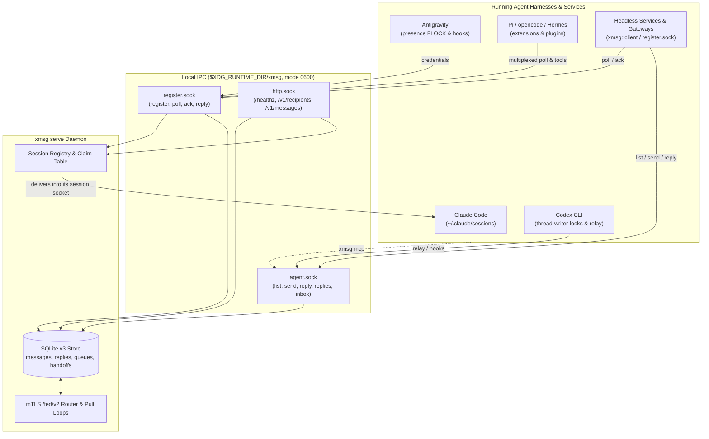

This page shows the main parts of xmsg. Each row and each socket links to the page that has the
detail. The [glossary](/glossary/) defines the terms.

## Core concepts

| Concept | In one line | Read more |
|---|---|---|
| Address | Every recipient has one: `id@node` for a session, `
/<child>@node` for a subagent, `name@node` for a service. | [Addressing](/concepts/addressing/) |
| Session, service, subagent | The three kinds of recipient: live agent conversations, headless programs that poll, and child turns under a parent. | [Sessions, services and subagents](/concepts/sessions-services-subagents/) |
| Queue and handoff | Messages to a parked conversation wait for the reply TTL (7 days by default). They follow a Claude conversation to another machine of the same user. | [Delivery and replies](/concepts/replies/) |
| Reply | xmsg stores it under the original message ID. xmsg also pushes it when the other party has an inbox. | [Replies](/concepts/replies/#replies-stored-always-pushed-by-sender-kind) |
| Node | One xmsg daemon, named from its certificate or OS identity, such as `alice.workstation`. Nodes federate over mTLS `/fed/v2`. | [Federation](/concepts/federation/) |
| Hub, leaf, outbound link | Layouts for pods, machines behind NAT and single-hop forwarding. | [Hubs, leaves and gateways](/concepts/hubs-and-leaves/) |
| Trust | Locally, only your own UID can connect. Separate UIDs, mTLS certificates and peer rules are the security boundaries. | [Trust model](/concepts/trust-model/) |

## The daemon and its sockets

`xmsg serve` is the [daemon](/glossary/#daemon). It listens on three Unix sockets in
`$XDG_RUNTIME_DIR/xmsg/`. On macOS, the sockets are in the per-user Darwin temp directory:

1. **`http.sock`** serves the HTTP API (`/healthz`, `/v1/recipients`, `/v1/messages`). When a
   caller's process traces back to a registered session or service, the caller sends as that
   sender. Any other caller sends as `<from> · anon@<node>`.
2. **`agent.sock`** carries `list`, `send`, `reply`, `replies` and `inbox` for `xmsg mcp`, hooks,
   the Pi extension and the Rust `AgentClient`.
3. **`register.sock`** is where Antigravity, Pi, the `opencode` and `hermes` plugins and headless
   services register, poll, acknowledge and reply.

The [HTTP API and sockets reference](/reference/http-and-sockets/) has the frames.
