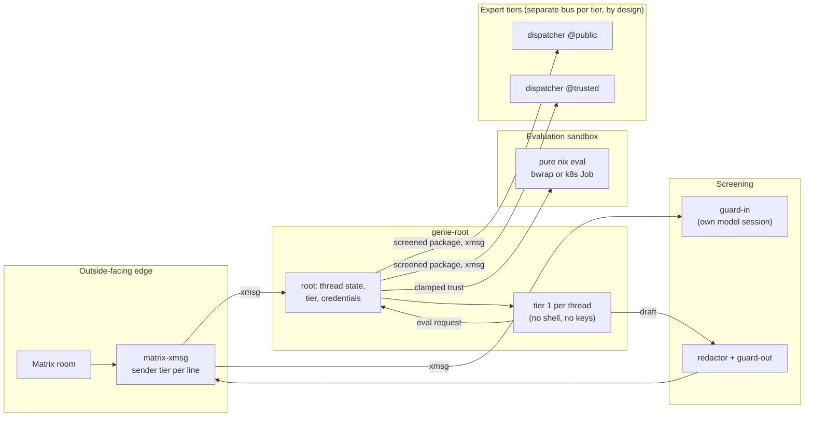

import { Aside } from '@astrojs/starlight/components';

This is an advanced case study. It assumes you know xmsg's
[services](/concepts/sessions-services-subagents/#services-namenode),
[replies](/concepts/replies/), [federation](/concepts/federation/) and
[trust model](/concepts/trust-model/). The system it describes is
[genie-agent](https://github.com/sini/genie-agent); its reference pages start at
[Genie overview](/genie/overview/).

## The problem

The den and gen projects get support questions in public Matrix rooms. Many have the same shape:
"my configuration fails to evaluate with this error, why?". The way to answer is often to
evaluate the asker's configuration and read the error. That takes time, and it is a good job for
an agent.

An agent that answers strangers is a target. Anyone in the room can write text meant to steer
it. The agent needs tools to be useful: evaluating Nix, reading repositories, opening pull
requests, and asking a stronger model. Behind it sit things only the owner should see: model and
GitHub credentials, the owner's private notes, private repositories.

So the design question was: how do you give a model useful tools and let strangers talk to it,
while no stranger's text can reach a credential, a private file, or a privileged path?

## The answer in one picture

Every arrow labelled `xmsg` is a message between two separately attested services. Genie's parts
never share memory, a process or a model context. They share a bus.

## Why each boundary sits where it does

### The tier comes from authentication, before any model

The Matrix bot knows who sent each line, because Matrix authenticates senders. It tags every line
`trusted` or `public` from the sender id. Root reads those tags from the raw envelope **before**
the guard sees it, and the thread tier is the lowest tier present.

The order matters. If the tier were read after the guard, a guard rewrite could carry a forged
tag. If it were read from text, anyone could type "(trusted)". Every capability that depends on
trust reads the stored thread tier and nothing else: the trusted evaluation path, the expert tier,
and the expert's memory.

### The model asks; root decides

Tier 1's `eval` tool has a `trusted` argument. That argument is a request. Root runs a trusted
evaluation only when the request is set **and** the thread is trusted. A model can lower its
capabilities but never raise them. The same pattern holds for escalation: tier 1 asks to
escalate, and root picks the destination from the thread tier, ignoring anything the package
says.

### No model holds a key

Root talks to the model API on tier 1's behalf, over a per-thread socket. The broker alone holds
the GitHub token, and models ask it for gists and PRs by typed proposal. Each expert session
receives its own token as a file descriptor, never in an argument or environment. The guards and
the redactor exist, but the main guarantee is that there is nothing in the model's context to
leak. See [Credentials & isolation](/genie/credentials-and-isolation/).

### Guards are separate sessions, in both directions

`guard-in` screens text before a model reads it: messages, web pages, evaluation output in an
escalation package, and replayed transcripts. `guard-out` screens every answer before it is
posted. Each guard is its own model session with its own prompt, so an injection that steers
tier 1 does not also steer the guard. The redactor, plain code, runs before `guard-out`, and
`guard-out` judges the exact bytes that will be posted. See [Guard model](/genie/guard-model/).

### The expert is reached over xmsg, and each tier has its own bus

The expert tier is Claude Code, which runs as an interactive session, not a library call. Genie
runs a small resident dispatcher per tier. The dispatcher registers on xmsg as the service
`genie-expert`, and runs one Claude Code session per escalated thread. Root sends the package as
an xmsg message with an idempotency key. The session answers with an xmsg `reply`, and the
dispatcher relays it as its own reply to root's message.

Using xmsg here gave genie several things for free:

- **Attestation.** xmsg admits a service by its executable and user id. That is why each genie
  service ships as a single executable: pinning a shared `node` binary would attest nothing.
- **Replies as the end of a turn.** A reply is stored under the message id and pushed back to the
  sender. The dispatcher does not have to guess when Claude Code has finished.
- **Idempotency.** A retried escalation with the same key delivers nothing new.
- **A tier fence by construction.** xmsg's local sockets admit only the server's own user id.
  When each tier runs as its own OS user with its own xmsg instance, a public-tier session cannot
  reach the trusted tier's bus at all. No firewall rule or network namespace is needed. Only
  pinned federation links cross between nodes, and the design allows none between the two tiers.

### Evaluate, never build

A stranger's configuration can try anything: read environment variables, read local files, or
exhaust memory. Genie only evaluates: `pure-eval`, no substituters, no import-from-derivation
unless the thread is trusted, a throwaway store, a timeout and a memory budget. On Kubernetes,
each evaluation is its own Job, with resource limits and, where the cluster provides it, a gVisor
runtime class.

## The deployment shape

The target shape has three parts. The bot and tier 1 run in a Kubernetes pod, with an xmsg
[leaf](/concepts/hubs-and-leaves/#leaf-node-mode---leaf) container next to them. Evaluations run
as Jobs under gVisor. Each expert tier is isolated from the others. This relies on xmsg's trust model. The bus is trusted. Its boundaries are the user id and the
network. The outside-facing edges, the Matrix bot and genie itself, own their own security.

Today the parts sit in different places:

- `genie-guard` runs in Kubernetes, as a pod with a guard container and an xmsg leaf container.
- The evaluation namespace and its limits exist in the cluster.
- Root and both expert tiers run under the NixOS module on one host, as one OS user. The tiers
  use separate tokens, but the module does not isolate them from each other at the kernel level.
  The pages say so plainly, and the per-tier and per-pod shapes are the step up.

### The portable fallback

Every platform-specific mechanism is an optional enhancement with a fallback, not a hard
requirement:

| Mechanism | Without it |
|---|---|
| bubblewrap jail for tier 1 | Root logs `baseline: credential custody, no OS isolation` and runs. Custody still holds. |
| bubblewrap jail for evaluations | Evaluations run unjailed, still pure. |
| Delegated cgroup | The memory budget is reported as an unenforced request. |
| systemd `LoadCredential=` | `loadCredential = false` reads the credential paths directly. |
| Linux SEA binary | `genie-root-node` runs on Linux and macOS, without the executable-identity guarantee. |
| gVisor runtime class | Jobs run on the cluster's default runtime. |

This matters because the target is a gVisor pod. Inside gVisor, several Linux features differ or
are missing. A design that refused to start without them would not run where it is meant to.

## What went wrong, and what was learned

These come from genie-agent's design record and commit history.

**The trust flag was first a model argument.** An early design let tier 1's `trusted` flag pick
the evaluation path. A design review rejected it: the model writes that flag, and the model reads
strangers' text. The clamp, `request AND thread tier`, replaced it. The lesson that recurs
throughout genie: any decision a model can write must be checked against state the model cannot
write.

**The trigger line's tier was hard-coded.** The Matrix bot's first envelope tagged the triggering
message `(trusted)` regardless of sender. A design review caught it before public admission was turned on. Now
every line, the trigger's included, carries a tier computed from the sender id.

**The memory bank was an injection channel.** Accepted answers are distilled into a memory bank
that later sessions recall. A poisoned answer admitted once would reach every future session. A
model check cannot reliably spot a prose injection, and neither can a regex. So admission needs a
human approval. Deterministic checks can only refuse. Because of that step, recall is trusted.

**A shared bus on a shared host.** The expert tiers were meant to run as separate users on one
host. xmsg's HTTP API then listened on loopback TCP, which every local user can reach. The fix
went into xmsg itself: the HTTP API moved onto a per-user Unix socket with a peer-credential check,
like the agent and register sockets. TCP is now off unless explicitly enabled for a pod. The
[trust model](/concepts/trust-model/#same-uid-trust-boundary) describes the result.

**The expert sandbox saw the owner's whole `~/.claude`.** In local mode, the public expert
mounted the owner's Claude directory read-write to share a token. That exposed private memory,
settings and transcripts, and a write there could plant files the owner's own sessions would
load. A second bug hid inside: Claude Code refreshes its token by renaming a file, which replaced
the shared symlink and quietly forked the tier onto a private copy. Each tier now has its own
token, and nothing of the owner's directory is mounted beyond a configured read-only memory
directory. A VM test plants a marker in each file and checks that no tier can read it.

**Tokens kept turning up where they should not be.** At first the expert token reached sessions
through the herdr server's environment, which every pane inherits, and through files on disk. The
channel moved to a file descriptor passed to each session's launcher. Then the dispatcher itself
was found holding the token in its JavaScript heap. A short-lived helper now does the handoff, so
neither the dispatcher's memory, an argv nor an environment holds the token.

**A readiness signal that was not one.** An early spike found two problems. herdr reports a session `idle` for about a second after a
message is sent. And a successful `agent start` exit code comes before the session is
registered. Neither is a usable signal. The dispatcher instead treats "xmsg
lists the session" as ready, and "xmsg reply arrived" as the end of a turn.

**The guard refused the owner.** A trusted owner asked genie to compare two public issues with a
PR stack. The guard prompt then had a rule that treated doubtful, out-of-scope work as injection,
and it rejected the request. The public history that supported the request was withheld too. Two
changes followed. The guard now rejects only real instances of its five rules; scope alone is
never injection, and authorization is left to the broker and the sandbox. And a configured
producer can request scoped review, where trusted lines are context and only public lines are
judged. See [Guard model](/genie/guard-model/#scoped-review-for-trusted-triggers).

**The guard blocked genie describing itself.** `guard-out` blocked answers that explained genie's
own tiers and tools as if they were leaks. genie-agent is open source, so its prompt now says
plainly that describing the public design, and quoting the public prompt files, is never a leak.
Reproducing a live session's assembled prompt or private context still is.

<Aside type="tip" title="The pattern to take away">
Put each decision where the information to make it safely already lives. The Matrix bot knows the
sender, so it sets the tier. Root holds the state, so it clamps trust and picks destinations. The
dispatcher owns lifecycle, so it decides readiness from xmsg, not from guesses. Models write
drafts and requests, and nothing else.
</Aside>
