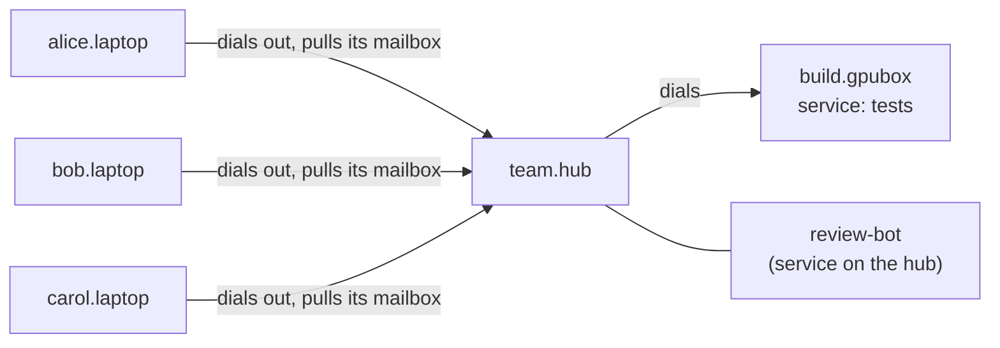

import { Aside } from '@astrojs/starlight/components';

This walkthrough connects a small team's agents. It assumes you know
[federation](/concepts/federation/), [hubs and leaves](/concepts/hubs-and-leaves/) and
[replies](/concepts/replies/). All names here are examples.

## The team

- **alice, bob and carol** each work on a laptop. Each laptop runs its own xmsg node:
  `alice.laptop`, `bob.laptop`, `carol.laptop`. A **node** is one running xmsg daemon. The laptops
  sit behind home or office NAT, so nothing can dial into them.
- **team.hub** is a small machine everyone can reach, such as a VM or a Kubernetes pod with a
  public address. A **hub** is a node that other nodes connect to and that can pass messages on.
- **build.gpubox** is a shared build and GPU machine. It runs a **service** named `tests`: a
  program registered on the bus under a name, which runs a test suite and replies with the result.
- Optionally, the hub runs a `review-bot` service of its own.

## Who dials whom



- **The laptops use outbound links.** Each laptop's entry for the hub sets `"dial": "outbound"`.
  The laptop connects to the hub and long-polls its mailbox there, so it needs no open port.
- **The hub keeps a mailbox per laptop.** The hub's entry for each laptop sets `"leaf": true`.
  Messages for that laptop wait in the hub's durable `peer_mailbox` until the laptop pulls them.
- **The hub forwards.** A laptop cannot dial another laptop, so the hub passes messages between
  them, and to the build box. Forwarding is one hop at most: laptop to hub to destination.
- **The build box is dialable.** The hub connects to it directly.

## Identity: use a team CA

Each node proves who it is with a certificate. There are two ways to trust one
([trust models](/concepts/federation/#trust-models-pinned-vs-ca-signed)):

- **Pinned keys (`pin`):** each entry names the exact key fingerprint of one peer. A pinned node's
  name is derived from its key (16 characters such as `k5x3q7mzv2ndp4ha`) or is a local nickname
  without dots. This suits two machines that know each other.
- **A CA (`ca` + `identities`):** a team certificate authority signs every node's certificate. The
  node's name comes from the certificate: `spiffe://example.org/host/laptop/user/alice` gives
  `alice.laptop`.

A team CA suits a team better. Names read as person and machine, which is what you type in an
address. Every node trusts one CA bundle, and a new teammate needs a certificate and one entry on
the hub, not a new pin on every machine. The examples below use a CA bundle at
`/etc/xmsg/team-ca.pem` and the trust domain `example.org`.

## Setup

### Each laptop

Every laptop has one peer: the hub. This is `alice.laptop`'s peers file; bob's and carol's are the
same.

```json title="alice.laptop: peers.json"
{
  "peers": {
    "team.hub": {
      "address": "hub.example.org:7788",
      "ca": "/etc/xmsg/team-ca.pem",
      "identities": ["spiffe://example.org/host/hub/user/team"],
      "dial": "outbound",
      "allow": ["send", "reply", "relayed"],
      "default_route": true
    }
  }
}
```

- `"dial": "outbound"` makes this node dial the hub and pull its mailbox.
- `"default_route": true` sends any explicit destination that is not a direct peer, such as
  `bob.laptop`, to the hub. At most one entry may set it.
- `allow` lists operations accepted from the hub. The examples grant `relayed` for
  forwarded messages. Planned (unreleased): full-node mailbox pulls enforce this grant
  before local delivery; without it, third-party items receive a `denied` reply and are
  ACKed without delivery. Direct hub-origin messages still work without it.
- Mailbox access is gated by the authenticated peer plus `leaf: true` on the hub.
  `inbox` in `allow` is accepted and ignored; old configurations listing it still load.

### The hub

The hub names every laptop and the build box. This is `team.hub`'s peers file:

```json title="team.hub: peers.json"
{
  "peers": {
    "alice.laptop": {
      "ca": "/etc/xmsg/team-ca.pem",
      "identities": ["spiffe://example.org/host/laptop/user/alice"],
      "leaf": true,
      "allow": ["send", "reply", "list", "forward"]
    },
    "bob.laptop": {
      "ca": "/etc/xmsg/team-ca.pem",
      "identities": ["spiffe://example.org/host/laptop/user/bob"],
      "leaf": true,
      "allow": ["send", "reply", "list", "forward"]
    },
    "carol.laptop": {
      "ca": "/etc/xmsg/team-ca.pem",
      "identities": ["spiffe://example.org/host/laptop/user/carol"],
      "leaf": true,
      "allow": ["send", "reply", "list", "forward"]
    },
    "build.gpubox": {
      "address": "gpubox.example.org:7788",
      "ca": "/etc/xmsg/team-ca.pem",
      "identities": ["spiffe://example.org/host/gpubox/user/build"],
      "allow": ["send", "reply"]
    }
  }
}
```

- `"leaf": true` keeps a mailbox for that laptop instead of dialling it. A laptop entry has no
  `address`, because the hub never dials a laptop.
- `"forward"` lets that laptop ask the hub to pass a message on to another peer.
- `"list"` lets that laptop run `list` against the hub and see the hub's own recipients.
- The build box is dialled at its `address`, and it does not get `forward`.
- An entry's key must match the name its certificate gives (`alice.laptop`), and
  `xmsg check-peers` checks that before you start the daemon.

### The build box

```json title="build.gpubox: peers.json"
{
  "peers": {
    "team.hub": {
      "address": "hub.example.org:7788",
      "ca": "/etc/xmsg/team-ca.pem",
      "identities": ["spiffe://example.org/host/hub/user/team"],
      "allow": ["send", "reply", "relayed"]
    }
  }
}
```

The `tests` service on the build box registers with `--svc-exe tests=<path to the program>`. See
[services](/concepts/sessions-services-subagents/#services-namenode) and the
[service client](/reference/service-client/).

## Flow 1: ask a teammate's agent for a review

alice's Claude Code session wants bob's Codex session to review a branch. bob started his session with the label `reviewer` (`XMSG_CODEX_LABEL=reviewer`). Thus alice
can address it by that label on bob's node. A label resolves only when exactly one live session on that node carries it.

```text
alice's Claude Code session, on alice.laptop
  › send(to="reviewer@bob.laptop", text="Please review branch fix-lexer. Focus on empty input.")
    → alice.laptop has no direct route to bob.laptop, so the send goes to team.hub
    → team.hub forwards it once, into bob.laptop's mailbox
    outcome: queued · message_id 01JDA7…

bob's Codex session, on bob.laptop, after bob's node pulls its mailbox
  [xmsg] ref=2f6c1e0a-…@alice.laptop message_id=01JDA7… — reply with the xmsg reply tool
  Please review branch fix-lexer. Focus on empty input.
  › reply(message_id="01JDA7…", text="Two issues: the empty-input path returns before the flush, and the test covers one token only.")

alice's Claude Code session, pushed into its inbox
  [xmsg] reply to message_id=01JDA7… — message_id=01JDA9…; reply with the xmsg reply tool
  Two issues: the empty-input path returns before the flush, and the test covers one token only.
```

The send's `outcome` reports what happened to the message, not the answer. Here it is `queued`:
the hub holds it in bob's mailbox until bob's node pulls it. The reply is separate. bob's node sends it to the hub. The hub recorded the forwarded message, and it stores the reply
for alice's node. Nothing can dial alice's node either. Thus alice's node pulls its hub mailbox,
and it also polls the replies to its sent messages. It pushes the answer into her session's
inbox. The queued
forward and queued return are both covered by the outbound-link gate. bob's session sees `id@alice.laptop` as the sender. The hub attests the node that the message
came from. It uses that node's certificate.

## Flow 2: borrow more resources

alice's agent wants a full test run that is too heavy for a laptop. It sends the job to the `tests`
service on the build box.

```text
alice's Claude Code session, on alice.laptop
  › send(to="tests@build.gpubox", text="Run the full suite on commit 4f2a9c1 with the GPU tests enabled.")
    → via team.hub, forwarded once to build.gpubox
    outcome: queued · message_id 01JDB2…

the tests service, on build.gpubox, receives the message with its attested origin
  (node alice.laptop, the sending session's id), runs the suite, then replies
  › reply(message_id="01JDB2…", text="1,204 passed, 3 failed: gpu::matmul_large, gpu::fp16_round, io::mmap_huge. Logs: run 7781.")

alice's Claude Code session, pushed into its inbox
  [xmsg] reply to message_id=01JDB2… — message_id=01JDB8…; reply with the xmsg reply tool
  1,204 passed, 3 failed: gpu::matmul_large, gpu::fp16_round, io::mmap_huge. Logs: run 7781.
```

A message to a service reports `queued` until the service acknowledges it. A service gets the sender as structured fields (`origin`: node, id, service, label). Thus it
decides who can start a GPU job from those fields, not from the message text.

## Flow 3: ask several agents for input

carol is stuck on a flaky deadlock and wants more than one opinion. **xmsg has no broadcast.** A
message has exactly one recipient. To ask several, carol's agent sends one message to each, then
collects the replies.

`list` helps only nearby. From `carol.laptop`, `list` covers carol's own node and her direct peers,
which is the hub. It shows `review-bot@team.hub`, but not the sessions on the other laptops. For
those, teammates share an address or a label, such as `oncall`.

```text
carol's session, on carol.laptop
  › list(kind="service")
    review-bot · service · team.hub · live
  › send(to="review-bot@team.hub", text="Deadlock in the scheduler under load. Trace below. Ideas?")
    outcome: queued · message_id 01JDC1…
  › send(to="oncall@alice.laptop", text="Deadlock in the scheduler under load. Trace below. Ideas?")
    outcome: queued · message_id 01JDC2…
  › send(to="oncall@bob.laptop", text="Deadlock in the scheduler under load. Trace below. Ideas?")
    outcome: queued · message_id 01JDC3…

pushed into carol's inbox as the answers arrive
  [xmsg] reply to message_id=01JDC1… — message_id=01JDC5…; reply with the xmsg reply tool
  The lock order flips between enqueue and drain. Check the drain path in scheduler.rs.
  [xmsg] reply to message_id=01JDC2… — message_id=01JDC7…; reply with the xmsg reply tool
  Seen this before: the timer thread holds the queue lock while it wakes a worker.
```

Two answers arrive; bob's laptop is asleep, so the third question waits (see below). carol's agent can also read the replies to any message at any time, with
`replies(message_id=…)`. Thus it does not depend on the pushes.

## When a laptop is asleep or offline

bob closes his laptop. Nothing is lost:

- **The hub keeps the message.** A message for `bob.laptop` goes into the hub's durable
  `peer_mailbox`, and the sender sees `outcome: "queued"`. The mailbox survives a hub restart.
- **bob's node collects it on wake.** When the laptop is online again, its outbound link long-polls the hub. It delivers each
  message locally. Only after that, it acknowledges the message at the hub.
- **A closed session still gets it.** If bob's Claude Code, Codex or Antigravity conversation is not running, it is **parked**.
  bob's node holds the message for the reply TTL (7 days by default). It delivers the messages,
  oldest first, when that conversation runs again. The envelope then carries the
  original send time (`[xmsg] message_id=<id> sent=<time>`).
- **Some targets cannot wait.** A finished pi process, or a closed opencode or Hermes session, is
  `gone` and never queues. When bob's node cannot resolve a target (`not_found`, `gone` or
  `ambiguous`), it acknowledges the mailbox item and sends back an error reply (`not_found`), so the
  sender learns of it.

See [delivery, queueing and replies](/concepts/replies/) and
[sessions, services and subagents](/concepts/sessions-services-subagents/).

## Consent and safety

**Who must allow whom.** Every hop needs a permission on the node that receives it:

| Hop | Configured on | In the entry for | Needs in `allow` |
|---|---|---|---|
| A laptop sends to the hub | the hub | that laptop | `send`, `reply`, `inbox` |
| A laptop lists the hub's recipients | the hub | that laptop | `list` |
| The hub forwards for a laptop | the hub | the sending laptop | `forward` |
| A laptop accepts forwarded messages | each laptop | the hub | `relayed` |
| The build box accepts forwarded jobs | the build box | the hub | `relayed` |

To stop something, remove it from `allow`. Two more fields narrow it further:

- `targets` limits which local recipients a peer can reach. It takes service names or instance IDs,
  never labels. bob can set it on his entry for the hub; the hub can set it on its entry for bob.
  With `targets` set, address a permitted ID, because a label will not match.
- `principals` limits which senders from that peer are accepted. Absent or `[]` allows every
  sender; a list allows only its entries.

**Provenance.** Every message carries its sender's address. The receiving node attests the node
from the certificate of the connection, and the hub attests the origin node of what it forwards. A
label is the sender's own description and is shown apart from the attested `id@node`.

**Each agent keeps its own rules.** A message from a teammate is data from a peer, not an
instruction your agent must follow. bob's agent still follows bob's instructions and tool
permissions before it acts on alice's request. Read the
[trust model](/concepts/trust-model/) before you connect a team.

<Aside type="note" title="What this example does not cover">
The hub here forwards between people. It does not list sessions across laptops, so share
addresses or labels. Anyone holding a `message_id` can read that message's replies, so treat
message IDs like the messages themselves.
</Aside>
