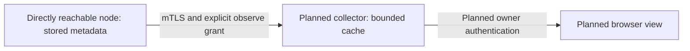

The fleet observer is **planned and not yet released**. The first stage adds a
node metadata export for explicitly authorized federation peers. The collector,
owner authentication and browser view are a later stage and are not implemented
by the node export. A node can carry the export without running a collector.

## Passive metadata

The export reads the node's [observation journal](/reference/http-and-sockets/#local-observation-journal-planned)
and cached registration descriptors. It does not read message bodies, harness
transcripts, paths, working directories, environment values or credentials.
It does not discover harnesses, probe processes, list recipients through the bus,
poll inboxes or replies, acknowledge messages, or wake agents.

Each node must be directly reachable on its existing federation listener.
Outbound-only nodes and leaves are unsupported: observation does not open an
inbound listener on them or use custody polling to reach them.

## An individual grant

The literal `observe` right is separate from `list`, `send`, `reply`, `forward`
and `leaf`; neither `"*"` nor wildcard admission implies it. A concrete peer can
receive it through a pinned key or one literal CA identity. A hub rule granting
it must also name one literal SPIFFE identity. Rules keep their first-match
semantics; matching rules never combine their rights.

After an explicit grant, omitted `targets` means node-wide metadata; `targets: []`
permits no event or descriptor data. For observation, an unqualified key means
that key on the exporting node; a qualified `key@node` must match exactly.
Every endpoint in a scoped event must be allowed. A missing, invalid or excluded
endpoint omits the whole event, including its correlations.

Labels are off by default. A label appears only when the grant has
`observe_labels: true` **and** the request has `labels=true`. Even an explicit
`observe_labels: false` field requires the `observe` right. IDs and opted-in
labels are metadata entrusted to the collector; a compromised trusted node or
collector can disclose them. See the [grant example](/operations/fleet-observer/#grant-a-collector-access).

## Reading the evidence

Sequence order belongs to one node and epoch. Source clocks can disagree;
there is no global clock order or inferred network hop. An outcome reports a
bus fact, never proof that an agent read a message or completed a task.
The event's `available` value, `not_recorded` or `retained_at_capture`, is a
historical content-availability hint. It supplies no content-fetch route and
no guarantee about content today.

Cached snapshot registration states are not current process liveness. Unknown,
partial, unavailable, stale, denied and reset states must remain visible rather
than becoming an empty healthy node. In a future view, shapes and role colors
can distinguish nodes, sessions and services; those colors must not imply health.

The journal defaults to seven days, 10,000 events or 16 MiB of logical metadata,
whichever limit applies first. Export also excludes events older than seven days.
Capture can lose observations, and eviction or restart can leave gaps. Policy
filtering is identified separately from source loss. Sequence spacing can reveal
omission volume even when endpoint identities and correlations are excluded.

The planned collector will keep bounded per-node metadata with visible retention
and gap boundaries. Body detail and transcript views remain planned and
unimplemented. See [operations](/operations/fleet-observer/) and the
[wire reference](/reference/http-and-sockets/#planned-node-observation-export).
