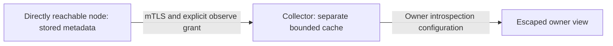

import Status from '../../../components/Status.astro';

Node export is available to explicitly authorized federation peers. The owner
collector and browser view (<Status id="fleet-observer.collector" />) collect only
stored metadata into a separate bounded cache; a node can carry the export
without running a collector.

## Passive metadata

The export reads the node's [observation journal](/reference/http-and-sockets/#local-observation-journal)
and cached registration descriptors. It does not read message bodies, harness
transcripts, paths, working directories, environment values or credentials.
It does not discover harnesses, probe processes, list recipients through the bus,
poll inboxes or replies, acknowledge messages, or wake agents.

Direct export uses the node's existing federation listener. **Reverse observation
through an owner-administered hub** (<Status id="fleet-observer.reverse-relay" />): an outbound-only
leaf can answer metadata reads over its existing control-only polls, without an
inbound listener, message custody, ACK, or agent wake. A planned collector source
selects one explicit relay route and shows the configured leaf `via hub` in event,
inventory, and stale history. Direct sources keep their existing transport.

The hub and leaf each opt in through independent default-off switches and the
same exact `(hub, leaf, collector)` route. Routes name full literal SPIFFE URIs or
`sha256:` pins; display node names and wildcard patterns are insufficient. Both
nodes must separately grant the end collector `observe`. Existing `list`, `leaf`,
`forward`, and outbound transport configuration never imply that grant.

The hub authenticates the collector with mTLS and attests its actual identity to
the leaf. The leaf authenticates the hub and applies its own current collector
grant, endpoint targets, and label opt-ins. The hub also checks its collector
policy and refuses an entire excluded response; it forwards accepted DTO bytes
unchanged. Caller origin headers and browser bearer tokens are not forwarded.
The hub is trusted to inspect, withhold, or fabricate its attested metadata;
this is not an independently signed statement from the leaf. Cross-owner hubs
are unsupported. See the [planned route example](/operations/fleet-observer/#reverse-observation-through-a-trusted-hub).

Source-IP restrictions use witnessed connections: the hub checks the collector's
actual IP, and the leaf checks the hub's actual IP. A collector `from` condition
on the leaf refuses reverse reads because the leaf cannot witness that IP.
Forwarded IP headers do not supply the missing witness.

## An individual grant

The literal `observe` right is separate from `list`, `send`, `reply`, `forward`
and `leaf`; neither `"*"` nor wildcard admission implies it. A concrete peer can
receive it through a pinned key or one literal CA identity. A hub rule granting
it must also name one literal SPIFFE identity. Rules keep their first-match
semantics; matching rules never combine their rights.

After an explicit grant, omitted `targets` means node-wide metadata; `targets: []`
permits no event or descriptor data. For observation, an unqualified key means
that key on the exporting node; a qualified `key@node` must match exactly.
Every endpoint in a scoped event must be allowed. A missing, invalid or excluded
endpoint omits the whole event, including its correlations.

Labels are off by default. A label appears only when the grant has
`observe_labels: true` **and** the request has `labels=true`. Even an explicit
`observe_labels: false` field requires the `observe` right. IDs and opted-in
labels are metadata entrusted to the collector; a compromised trusted node or
collector can disclose them. See the [grant example](/operations/fleet-observer/#grant-a-collector-access).

## Reading the evidence

Sequence order belongs to one node and epoch. Source clocks can disagree;
there is no global clock order or inferred network hop. An outcome reports a
bus fact, never proof that an agent read a message or completed a task.
The event's `available` value, `not_recorded` or `retained_at_capture`, is a
historical content-availability hint. It supplies no content-fetch route and
no guarantee about content today.

Cached snapshot registration states are not current process liveness. Unknown,
partial, unavailable, stale, denied and reset states must remain visible rather
than becoming an empty healthy node. Shapes distinguish cached nodes, sessions and services; those colors do not imply
process health. Source time and collector receipt age stay separate.

Collector freshness (<Status id="fleet-observer.collector" />) outranks cached status. A node is only `healthy`
when a validated ingest (including a healthy no-change empty page or unchanged
snapshot) succeeded within the `15 s` monotonic freshness window; a TCP/TLS
connection, `Pending`, or a busy store slot is not a success, and current
authorization or scope masks always hide cached rows, gaps and last-success times.

The collector view also summarizes fleet coverage at the top
(`N/M configured nodes reporting · K unreachable · J endpoint not found/unsupported or misconfigured`,
plus any non-zero `loading`, `denied`, `hidden`, `rate limited`, `malformed` or
`storage full` buckets). Never-polled unmasked nodes show `loading: first observation pending`
rather than `pending revalidation`, while nodes with retained history masked on
restart or scope change show `stored history hidden until this node answers`.
Direct HTTP `404` responses report `observation endpoint not found/unsupported or misconfigured`
and recover automatically on the next valid response without clearing `403` denial
masks. Unmasked non-loading tiles display `gaps`, `loss counters: not exported/unknown`,
and the `last successful poll` line; relayed nodes keep `via <hub> (hub-attested)`
provenance across loading, stale, and masked states.

The journal defaults to seven days, 10,000 events or 16 MiB of logical metadata,
whichever limit applies first. Export also excludes events older than seven days.
Capture can lose observations, and eviction or restart can leave gaps. Policy
filtering is identified separately from source loss. Sequence spacing can reveal
omission volume even when endpoint identities and correlations are excluded.

The collector keeps bounded per-node metadata with visible retention and gap
boundaries. Stored history is hidden after restart until its node validates the
current scope; the view explicitly says “history hidden until this node answers”.
Once validated in this process, retained metadata may remain visible as stale
during a temporary outage. Denial and scope changes mask old history before purge. Body detail and transcript views (<Status id="fleet-observer.body-transcript-views" />) remain unimplemented. See [operations](/operations/fleet-observer/) and the
[wire reference](/reference/http-and-sockets/#planned-node-observation-export).

## New event kinds

<Status id="fleet-observer.unknown-event-kind" />

The planned collector [unknown event kind](/glossary/#unknown-event-kind) fallback
lets a collector read metadata from a newer node without losing known neighboring
events or cursor progress. It displays **“unknown event kind (newer node)”** in place
of an unrecognized kind. The original identifier never appears in the view.

This accepts a new kind name within the existing event envelope, not a new payload
schema. Bodies, extra fields, invalid metadata and unrecognized values in other
enums remain refused. The node exporter and public event-kind enum stay closed.

The collector keeps the bounded original name only in its private stored event
JSON so exact replays and later upgrades preserve event identity. Stored newer rows
use the same fallback after fresh scope validation. This requires a collector with
the compatibility change; an unpatched older binary can still reject new data.

Relay history retains its configured hub origin in the bounded seven-day cache.
Downgrading to a collector without relay support destructively purges relay
history; it never reclassifies that history as direct observations.

## Session context tags

<Status id="session-context.tags" />

A session's self-reported tags can appear in the node's authorized observation
export. To keep task values out of the export while still showing them in local
listings, configure the source node with `--context-mask observe:task`. To
withhold every tag from the export, use `--context-mask 'observe:*'`.

The source node applies the mask before export. The observation grant still
controls who can read the export. See [session context and node policy](/reference/cli-and-mcp/#session-context-tags).

## Mission Control sessions

<Status id="mission-control.session" />

Mission Control is an optional collector extension. A browser owner signs in
through a configured OIDC provider. The issuer turns that verified identity
into a revocable local session. A native client obtains its own credential
through a browser-approved device grant. Both use the same owner principal
and have independent credential records and expiration times.

<Status id="mission-control.http" />

The planned session transports show one scoped view of fleet metadata and
open attention items. The view starts Unknown until a complete snapshot
arrives. A synchronized connection is Live when its nodes deliver live
updates. It is Delayed when at least one node delivers in batches.
Reconnecting means the client is attempting to resume. Stale means the
connection has been silent past its freshness deadline or retries ended.
The last known data stays visible and marked. Node freshness and the age of
the last applied observation are shown separately from connection state.

See [issuer setup](/operations/fleet-observer/#mission-control-issuer) and
the [wire reference](/reference/http-and-sockets/#mission-control-issuer-routes).
