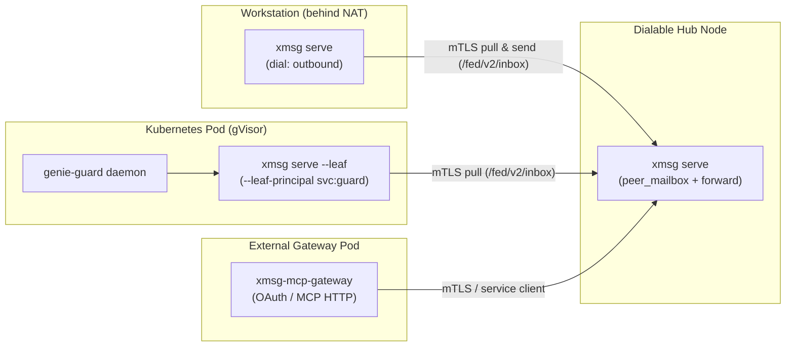

import { Aside } from '@astrojs/starlight/components';

Not every node can accept inbound TCP connections or share a host PID namespace. `xmsg` supports
three composable topologies on top of direct mTLS peerings: **leaf nodes** (`--leaf`), **outbound
links** (`"dial": "outbound"`), and **single-hop hub forwarding** (`allow = ["forward"]`), plus
external **hosted-dot gateways**.

## Leaf node mode (`--leaf`)

For single-service workloads running inside containers or Kubernetes pods (such as `genie-guard` or
a Matrix bridge sidecar), `xmsg serve --leaf` runs as an outbound-only sidecar:

- **Local sockets:** Binds `$XDG_RUNTIME_DIR/xmsg/register.sock` (or `--leaf-register-sock`),
  `agent.sock`, and optional loopback HTTP (`--listen`).
- **Principal admission (`--leaf-principal`):** Daemons registering on `register.sock` must match
  the configured `--leaf-principal` (for example, `svc:genie-guard`) and the server's UID
  (`SO_PEERCRED`). Because containers in a pod may not share a PID namespace, `/proc/<pid>/exe`
  attestation is omitted and combining `--svc-exe` with `--leaf` is refused at startup.
- **Hub-side durable mailbox (`"leaf": true`):** On the hub, the leaf peer's entry sets
  `"leaf": true`. When any sender addresses `<target>@<leaf-peer>`, the hub checks the peer's
  `targets` filter and stores the message in its durable SQLite `peer_mailbox`.
- **Long-poll and strict `ack` ordering:** The leaf's background loop long-polls
  `GET /fed/v2/inbox?wait=<s>` on the hub, enqueues the message into the local service inbox, and
  calls `POST /fed/v2/inbox/{id}/ack` on the hub **only after** the local service daemon
  acknowledges the delivery over `register.sock`. If the daemon crashes before acknowledging, the
  message remains in the hub mailbox and redelivers on reconnect.

## Outbound links (`"dial": "outbound"`)

A full `xmsg` node running interactive agent harnesses (`claude`, `codex`, `agy`, `opencode`,
`hermes`, `pi`, and `svc`) behind NAT or a stateful firewall can connect to a dialable hub without
opening an inbound port:

- **On the undialable node:** Set `"dial": "outbound"` and `"allow": ["send", "reply", "inbox"]` on
  the hub's entry in `peers.json`. (`"leaf": true` and `"dial": "outbound"` on the same entry are
  mutually exclusive.)
- **On the hub:** Mark the undialable node's entry with `"leaf": true` so messages and `list`
  queries addressed to it queue in the hub's `peer_mailbox`.
- **Background pull loop:** At startup, the full node spawns an outbound pull loop that long-polls
  `GET /fed/v2/inbox` on the hub, answers `list` queries on `POST /fed/v2/list/{query}`, resolves
  local targets across all harnesses, delivers messages locally, and acknowledges them at the hub.
  If a target is unresolvable (`not_found`, `gone`, `ambiguous`), the node acknowledges the mailbox
  item and posts an error reply (`not_found`) back to the hub over `POST /fed/v2/replies`.
- **Outbound reply polling:** When a local session or service on the undialable node sends a
  message to the hub, the hub cannot dial back to push replies. The undialable node automatically
  arms `poll_federated_replies` (`GET /fed/v2/messages/{id}/replies?after=<seq>&wait=<s>`) to pull
  replies and push them into the local sender's inbox.

## Forwarding through a hub

Two nodes that cannot dial each other directly can route messages through an intermediate hub node.
Forwarding is strictly opt-in and bounded to a **single hop**:

- **Permission on the hub (`"forward"`):** The sending peer's entry in the hub's `peers.json` must
  include `"forward"` in `allow`.
- **Permission on the recipient (`"relayed"`):** The hub's entry in the recipient node's
  `peers.json` must include `"relayed"` (or `"relay"`) in `allow`.
- **Single-hop envelope mark (`forwarded`):** The hub attests the sender's `origin.node` from the
  TLS identity of the sending peer and attaches
  `forwarded: { "forwarder": "<hub-node>", "targets"?: [...] }`. The recipient verifies that
  `forwarder` matches the authenticated hub connection and refuses to re-forward any message that
  already carries `forwarded`.
- **Dual target filtering:** If the hub configures `targets` for the destination peer, the hub
  checks the unresolved `ref` before relaying and also passes `targets` inside the `forwarded` mark
  so the destination enforces that a service name in `targets` resolves to a service (never an
  instance merely carrying that label).
- **Reply routing:** The hub records forwarded messages in `forwarded_messages` and relays replies
  from the recipient back to the origin peer (either via direct push or by storing them for the
  origin's outbound reply poller).

<Aside type="note" title="Client hop syntax">
Client surfaces (`send` over HTTP, `agent.sock`, MCP, and plugins) accept at most one `@` in `to`
(`ref@dest`). Explicit multi-`@` client strings (`x@dest@hub`) are refused with `bad_request`; the
`/fed/v2` hop envelope is strictly a node-to-node mechanism.
</Aside>

## Hosted-dot gateways

External hosted agents (such as remote MCP clients connecting over HTTPS/OAuth) connect to the
`xmsg` bus through a dedicated edge gateway (`xmsg-mcp-gateway`) speaking the
[Rust service client protocol](/reference/service-client/) to an `xmsg` leaf or hub node. The
gateway owns external authentication, per-grant authorization, and rate limiting at the outside
edge, while appearing on the `xmsg` bus as an attested service (`xmsg-gateway@xmsg-gateway.xmsg-gateway`).

{/* TODO: Add dedicated end-to-end deployment guide for xmsg-mcp-gateway once the hosted-dot gateway release is pinned. */}
