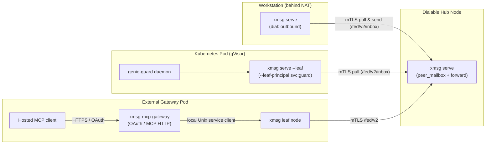
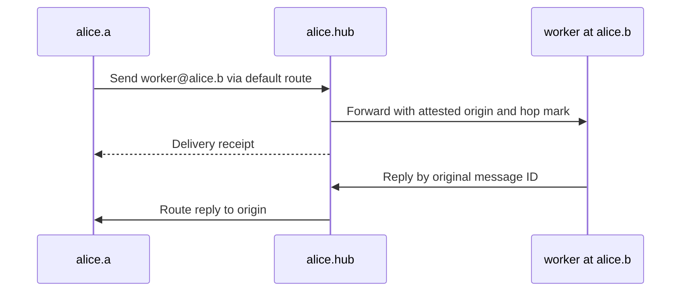

import { Aside } from '@astrojs/starlight/components';

Some nodes cannot accept inbound TCP connections or share a host PID namespace. For them,
`xmsg` has three topologies that you can combine with direct mTLS peerings:

- **[Leaf](/glossary/#leaf) nodes** (`--leaf`);
- **[Outbound links](/glossary/#outbound-link)** (`"dial": "outbound"`);
- **Single-hop [hub](/glossary/#hub) forwarding** (`allow = ["forward"]`).

External **hosted-dot [gateways](/glossary/#gateway)** are a fourth option. A hosted dot is a
hosted MCP client, such as a model in ChatGPT.



## Choose a topology

| Setup | Use it for | Connection pattern |
|---|---|---|
| Single node | Harnesses and services under one OS user | Local Unix sockets; no federation certificate needed. |
| Direct peers | Nodes that can accept mTLS connections | Pinned keys or CA-signed identities in each node's peers file. |
| Leaf sidecar | One service in a pod | Local same-UID sockets, required loopback listener, outbound polling to a hub. |
| Full node with an outbound link | Interactive harnesses behind NAT | Keep normal harness registration; dial the hub and pull its mailbox. |
| Forwarding hub | A knows H, H knows B, A does not dial B | Set H as A's default route and grant forwarding at both receiving hops. |

Different users on the same host can run separate nodes, such as `alice.workstation` and
`bob.workstation`. One user can have nodes on several hosts. The explicit node names tell them
apart. For an instance ID,
[bare recipient resolution](/concepts/addressing/#how-a-bare-reference-resolves-over-the-federated-view)
checks the sender's own user's nodes before other users' nodes.

## Leaf node mode (`--leaf`)

Some workloads run one service in a container or a Kubernetes pod, such as `genie-guard` or a
Matrix bridge sidecar. For them, `xmsg serve --leaf` runs as an outbound-only sidecar:

- **Local sockets:** The leaf binds `$XDG_RUNTIME_DIR/xmsg/register.sock` (or
  `--leaf-register-sock`) and `agent.sock`. It also needs an HTTP listener (`--listen`, or
  `XMSG_LISTEN`). Keep the listener on loopback in the pod's isolated network namespace, also when
  the worker uses Unix sockets.
- **Principal admission (`--leaf-principal`):** A daemon that registers on `register.sock` must
  match the configured `--leaf-principal` (for example, `svc:genie-guard`). It must also have the
  server's UID (`SO_PEERCRED`). Containers in a pod can have separate PID namespaces. Thus the
  leaf does not do `/proc/<pid>/exe` attestation, and xmsg refuses `--svc-exe` with `--leaf` at
  startup.
- **Hub-side durable mailbox (`"leaf": true`):** On the hub, the leaf peer's entry sets
  `"leaf": true`. A sender can address `<target>@<leaf-peer>`. Then the hub checks the peer's
  `targets` filter and stores the message in its durable SQLite
  [`peer_mailbox`](/glossary/#peer-mailbox). The send returns `outcome: "queued"`. See
  [mailbox retention](/concepts/federation/#mailbox-retention).
- **Long-poll and strict `ack` ordering:** The leaf's background loop long-polls
  `GET /fed/v2/inbox?wait=<s>` on the hub. It puts each message into the local service inbox. The
  local service daemon then acknowledges the delivery over `register.sock`. **Only after that**,
  the leaf calls `POST /fed/v2/inbox/{id}/ack` on the hub. If the daemon stops before its
  acknowledgement, the message stays in the hub mailbox. The hub delivers it again when the leaf
  connects again.

## Outbound links (`"dial": "outbound"`)

A full `xmsg` node can run interactive agent harnesses (`claude`, `codex`, `agy`, `opencode`,
`hermes`, `pi` and `svc`) behind NAT or a stateful firewall. It can connect to a dialable hub
without an open inbound port:

- **On the undialable node:** In `peers.json`, set `"dial": "outbound"` and
  `"allow": ["send", "reply"]` on the hub's entry. An entry cannot have both `"leaf": true` and
  `"dial": "outbound"`.
- **On the hub:** Set `"leaf": true` on the undialable node's entry. Then messages and `list`
  queries for that node wait in the hub's `peer_mailbox`.
- **Mailbox authorization:** The hub authenticates the peer. It also needs `leaf: true` on the
  entry before the peer can read its own mailbox. xmsg accepts `inbox` in `allow` and ignores
  it. Thus old configurations that list it still load.
- **Background pull loop:** At startup, the full node starts an outbound pull loop. The loop does
  these steps:
  1. It long-polls `GET /fed/v2/inbox` on the hub.
  2. It answers `list` queries on `POST /fed/v2/list/{query}`.
  3. It resolves local targets across all harnesses and delivers the messages locally.
  4. It acknowledges the messages at the hub.

  A target can fail to resolve (`not_found`, `gone`, `ambiguous`). Then the node acknowledges the
  mailbox item. It also sends an error reply (`not_found`) to the hub over
  `POST /fed/v2/replies`.
- **Outbound reply polling:** A local session or service on the undialable node can send a message
  to the hub. The hub cannot connect back to push the replies. Thus the undialable node starts
  `poll_federated_replies` automatically
  (`GET /fed/v2/messages/{id}/replies?after=<seq>&wait=<s>`). It pulls the replies and pushes them
  into the local sender's inbox.

## Forwarding through a hub

Two nodes that cannot connect to each other directly can send messages through a hub node
between them. This is [forwarding](/glossary/#forwarding). Each node must opt in. Forwarding is
limited to a **single hop**:

- **Permission on the hub (`"forward"`):** In the hub's `peers.json`, the sending peer's entry
  must have `"forward"` in `allow`.
- **Permission on the recipient (`"relayed"`):** For direct forwarded sends, the hub's entry in
  the recipient node's `peers.json` must have `"relayed"` (or `"relay"`) in `allow`. Mail that
  starts on the hub itself does not need `relayed`.
  Full-node outbound pulls apply the same grant to third-party origins. They compare canonical
  node names, not local nicknames. A denied item gets an error reply and an ACK. This check is on
  the main branch and is not yet in a release.
- **Single-hop envelope mark (`forwarded`):** The hub attests the sender's `origin.node` from the
  TLS identity of the sending peer. It adds
  `forwarded: { "forwarder": "<hub-node>", "targets"?: [...] }`. On dialable delivery, the
  recipient checks that `forwarder` is the authenticated hub connection. It refuses to forward
  again a message that already has `forwarded`.
  Mailbox pull items carry the canonical origin and the local target, but not this mark. The
  full-node consumer delivers them locally. It does not forward them again.
- **Dual target filtering on dialable forwarding:** The hub can set `targets` for the destination
  peer. Then the hub checks the unresolved `ref` before it relays. It also sends `targets` in the
  `forwarded` mark. The destination then makes sure that a service name in `targets` resolves to a
  service, not to an instance that only has that label.
  Mailbox pull items keep the origin, but they do not have `forwarded.targets`. On the mailbox
  route, only the hub's pre-filter applies that limit. Recipient-side semantic enforcement of the
  forwarded target limit is a follow-up.
- **Reply routing:** The hub records forwarded messages in `forwarded_messages`. It relays replies
  from the recipient back to the origin peer. It pushes them directly, or it stores them for the
  origin's outbound reply poller.

<Aside type="note" title="Client hop syntax">
Client surfaces (`send` over HTTP, `agent.sock`, MCP and plugins) accept at most one `@` in `to`
(`ref@dest`). xmsg refuses a client string with more than one `@` (`x@dest@hub`) with
`bad_request`. Only nodes use the `/fed/v2` hop envelope.
</Aside>

### Complete three-node forwarding example

In this example, A, H and B have CA-signed certificates with the single URI SANs below. Each
daemon uses its own certificate and key, and the shared CA bundle. B has a registered service
named `worker`. The node names in the configuration come from the certificate identities.

| Node | Certificate URI SAN | Federation listener |
|---|---|---|
| A | `spiffe://example.org/host/a/user/alice` | `a.example:7788` |
| H | `spiffe://example.org/host/hub/user/alice` | `hub.example:7788` |
| B | `spiffe://example.org/host/b/user/alice` | `b.example:7788` |

A's `peers.json` names only H and selects it for unknown explicit destinations:

```json
{
  "peers": {
    "alice.hub": {
      "address": "hub.example:7788",
      "ca": "/etc/xmsg/ca.pem",
      "identities": ["spiffe://example.org/host/hub/user/alice"],
      "allow": ["send", "reply"],
      "default_route": true
    }
  }
}
```

H knows both peers and permits A to request forwarding:

```json
{
  "peers": {
    "alice.a": {
      "address": "a.example:7788",
      "ca": "/etc/xmsg/ca.pem",
      "identities": ["spiffe://example.org/host/a/user/alice"],
      "allow": ["send", "reply", "forward"]
    },
    "alice.b": {
      "address": "b.example:7788",
      "ca": "/etc/xmsg/ca.pem",
      "identities": ["spiffe://example.org/host/b/user/alice"],
      "allow": ["send", "reply"]
    }
  }
}
```

B accepts relayed sends from H:

```json
{
  "peers": {
    "alice.hub": {
      "address": "hub.example:7788",
      "ca": "/etc/xmsg/ca.pem",
      "identities": ["spiffe://example.org/host/hub/user/alice"],
      "allow": ["send", "reply", "relayed"]
    }
  }
}
```

From A, call `send(to="worker@alice.b", text="review this")`. A direct peer route has priority
over `default_route`. Only one default route is permitted. The explicit destination is
necessary here. A bare name needs a complete list view, and this example does not give one.



The receipt tells you that xmsg delivered or queued the message. It is not the recipient's
answer. The
[three-node source oracle](https://github.com/sini/xmsg/blob/76f8f1e8249777cfb63c4d0287431cbbf6b2ce76/tests/gate_x26_hub_forwarding.rs)
exercises this permission placement and reply route.

## Bridges and hosted clients

- [xmsg-mcp-gateway](/extensions/gateway/) connects hosted MCP clients through a local xmsg
  service.
- [matrix-xmsg](/extensions/matrix/) connects Matrix to the bus.
- [agent-quota](/extensions/agent-quota/) reports usage as a separate command today.

Each extension owns its behavior outside the bus. xmsg does not authenticate a Matrix user or an
OAuth caller itself.


## Mailbox controls while a service works

**Planned, not yet released.** Updated leaves and outbound links keep a separate, bounded
control long-poll alongside message delivery. A slow service ACK therefore does not spend
ordinary inbox tokens just to answer list or file queries. The hub still retains its durable
message until the service ACK arrives; control traffic never acknowledges or consumes it.

For example, a service can read a file while processing its current delivery. The leaf can
answer the hub's reverse attachment query before that service ACK, while normal messages
keep their existing peer and inbox quotas. An 8 MiB file at the default 65536-byte chunk size
needs 128 chunk queries. The control bucket allows 120 per minute, or 360 over the whole-fetch
180-second deadline; its initial burst covers 120 and the remaining eight refill in four
seconds. The independent attachment-serving quota also applies. In the full-size acceptance
case, its retries brought the total to 197 control requests and the verified transfer
completed in 68.758 seconds.

Old and new hubs/leaves retain the legacy unflagged mailbox path. Update the hub before its
leaves to obtain the separate control budget; a mixed-version pair keeps the older combined
polling behavior. This changes polling, not the message's peer admission, grants, ownership
or service-ACK-before-hub-ACK rule. See the
[wire reference](/reference/http-and-sockets/#federated-fedv2-wire-routes).

## Planned: enrolled nodes and bounded hub mailboxes

A hub admission rule may set `leaf: true`. A node admitted by that rule has no
inbound address: it dials the hub, pulls its mailbox and acknowledges messages.
The mailbox key is the certificate's canonical node name. The hub can send to the
admitted name, including attachment queries, without a concrete per-node entry.
Rows survive a hub restart; until the client reconnects, the in-memory admission
is unknown. The first reconnect restores access to the queued rows.

Each admission pattern binds a CA bundle, for example:

```json
{
  "peers": {},
  "hub": {
    "patterns": [{"pattern": "spiffe://example.org/host/*/user/alice", "ca": "/etc/xmsg/enrollment.pem"}],
    "rules": [{"pattern": "spiffe://example.org/host/*/user/alice", "allow": ["send", "reply"], "leaf": true}]
  }
}
```

Patterns under different bundles must derive disjoint node names, including across
trust domains and the host/user and namespace/service-account forms. Partition by
user or host. A rule spanning distinct bundles is refused; split it into rules
for each population. A bare string pattern is supported only when the peers file
uses one CA bundle.

Per-leaf limits remain `--peer-mailbox-max-rows` and `--peer-mailbox-max-bytes`.
All pattern-admitted mailboxes together also have
`--admitted-mailbox-max-rows 100000` and
`--admitted-mailbox-max-bytes 671088640`. A full mailbox refuses new rows without
evicting old ones. Concrete leaf entries remain outside that aggregate cap.
Expired admitted entries are removed by the mailbox purge tick once they have no
queued rows.
