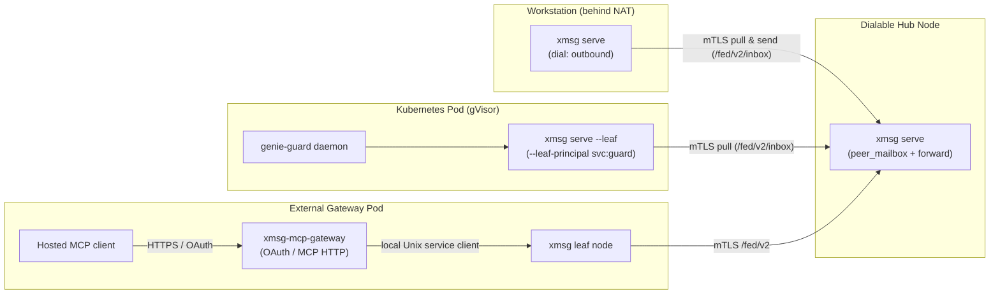
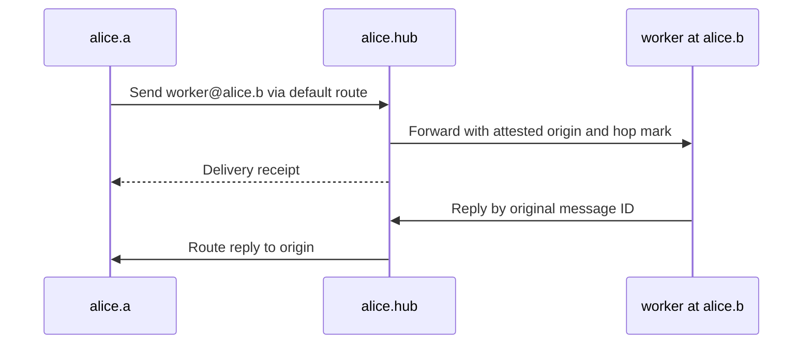

import { Aside } from '@astrojs/starlight/components';

Not every node can accept inbound TCP connections or share a host PID namespace. `xmsg` supports
three composable topologies on top of direct mTLS peerings: **leaf nodes** (`--leaf`), **outbound
links** (`"dial": "outbound"`), and **single-hop hub forwarding** (`allow = ["forward"]`), plus
external **hosted-dot gateways**.



## Choose a topology

| Setup | Use it for | Connection pattern |
|---|---|---|
| Single node | Harnesses and services under one OS user | Local Unix sockets; no federation certificate needed. |
| Direct peers | Nodes that can accept mTLS connections | Pinned keys or CA-signed identities in each node's peers file. |
| Leaf sidecar | One service in a pod | Local same-UID sockets, required loopback listener, outbound polling to a hub. |
| Full node with an outbound link | Interactive harnesses behind NAT | Keep normal harness registration; dial the hub and pull its mailbox. |
| Forwarding hub | A knows H, H knows B, A does not dial B | Set H as A's default route and grant forwarding at both receiving hops. |

Different users on the same host can run separate nodes such as `alice.workstation` and
`bob.workstation`; the same user can have nodes on several hosts. Their explicit node names
distinguish them. [Bare recipient resolution](/concepts/addressing/#how-a-bare-reference-resolves-over-the-federated-view)
prefers the sender's own user's nodes for an instance ID before consulting other users.

## Leaf node mode (`--leaf`)

For single-service workloads running inside containers or Kubernetes pods (such as `genie-guard` or
a Matrix bridge sidecar), `xmsg serve --leaf` runs as an outbound-only sidecar:

- **Local sockets:** Binds `$XDG_RUNTIME_DIR/xmsg/register.sock` (or `--leaf-register-sock`),
  `agent.sock`, and a **required** HTTP listener (`--listen`, or `XMSG_LISTEN`). Keep it on
  loopback inside the pod's isolated network namespace, even when the worker uses Unix sockets.
- **Principal admission (`--leaf-principal`):** Daemons registering on `register.sock` must match
  the configured `--leaf-principal` (for example, `svc:genie-guard`) and the server's UID
  (`SO_PEERCRED`). Because containers in a pod may not share a PID namespace, `/proc/<pid>/exe`
  attestation is omitted and combining `--svc-exe` with `--leaf` is refused at startup.
- **Hub-side durable mailbox (`"leaf": true`):** On the hub, the leaf peer's entry sets
  `"leaf": true`. When any sender addresses `<target>@<leaf-peer>`, the hub checks the peer's
  `targets` filter and stores the message in its durable SQLite `peer_mailbox`.
- **Long-poll and strict `ack` ordering:** The leaf's background loop long-polls
  `GET /fed/v2/inbox?wait=<s>` on the hub, enqueues the message into the local service inbox, and
  calls `POST /fed/v2/inbox/{id}/ack` on the hub **only after** the local service daemon
  acknowledges the delivery over `register.sock`. If the daemon crashes before acknowledging, the
  message remains in the hub mailbox and redelivers on reconnect.

## Outbound links (`"dial": "outbound"`)

A full `xmsg` node running interactive agent harnesses (`claude`, `codex`, `agy`, `opencode`,
`hermes`, `pi`, and `svc`) behind NAT or a stateful firewall can connect to a dialable hub without
opening an inbound port:

- **On the undialable node:** Set `"dial": "outbound"` and `"allow": ["send", "reply"]` on
  the hub's entry in `peers.json`. (`"leaf": true` and `"dial": "outbound"` on the same entry are
  mutually exclusive.)
- **On the hub:** Mark the undialable node's entry with `"leaf": true` so messages and `list`
  queries addressed to it queue in the hub's `peer_mailbox`.
- **Mailbox authorization:** The hub authenticates the peer and requires `leaf: true`
  for that peer's own mailbox. `inbox` in `allow` is accepted and ignored; old
  configurations listing it still load.
- **Background pull loop:** At startup, the full node spawns an outbound pull loop that long-polls
  `GET /fed/v2/inbox` on the hub, answers `list` queries on `POST /fed/v2/list/{query}`, resolves
  local targets across all harnesses, delivers messages locally, and acknowledges them at the hub.
  If a target is unresolvable (`not_found`, `gone`, `ambiguous`), the node acknowledges the mailbox
  item and posts an error reply (`not_found`) back to the hub over `POST /fed/v2/replies`.
- **Outbound reply polling:** When a local session or service on the undialable node sends a
  message to the hub, the hub cannot dial back to push replies. The undialable node automatically
  arms `poll_federated_replies` (`GET /fed/v2/messages/{id}/replies?after=<seq>&wait=<s>`) to pull
  replies and push them into the local sender's inbox.

## Forwarding through a hub

Two nodes that cannot dial each other directly can route messages through an intermediate hub node.
Forwarding is strictly opt-in and bounded to a **single hop**:

- **Permission on the hub (`"forward"`):** The sending peer's entry in the hub's `peers.json` must
  include `"forward"` in `allow`.
- **Permission on the recipient (`"relayed"`):** The hub's entry in the recipient node's
  `peers.json` must include `"relayed"` (or `"relay"`) in `allow` for direct forwarded
  sends. Planned (unreleased): full-node outbound pulls apply this same grant to
  third-party origins, comparing canonical node names rather than local nicknames.
  Denied items get an error reply and an ACK; direct hub-origin mail still works
  without `relayed`.
- **Single-hop envelope mark (`forwarded`):** The hub attests the sender's `origin.node` from the
  TLS identity of the sending peer and attaches
  `forwarded: { "forwarder": "<hub-node>", "targets"?: [...] }`. On dialable delivery, the recipient verifies that
  `forwarder` matches the authenticated hub connection and refuses to re-forward any message that
  already carries `forwarded`.
  Mailbox pull items carry the canonical origin and local target without this mark;
  the full-node consumer delivers locally rather than forwarding the item again.
- **Dual target filtering on dialable forwarding:** If the hub configures `targets` for the destination peer, the hub
  checks the unresolved `ref` before relaying and also passes `targets` inside the `forwarded` mark
  so the destination enforces that a service name in `targets` resolves to a service (never an
  instance merely carrying that label).
  Mailbox pull items retain the origin but omit `forwarded.targets`; only the hub's
  pre-filter applies to that bound on the mailbox route. Recipient-side semantic
  enforcement of the forwarded target bound remains a follow-up.
- **Reply routing:** The hub records forwarded messages in `forwarded_messages` and relays replies
  from the recipient back to the origin peer (either via direct push or by storing them for the
  origin's outbound reply poller).

<Aside type="note" title="Client hop syntax">
Client surfaces (`send` over HTTP, `agent.sock`, MCP, and plugins) accept at most one `@` in `to`
(`ref@dest`). Explicit multi-`@` client strings (`x@dest@hub`) are refused with `bad_request`; the
`/fed/v2` hop envelope is strictly a node-to-node mechanism.
</Aside>

### Complete three-node forwarding example

Assume A, H and B have CA-signed certificates with the single URI SANs below, and each daemon
uses its own certificate/key plus the shared CA bundle. B has a registered service named `worker`.
The certificate identities derive the node names in the configuration.

| Node | Certificate URI SAN | Federation listener |
|---|---|---|
| A | `spiffe://example.org/host/a/user/alice` | `a.example:7788` |
| H | `spiffe://example.org/host/hub/user/alice` | `hub.example:7788` |
| B | `spiffe://example.org/host/b/user/alice` | `b.example:7788` |

A's `peers.json` names only H and selects it for unknown explicit destinations:

```json
{
  "peers": {
    "alice.hub": {
      "address": "hub.example:7788",
      "ca": "/etc/xmsg/ca.pem",
      "identities": ["spiffe://example.org/host/hub/user/alice"],
      "allow": ["send", "reply"],
      "default_route": true
    }
  }
}
```

H knows both peers and permits A to request forwarding:

```json
{
  "peers": {
    "alice.a": {
      "address": "a.example:7788",
      "ca": "/etc/xmsg/ca.pem",
      "identities": ["spiffe://example.org/host/a/user/alice"],
      "allow": ["send", "reply", "forward"]
    },
    "alice.b": {
      "address": "b.example:7788",
      "ca": "/etc/xmsg/ca.pem",
      "identities": ["spiffe://example.org/host/b/user/alice"],
      "allow": ["send", "reply"]
    }
  }
}
```

B accepts relayed sends from H:

```json
{
  "peers": {
    "alice.hub": {
      "address": "hub.example:7788",
      "ca": "/etc/xmsg/ca.pem",
      "identities": ["spiffe://example.org/host/hub/user/alice"],
      "allow": ["send", "reply", "relayed"]
    }
  }
}
```

From A, call `send(to="worker@alice.b", text="review this")`. Direct peer routes take
precedence over `default_route`; at most one default route is allowed. The explicit destination
is important here: a bare name needs a complete list view, which this example does not grant.



The receipt reports delivery or queueing; it is separate from the recipient's answer. The
[three-node source oracle](https://github.com/sini/xmsg/blob/76f8f1e8249777cfb63c4d0287431cbbf6b2ce76/tests/gate_x26_hub_forwarding.rs)
exercises this permission placement and reply route.

## Bridges and hosted clients

[xmsg-mcp-gateway](/extensions/gateway/) connects hosted MCP clients through a local xmsg
service, [matrix-xmsg](/extensions/matrix/) bridges Matrix, and
[agent-quota](/extensions/agent-quota/) currently reports usage as a separate command.
Each extension owns the behavior outside the bus; xmsg does not authenticate a Matrix user or
an OAuth caller itself.
