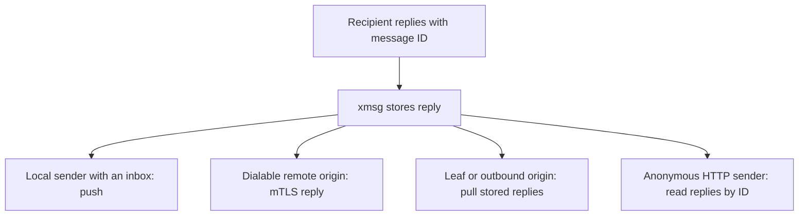

## Delivery outcomes and the queue

Each `send` returns an `address`, a `message_id` and an [`outcome`](/glossary/#outcome):

- **`delivered`:** xmsg put the message into a live Claude Code or Antigravity session, or a live
  Codex relay accepted it.
- **`queued`:** xmsg holds the message in SQLite for one of these recipients:
  - a **parked** Claude Code, Codex or Antigravity conversation, which is not running now or is
    between turns;
  - a live **subagent** in an active turn. The message waits in its turn mailbox until the
    subagent calls `inbox` or its turn ends;
  - a live **Pi**, **opencode** or **Hermes** session, or a registered **service**. The message
    waits until the harness plugin or the service acknowledges (`ack`) the delivery.
- **`pending`:** a retry with the same [idempotency key](#idempotency-idempotency_key) found the
  first send still in progress.

When xmsg delivers a held message, or the recipient acknowledges it, its stored record changes to
`delivered`. `GET /v1/messages/{id}` and idempotent send replays show this record.

### What queues and for how long

- **What queues:** a send to an instance ID that this node saw before, while that instance is
  not running. xmsg knows these IDs from `instance_claims`, Codex roots or Antigravity
  registrations. A Pi ID, a released or closed `opencode` or `hermes` session, or an exited `X~n`
  fork returns `410 gone`. xmsg never queues for them.
- **Lifetime (`--reply-ttl`):** xmsg holds queued messages for the
  [reply TTL](/glossary/#reply-ttl): `604800` seconds (7 days) by default. After that time, xmsg
  deletes them unread. A parked ID stays addressable as `parked` for the longer of two periods:
  - the reply TTL after xmsg last saw it live;
  - the time while its queue holds a message.

  After that, sends to it return `404 not_found`.
- **Drain order:** When xmsg next sees the conversation live, it delivers the queued messages in
  FIFO order. Each envelope header has the original send time:
  `[xmsg] message_id=<id> sent=<RFC 3339 UTC time>`.

## The queue across a user's machines

A user's nodes share one [principal](/glossary/#principal) (`<user>` in `<user>.<host>`). A
Claude Code conversation can have its `~/.claude` directory synced between machines. Then it keeps
its bare conversation ID, and its queued messages follow it automatically. This is the
[handoff](/glossary/#handoff):

1. **The node that gets the conversation asks.** A scan on node $B$ sees a new live Claude
   process with plain ID $X$. Node $B$ then asks all dialable peers of the same user at the same
   time, over `POST /fed/v2/handoff`.
2. **A holder hands over only to the single live listing.** A peer $A$ holds parked messages for
   $X$. It checks that $B$ is the only live listing of $X$ across a complete view of that user's
   nodes. The queue stays on $A$ if a node of the user is unreachable (`503 unavailable`), or if
   two nodes list $X$ live (`409 ambiguous`). xmsg refuses nodes of another user (`403 denied`).
3. **Transfer, then acknowledge.** Node $A$ sends a page of messages (up to
   $64 \times \text{max\_body}$). It keeps its queue until node $B$ acknowledges receipt on
   `POST /fed/v2/handoff/ack`. Node $B$ stores the acknowledgement that it owes in SQLite. It
   tries again with backoff (up to 30 s), also after a restart. It stops when $A$ confirms or the
   messages expire.
4. **Replies route transparently.** At acknowledgement, $A$ records each handed-over message as
   forwarded to $B$. When the conversation on $B$ replies, the reply goes to $A$. $A$ authorizes
   the reply and forwards it to the original sender.

## Replies: stored always, pushed by sender kind

Each envelope that xmsg delivers to a recipient has a reply instruction footer:

```text
[xmsg] ref=2f6c1e0a-8d3b-4c7e-9a41-0b5d2e7f9c13@alice.workstation message_id=01J9XYZ... — reply with the xmsg reply tool (tools: send, reply, list, replies)
```

- **Symmetric reply authorization:** `reply(message_id=m, text=...)` answers the other party of
  $m$. If the caller is $m$'s recipient, the reply goes to $m$'s sender. If the caller is $m$'s
  sender, the reply goes to $m$'s recipient as a follow-up in the same exchange
  (`in_reply_to = m`). xmsg refuses a caller that is neither party with `denied`
  (`not_recipient`).
- **Stored always:** xmsg stores each reply under $m$. Anyone with the message ID can read it with
  `replies(message_id=m)` or `GET /v1/messages/{id}/replies?after={seq}&wait={seconds}`.
- **Pushed when the target party has an inbox:** The answered party can be a Claude Code, Codex,
  Antigravity, Pi, opencode or Hermes session, or a registered service. Then xmsg also pushes the
  reply into its [inbox](/glossary/#inbox), as a new message with its own ULID and `thread_id`:
  ```text
  [xmsg] reply to message_id=<orig_id> — message_id=<new_id>; reply with the xmsg reply tool
  ```
- **Push outcomes:** xmsg records one on each reply: `pushed`, `sender_gone`, `push_failed` or
  `stored`. `stored` means the origin is a leaf or an outbound-linked node, which pulls its
  replies. A reply to an anonymous HTTP caller has no push outcome. The caller reads it with
  `replies`.
- **Codex restart custody (planned):** These rules apply to a Codex root after an xmsg daemon restart:
  - A known root that was active before restart and is not revoked stays queueable within the
    reply TTL. xmsg retains its recovery eligibility across repeated restarts. Deliberate
    `SessionEnd` or unsubscribe parking does not become an automatic recovery candidate.
  - For queued recovery candidates, the daemon rechecks the same persisted owner, trusted
    executable, writer lease and rollout before attempting the restricted live relay. A new
    message triggers recovery; bounded background retries also handle existing queued work
    without a new MCP call. Backoff starts at one second and caps at thirty seconds.
  - Until recovery succeeds, the root appears as `awaiting_reattestation` in the inactive list,
    rather than as live. Revocation or a changed owner ends automatic recovery. An attributed
    MCP call or hook can still use the normal resume checks; an unknown root needs registration.
  - Each drain sends at most eight envelopes and starts no new attempt after two seconds.
    Each relay attempt that has started has its own two-second deadline, so a drain can approach
    four seconds. This is not a two-second total budget. If more pending
    envelopes remain, later bounded passes continue the work.
  - New replies with definite non-handoff custody keep their stable message ID, return
    provenance and original queue time. The same verified root receives them in FIFO order.
  - xmsg marks accepted handoffs `pushed`. It never replays an unknown or in-flight handoff
    automatically. An explicit operator revocation still refuses delivery.
  - Older `sender_gone` or `push_failed` rows without a matching durable handoff remain pull-only,
    through `replies`. xmsg does not infer a replacement identity or provenance.
- **Cross-node replies return to the origin:** A reply to a federated message always goes back
  to the origin node, by `/fed/v2/replies` or by reply pull. The origin node decides how to
  deliver it to the sender.

## Idempotency (`idempotency_key`)

You can give an [idempotency key](/glossary/#idempotency-key) (`idempotency_key`, 1 to 128
characters) on a `send` or `reply` over HTTP, `agent.sock` or `register.sock`. Service frames
spell it `idempotencyKey`. The key gives at-most-once delivery across matching retries **within
the configured retention window**. The default window is `86400` seconds (24 hours). Set it with
`--idempotency-ttl` or `XMSG_IDEMPOTENCY_TTL`. After the window, the same key can make a new
message and deliver again:

- **Reservation before delivery:** xmsg writes the key and the new `message_id` to SQLite before
  delivery starts.
- **Replay:** A retry can have the same key, target and body. After the first send settles, the
  retry returns the first result (`message_id`, `address`, `outcome`). xmsg does not deliver a
  second copy.
- **In-flight wait (`pending`):** A retry can arrive while the first request is still in
  progress. Then the retry waits up to 2 seconds for the first request to settle. If it is still
  in progress, the retry returns `outcome: "pending"` (or `pushOutcome: "pending"`) with the
  reserved ID.
- **Failed delivery retry:** If delivery failed with an error, you can retry with the key, under
  the **same** `message_id`. Peers remove duplicates by `message_id`. A peer that recorded the ID
  as `delivered` or `queued` gives that result again. A peer that recorded a failure tries
  delivery again.
- **Conflict (`409 conflict`):** xmsg refuses the same key with a different `to`, `message_id` or
  `text` with `409 conflict`.
- **Principal scoping:** Each attested caller has its own keys: `id[~n]`, `<P>/<child>` or the
  service `name`. An anonymous HTTP caller uses `anon:<from>`.

## How a reply reaches you



A push is an additional delivery attempt. It does not replace the stored reply. Check the
reported outcome. Use `replies` when the sender has no inbox, or when a push did not reach it.
The [shared reply surface](https://github.com/sini/xmsg/blob/76f8f1e8249777cfb63c4d0287431cbbf6b2ce76/src/surface.rs)
and [key retention](https://github.com/sini/xmsg/blob/76f8f1e8249777cfb63c4d0287431cbbf6b2ce76/src/storage.rs)
define these paths and the retry window.
