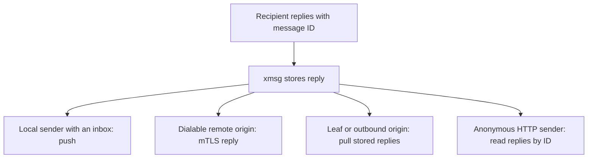

## Delivery outcomes and the queue

Every `send` returns an `address`, a `message_id`, and an `outcome`:

- **`delivered`:** The message was injected into a live Claude Code or Antigravity session or
  accepted by a live Codex relay.
- **`queued`:** The message is held in SQLite for:
  - a **parked** Claude Code, Codex, or Antigravity conversation (not running right now, or between
    turns);
  - a live **subagent** in an active turn (held in its turn mailbox until it calls `inbox` or its
    turn ends);
  - a live **Pi**, **opencode**, or **Hermes** session, or a registered **service**, until the
    harness plugin or service explicitly acknowledges (`ack`) the delivery.

Once a held message is delivered or acknowledged, its stored record (`GET /v1/messages/{id}` and
idempotent send replays) updates to `delivered`.

### What queues and for how long

- **What queues:** Sends to an instance ID this node has previously observed (`instance_claims`,
  Codex roots, or Antigravity registrations) while it is not running. A Pi ID, a released or closed
  `opencode`/`hermes` session, or an exited `X~n` fork returns `410 gone` and never queues.
- **Lifetime (`--reply-ttl`):** Queued messages are held for the reply TTL (`604800` seconds =
  7 days by default) and dropped unread after expiry. A parked ID remains addressable as `parked`
  for the reply TTL after it was last seen live, or as long as its queue holds a message, whichever
  is longer; after that, sends to it return `404 not_found`.
- **Drain order:** When the conversation is next observed live, queued messages drain in FIFO order
  with their original send timestamp in the envelope header:
  `[xmsg] message_id=<id> sent=<RFC 3339 UTC time>`.

## The queue across a user's machines

A user's nodes share one principal (`<user>` in `<user>.<host>`), so a Claude Code conversation
whose `~/.claude` directory is synced between machines keeps its bare conversation ID, and its
queued messages follow it automatically:

1. **The node that gains the conversation asks.** When a scan on node $B$ newly observes a live
   Claude process holding plain ID $X$, node $B$ concurrently queries all dialable peers belonging
   to the same user over `POST /fed/v2/handoff`.
2. **A holder hands over only to the single live listing.** A peer $A$ holding parked messages for
   $X$ verifies that $B$ is the only live listing of $X$ across a complete view of that user's
   nodes. If any node of the user is unreachable (`503 unavailable`) or two nodes list $X$ live
   (`409 ambiguous`), the queue stays put. Nodes belonging to another user are refused (`403 denied`).
3. **Transfer, then acknowledge.** Node $A$ transfers a page of messages (up to $64 \times \text{max\_body}$)
   and retains its queue until node $B$ acknowledges receipt on `POST /fed/v2/handoff/ack`. Node $B$
   persists its owed acknowledgement in SQLite and retries with backoff (up to 30 s) across restarts
   until $A$ confirms or the messages expire.
4. **Replies route transparently.** At acknowledgement, $A$ records each handed-over message as
   forwarded to $B$. When the conversation on $B$ replies, the reply travels to $A$, which
   authorizes it and forwards it to the original sender.

## Replies: stored always, pushed by sender kind

Every envelope delivered to a recipient carries a reply instruction footer:

```text
[xmsg] ref=2f6c1e0a-8d3b-4c7e-9a41-0b5d2e7f9c13@alice.workstation message_id=01J9XYZ... — reply with the xmsg reply tool (tools: send, reply, list, replies)
```

- **Symmetric reply authorization:** Calling `reply(message_id=m, text=...)` answers $m$'s other
  party symmetrically. If the caller is $m$'s recipient, the reply goes to $m$'s sender; if the
  caller is $m$'s sender, it goes to $m$'s recipient as a follow-up in the same exchange
  (`in_reply_to = m`). Any caller who is neither party is refused with `denied` (`not_recipient`).
- **Stored always:** Every reply is stored under $m$ and can be read via `replies(message_id=m)` or
  `GET /v1/messages/{id}/replies?after={seq}&wait={seconds}` by anyone holding the message ID.
- **Pushed when the target party has an inbox:** If the party being answered is a Claude Code,
  Codex, Antigravity, Pi, opencode, or Hermes session, or a registered service, the reply is also
  pushed into their inbox as a new message with its own ULID and `thread_id`:
  ```text
  [xmsg] reply to message_id=<orig_id> — message_id=<new_id>; reply with the xmsg reply tool
  ```
- **Push outcomes:** Recorded on each reply as `pushed`, `sender_gone`, `push_failed`, or `stored`
  (when the origin is a leaf or outbound-linked node that pulls its replies). Replies to anonymous
  HTTP callers record no push outcome and are read via `replies`.
- **Codex restart custody:** a known, nonrevoked root remains queueable within the reply TTL while awaiting fresh writer-lease attestation. It is not automatically live after a daemon restart. An attributed MCP tool call can re-attest only a previously known, nonrevoked root, using the same full writer-lease and rollout checks as resume; unknown roots still require registration. After successful attestation, the call kicks a bounded FIFO relay drain (at most eight envelopes, starting no new attempt after two seconds; each existing relay attempt has its own two-second deadline). Explicit operator revocation still refuses delivery. New replies with definite non-handoff custody retain their stable message ID, return provenance and original queue timestamp; the same root drains them in FIFO order on re-registration. Accepted handoffs are marked `pushed`. Unknown or inflight handoffs are never automatically replayed. Historical `sender_gone` or `push_failed` rows without the matching durable handoff are pull-only through `replies`; no replacement identity or provenance is inferred.
- **Cross-node replies return to the origin:** A reply to a federated message always travels back to
  the originating node (`/fed/v2/replies` or reply pull), which decides how to deliver it to the
  sender.

## Idempotency (`idempotency_key`)

Providing `idempotency_key` (1 to 128 characters) on a `send` or `reply` over HTTP, `agent.sock`,
or `register.sock` (where service frames spell it `idempotencyKey`) guarantees at-most-once
delivery across matching retries **within the configured retention window**. The default is
`86400` seconds (24 hours), set by `--idempotency-ttl` / `XMSG_IDEMPOTENCY_TTL`. After expiry,
reusing the key can create a new message and deliver again:

- **Reservation before delivery:** The key and minted `message_id` are committed to SQLite before
  delivery starts.
- **Replay:** A retry with the same key and identical target/body after settlement returns the
  original result (`message_id`, `address`, `outcome`) without delivering a second copy.
- **In-flight wait (`pending`):** While the first request is still in flight, a concurrent retry
  waits up to 2 seconds for settlement; if still in flight, it returns `outcome: "pending"` (or
  `pushOutcome: "pending"`) with the reserved ID.
- **Failed delivery retry:** If delivery failed with an error, the key remains free to retry under
  the **same** `message_id`. Peers deduplicate by `message_id`: a peer that already recorded the ID
  as `delivered` or `queued` replays that result, while a peer that recorded a failure attempts
  delivery again.
- **Conflict (`409 conflict`):** Reusing the same key with a different `to`, `message_id`, or `text`
  is refused with `409 conflict`.
- **Principal scoping:** Keys are partitioned by attested caller (`id[~n]`, `<P>/<child>`, or
  service `name`), or `anon:<from>` for anonymous HTTP callers.

## How a reply reaches you



Push is an additional delivery attempt, not a replacement for the stored reply. Check the
reported outcome and use `replies` when the sender has no inbox or a push did not reach it.
The [shared reply surface](https://github.com/sini/xmsg/blob/76f8f1e8249777cfb63c4d0287431cbbf6b2ce76/src/surface.rs)
and [key retention](https://github.com/sini/xmsg/blob/76f8f1e8249777cfb63c4d0287431cbbf6b2ce76/src/storage.rs)
define these paths and the retry window.
