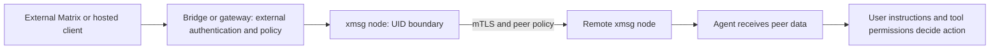

import { Aside } from '@astrojs/starlight/components';

## Same-UID trust boundary

All local IPC in `xmsg` uses Unix domain sockets in `$XDG_RUNTIME_DIR/xmsg/`. On macOS, when
`XDG_RUNTIME_DIR` is not set, xmsg uses the per-user Darwin temporary directory from
`getconf DARWIN_USER_TEMP_DIR`:

- xmsg creates the runtime directory with mode `0700` and checks it. The running user's UID owns
  it. xmsg binds `http.sock`, `agent.sock` and `register.sock` with mode `0600`.
- At startup, xmsg checks the owner of the directory and the sockets. It refuses symlinks before
  it binds.
- Each connection on `http.sock`, `agent.sock` and `register.sock` checks the peer credentials
  that the kernel attests. On Linux, xmsg uses `SO_PEERCRED`. On macOS, it uses `getpeereid` and
  `LOCAL_PEEREPID`. xmsg drops a connection when its UID is not the server's UID. It does this
  before it reads any protocol frame.

### Attribution vs. isolation within one UID

Within one OS user (UID), xmsg identifies a caller on `agent.sock` and `http.sock` by its process
ancestry. This is **attribution, not a security boundary against a hostile process**:

- It prevents accidental misattribution between sessions or harnesses. It lets tools find the
  caller's session address automatically.
- It does not stop a same-UID process with shell access. That process can inspect another session
  under the same UID, or pose as it.
- The **hard security boundaries** in `xmsg` are these:
  - **separate OS UIDs**, for example separate tiers or services under different users or pods;
  - **mTLS peer certificates** (`/fed/v2`);
  - **per-peer authorization policies** (`allow`, `principals`, `targets`, `from`).
- Anyone with a `message_id` can read that message's replies with `replies`. A message ID can be
  in a log or in forwarded text.

<Aside type="caution" title="No-Auth HTTP Service">
`xmsg` has no application-level HTTP authentication tokens. It uses Unix domain socket peer
credentials (`SO_PEERCRED` / `getpeereid`). By default, `xmsg serve` binds **no TCP port**. The
optional `--listen <IP:PORT>` (`XMSG_LISTEN`) flag is only for the loopback interface in an
isolated container or Kubernetes pod network namespace. Never bind `--listen` to a shared or
external network interface.
</Aside>

## Per-harness attestation & identity derivation

For same-UID processes that are not hostile, `xmsg` checks each harness's lifecycle. Thus
sessions do not collide, and one session cannot pose as another:

- **[Claude Code](/harnesses/claude-code/):** xmsg finds sessions in `~/.claude/sessions` (or
  the repeatable `--sessions-dir`). It checks that the process is live, and checks its start time,
  against `/proc/<pid>/stat`. On macOS, it uses `proc_pidinfo` and compares the result with the
  UTC `ps -o lstart` time in `<pid>.json`. Duplicate conversation IDs get deterministic `X~2`,
  `X~3` fork claims in `instance_claims`.
- **[Codex](/harnesses/codex/):** xmsg makes three checks:
  - ancestor executable attestation (`--codex-exe`);
  - an open `<H>/thread-writer-locks/
.lock` descriptor under a configured `--codex-home` `<H>`,
    with a continuous lease watch. On Linux, the watch uses `inotify`. On macOS, it uses `kqueue`
    on an `O_EVTONLY` descriptor;
  - bounded `O_NOFOLLOW` rollout header verification.

  Runtime MCP calls take `sessionId`, `threadId` and `turn_id` only from `params._meta`. They
  never take them from the `arguments` that the model controls.
  - *Shared app-server daemon note:* Two or more Codex root sessions can share one per-home
    app-server daemon under the same UID. Then they share that daemon's process ancestry and
    writer-lock descriptors. `codex --no-daemon` gives each root its own owner process. All Codex
    delivery paths add a fixed untrusted-peer-data preamble outside the escaped message bodies.
- **[Antigravity](/harnesses/antigravity/):** xmsg checks the ancestor executable
  (`--agy-exe`). It also checks for an open file descriptor to
  `<presence_dir>/<conversation_id>.lock`, matched by device and inode `(dev, ino)`. On Linux, it
  also checks for an exclusive `FLOCK` in `/proc/locks`.
- **[Pi](/harnesses/pi/), [opencode](/harnesses/opencode/) and [Hermes](/harnesses/hermes/):**
  xmsg admits them on `register.sock` after a UID check with `SO_PEERCRED` / `getpeereid`. It
  makes a new UUID v4 for each registered session. All tool calls and `continues`/`subagent`
  frames are limited to the `register.sock` connection that owns the session.
- **Services (`svc`):** xmsg admits a service on `register.sock` after two checks. The peer UID
  must be the server UID. The canonical executable path must match `--svc-exe <NAME>=<PATH>` (or
  `--leaf-principal` in `--leaf` mode). On Linux, xmsg reads the path from `/proc/<pid>/exe`. On
  macOS, it uses `proc_pidpath`. The check fails closed on a deleted binary (`(deleted)`) or a
  changed profile symlink.

Service liveness is **planned** to distinguish an unavailable start-time lookup from a process
that is known to have exited. Linux leaves keep working without `/proc`, including a live pidfd
whose peer PID is not visible in the container. Where available, xmsg retains the kernel pin or
compares a captured start token; macOS reads its native token without a mounted `/proc`. If that
facility is unavailable, the portable registration belongs to its connection. Unknown start time
(`0`) alone will not keep a disconnected service live, and an old connection will not remove a
newer registration. These lifecycle checks do not add isolation within a trusted UID.

## Envelope sanitization & breakout defense

- **Printable-ASCII anonymous `from`:** An unattested HTTP `from` string can contain only
  printable ASCII (`0x20..=0x7E`). It cannot contain `:`, `/` or `@`. Thus an anonymous caller
  cannot imitate an attested `id@node` address. xmsg always shows it as `<from> · anon@<node>`.
- **Label sanitization:** xmsg removes quotes, angle brackets, control characters and newlines
  from instance labels. It replaces each non-ASCII character with `_`. It drops a label that
  contains `@` or `·`. The maximum length is 64 characters.
- **XML breakout defense:** Transport envelopes escape attribute double quotes (`&quot;`). Thus
  message metadata and sender labels cannot break out of `<cross-session-message>` tags.
- **No-symlink file ingestion:** Each path that reads harness state on disk
  (`~/.claude/sessions`, Codex rollouts, Antigravity `transcript.jsonl`) first validates the UUID
  and subagent identifiers. Then it walks directories with
  `openat(..., O_NOFOLLOW | O_CLOEXEC | O_NONBLOCK)`. It refuses symlinks, FIFOs, sockets and
  files that the EUID does not own.

## Provenance is not instruction authority

An attested sender address answers **where a message came from**. It does not authorize the
receiver to run commands, reveal secrets or override its user's instructions. Display labels
remain sender-provided descriptions. A message from another session, service, Matrix room or
hosted model is peer data, including when its transport is authenticated.

The [Codex delivery preamble](https://github.com/sini/xmsg/blob/76f8f1e8249777cfb63c4d0287431cbbf6b2ce76/src/codex.rs#L28)
states this distinction explicitly. Apply the user's instructions and normal tool permissions
before acting. Structural [envelope escaping](https://github.com/sini/xmsg/blob/76f8f1e8249777cfb63c4d0287431cbbf6b2ce76/src/inbox.rs#L179)
prevents a message from breaking the wrapper; it does **not** prevent semantic prompt injection.

Within one UID, xmsg does not isolate hostile local processes from each other. It also does not
make peer text safe to execute or supply end-to-end outside-service authorization: external
[bridges and gateways](/extensions/gateway/) own their outside-facing boundaries.

## Planned: the enrollment CA boundary

The [enrollment CA](/operations/enrollment-ca/) is an optional online signing
root inside an xmsg node. It issues only the host/user form: the user comes from
a verified OIDC account and explicit policy, while the host is a label supplied
by the enrolling machine. **A host name is not attestation.** Alice can request
`alice.prod-db` from another device. Never grant permissions merely because an
enrolled certificate says `host/prod-db/user/*`; grant on the verified user.

The enrollment root is independent of fleet and cluster roots. A hub pattern
binds one bundle, patterns of different bundles cannot derive a common canonical
name, and a rule spanning bundles is refused. Compromise of the CA host therefore
affects the peer entries and hub patterns/rules trusting its root, including their
names and mailboxes. It does not make that root satisfy a fleet-bundle pattern.
It remains the operator's job to give enrollment identities suitably narrow rules.

Default host certificates expire 24 hours after issuance. The CA deny list stops
new issuance or renewal immediately there; there is no CRL or OCSP distribution
to peers. Renewal does not query the IdP, and fresh login is required after
90 days. Disabling an IdP account is not an immediate revocation of an existing
certificate. **Pinned peers bypass certificate expiry**: pinning an enrolled key
also bypasses these CA expiry/revocation bounds.

Both browser flows request an explicit interaction: Google uses
`consent select_account`; Kanidm and other providers use `login`. An attacker can
still ask a victim to sign in and share the resulting loopback redirect address,
which enrolls the attacker's key as the victim. Do not share that address. These
prompts do not promise a particular passkey ceremony; real-provider behavior is
an operator-run acceptance check. Device authorization is refused in v1.

These certificates authenticate a peer. They do not turn its messages into
instructions or isolate hostile processes within the same UID.
