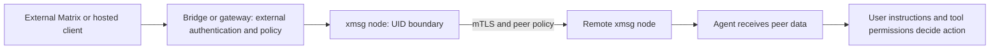

import { Aside } from '@astrojs/starlight/components';

## Same-UID trust boundary

All local IPC in `xmsg` takes place over Unix domain sockets in `$XDG_RUNTIME_DIR/xmsg/` (or the
per-user Darwin temporary directory from `getconf DARWIN_USER_TEMP_DIR` on macOS when
`XDG_RUNTIME_DIR` is unset):

- The runtime directory is created and verified at mode `0700`, owned by the running user's UID,
  with `http.sock`, `agent.sock`, and `register.sock` bound at mode `0600`.
- Startup verifies directory and socket ownership and refuses symlinks before binding.
- Every connection on `http.sock`, `agent.sock`, and `register.sock` checks kernel-attested peer
  credentials (`SO_PEERCRED` on Linux, `getpeereid` and `LOCAL_PEEREPID` on macOS) and drops any
  connection whose UID does not equal the server's UID prior to protocol framing.

### Attribution vs. isolation within one UID

Within a single OS user (UID), identifying a caller by its process ancestry on `agent.sock` and
`http.sock` is **attribution, not a hostile security boundary**:

- It prevents accidental cross-session or cross-harness misattribution and lets tools derive the
  caller's session address automatically.
- It does not stop a same-UID process with shell access from inspecting or impersonating another
  session running under that same UID.
- **Hard security boundaries** in `xmsg` are **separate OS UIDs** (for example, running separate
  tiers or services under distinct users or pods), **mTLS peer certificates** (`/fed/v2`), and
  **per-peer authorization policies** (`allow`, `principals`, `targets`, `from`).
- Anyone holding a `message_id` (from a log or forwarded text) can read that message's replies via
  `replies`.

<Aside type="caution" title="No-Auth HTTP Service">
`xmsg` provides no application-level HTTP authentication tokens; it relies on Unix domain socket
peer credentials (`SO_PEERCRED` / `getpeereid`). By default, `xmsg serve` binds **no TCP port**.
The optional `--listen <IP:PORT>` (`XMSG_LISTEN`) flag is intended strictly for isolated container
or Kubernetes pod loopback namespaces. Never bind `--listen` to a shared or external network
interface.
</Aside>

## Per-harness attestation & identity derivation

Among non-adversarial same-UID processes, `xmsg` verifies each harness's lifecycle so sessions do
not collide or spoof one another:

- **[Claude Code](/harnesses/claude-code/):** Discovered from `~/.claude/sessions` (or repeatable
  `--sessions-dir`). Process liveness and start time are verified against `/proc/<pid>/stat` (or
  `proc_pidinfo` on macOS, matching the UTC `ps -o lstart` timestamp recorded in `<pid>.json`).
  Duplicate conversation IDs receive deterministic `X~2`, `X~3` fork claims in `instance_claims`.
- **[Codex](/harnesses/codex/) (Linux):** Verified via ancestor executable attestation
  (`--codex-exe`), an open `<H>/thread-writer-locks/
.lock` descriptor under a configured
  `--codex-home` `<H>` with a continuous `inotify` lease watch, and bounded `O_NOFOLLOW` rollout
  header verification. Runtime MCP calls extract `sessionId`, `threadId`, and `turn_id` strictly
  from `params._meta`, never from model-controlled `arguments`.
  - *Shared app-server daemon note:* When multiple Codex root sessions share a single per-home
    app-server daemon under the same UID, they share that daemon's process ancestry and writer-lock
    descriptors; running `codex --no-daemon` gives each root its own owner process. All Codex
    delivery paths prepend a fixed untrusted-peer-data preamble outside escaped message bodies.
- **[Antigravity](/harnesses/antigravity/):** Verified via ancestor executable attestation
  (`--agy-exe`) and an open file descriptor to `<presence_dir>/<conversation_id>.lock` matched by
  device and inode `(dev, ino)` (plus `/proc/locks` exclusive `FLOCK` verification on Linux).
- **[Pi](/harnesses/pi/), [opencode](/harnesses/opencode/), and [Hermes](/harnesses/hermes/):**
  Admitted on `register.sock` via `SO_PEERCRED` / `getpeereid` UID verification; `xmsg` mints a
  fresh UUID v4 per registered session and scopes all tool calls and `continues`/`subagent` frames
  to the owning `register.sock` connection.
- **Services (`svc`):** Admitted on `register.sock` by verifying `SO_PEERCRED` UID and matching
  canonical `/proc/<pid>/exe` against `--svc-exe <NAME>=<PATH>` (or `--leaf-principal` in `--leaf`
  mode). Executable resolution fails closed on deleted binaries (`(deleted)`) or changed profile
  symlinks.

## Envelope sanitization & breakout defense

- **Printable-ASCII anonymous `from`:** Unattested HTTP `from` strings are restricted to printable
  ASCII (`0x20..=0x7E`) and cannot contain `:`, `/`, or `@`, ensuring an anonymous caller can never
  imitate an attested `id@node` address and is always rendered as `<from> · anon@<node>`.
- **Label sanitization:** Instance labels strip quotes, angle brackets, control characters, and
  newlines, replace non-ASCII characters with `_`, drop any label containing `@` or `·`, and cap
  length at 64 characters.
- **XML breakout defense:** Transport envelopes escape attribute double quotes (`&quot;`) so message
  metadata or sender labels cannot break out of `<cross-session-message>` tags.
- **No-symlink file ingestion:** Every path that reads harness state on disk (`~/.claude/sessions`,
  Codex rollouts, Antigravity `transcript.jsonl`) validates UUID/subagent identifiers first and
  walks directories with `openat(..., O_NOFOLLOW | O_CLOEXEC | O_NONBLOCK)`, rejecting symlinks,
  FIFOs, sockets, and non-EUID files.

## Provenance is not instruction authority

An attested sender address answers **where a message came from**. It does not authorize the
receiver to run commands, reveal secrets or override its user's instructions. Display labels
remain sender-provided descriptions. A message from another session, service, Matrix room or
hosted model is peer data, including when its transport is authenticated.

The [Codex delivery preamble](https://github.com/sini/xmsg/blob/76f8f1e8249777cfb63c4d0287431cbbf6b2ce76/src/codex.rs#L28)
states this distinction explicitly. Apply the user's instructions and normal tool permissions
before acting. Structural [envelope escaping](https://github.com/sini/xmsg/blob/76f8f1e8249777cfb63c4d0287431cbbf6b2ce76/src/inbox.rs#L179)
prevents a message from breaking the wrapper; it does **not** prevent semantic prompt injection.

Within one UID, xmsg does not isolate hostile local processes from each other. It also does not
make peer text safe to execute or supply end-to-end outside-service authorization: external
[bridges and gateways](/extensions/gateway/) own their outside-facing boundaries.
