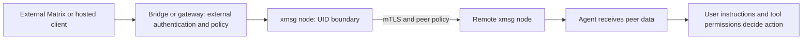

import { Aside } from '@astrojs/starlight/components';
import Status from '../../../components/Status.astro';

## Same-UID trust boundary

All local IPC in `xmsg` uses Unix domain sockets in `$XDG_RUNTIME_DIR/xmsg/`. On macOS, when
`XDG_RUNTIME_DIR` is not set, xmsg uses the per-user Darwin temporary directory from
`getconf DARWIN_USER_TEMP_DIR`:

- xmsg creates the runtime directory with mode `0700` and checks it. The running user's UID owns
  it. xmsg binds `http.sock`, `agent.sock` and `register.sock` with mode `0600`.
- At startup, xmsg checks the owner of the directory and the sockets. It refuses symlinks before
  it binds.
- Each connection on `http.sock`, `agent.sock` and `register.sock` checks the peer credentials
  that the kernel attests. On Linux, xmsg uses `SO_PEERCRED`. On macOS, it uses `getpeereid` and
  `LOCAL_PEEREPID`. xmsg drops a connection when its UID is not the server's UID. It does this
  before it reads any protocol frame.

### Attribution vs. isolation within one UID

Within one OS user (UID), xmsg identifies a caller on `agent.sock` and `http.sock` by its process
ancestry. This is **attribution, not a security boundary against a hostile process**:

- It prevents accidental misattribution between sessions or harnesses. It lets tools find the
  caller's session address automatically.
- It does not stop a same-UID process with shell access. That process can inspect another session
  under the same UID, or pose as it.
- The **hard security boundaries** in `xmsg` are these:
  - **separate OS UIDs**, for example separate tiers or services under different users or pods;
  - **mTLS peer certificates** (`/fed/v2`);
  - **per-peer authorization policies** (`allow`, `principals`, `targets`, `from`).
- Anyone with a `message_id` can read that message's replies with `replies`. A message ID can be
  in a log or in forwarded text.

<Aside type="caution" title="No-Auth HTTP Service">
`xmsg` has no application-level HTTP authentication tokens. It uses Unix domain socket peer
credentials (`SO_PEERCRED` / `getpeereid`). By default, `xmsg serve` binds **no TCP port**. The
optional `--listen <IP:PORT>` (`XMSG_LISTEN`) flag is only for the loopback interface in an
isolated container or Kubernetes pod network namespace. Never bind `--listen` to a shared or
external network interface.
</Aside>

## Per-harness attestation & identity derivation

For same-UID processes that are not hostile, `xmsg` checks each harness's lifecycle. Thus
sessions do not collide, and one session cannot pose as another:

- **[Claude Code](/harnesses/claude-code/):** xmsg finds sessions in `~/.claude/sessions` (or
  the repeatable `--sessions-dir`). It checks that the process is live, and checks its start time,
  against `/proc/<pid>/stat`. On macOS, it uses `proc_pidinfo` and compares the result with the
  UTC `ps -o lstart` time in `<pid>.json`. Duplicate conversation IDs get deterministic `X~2`,
  `X~3` fork claims in `instance_claims`.
- **[Codex](/harnesses/codex/):** xmsg makes three checks:
  - ancestor executable attestation (`--codex-exe`, matching the canonical executable `file_name`
    by default across store-path upgrades, or the exact canonical path with `--codex-exe-strict`);
  - an open `<H>/thread-writer-locks/
.lock` descriptor under a configured `--codex-home` `<H>`,
    with a continuous lease watch. On Linux, the watch uses `inotify`. On macOS, it uses `kqueue`
    on an `O_EVTONLY` descriptor. On macOS, a process that releases the lock without closing it
    can be re-admitted, because macOS reports only that the file was locked; codex never does this
    (see [Codex](/harnesses/codex/));
  - bounded `O_NOFOLLOW` rollout header verification.

  Runtime MCP calls take `sessionId`, `threadId` and `turn_id` only from `params._meta`. They
  never take them from the `arguments` that the model controls.
  - *Shared app-server daemon note:* Two or more Codex root sessions can share one per-home
    app-server daemon under the same UID. Then they share that daemon's process ancestry and
    writer-lock descriptors. `codex --no-daemon` gives each root its own owner process. All Codex
    delivery paths add a fixed untrusted-peer-data preamble outside the escaped message bodies.
- **[Antigravity](/harnesses/antigravity/):** xmsg checks for an open file descriptor to
  `<presence_dir>/<conversation_id>.lock`, matched by device and inode `(dev, ino)`. On Linux, it
  also checks for an exclusive `FLOCK` in `/proc/locks`. The optional `--agy-exe` flag checks the
  ancestor's canonical executable `file_name` by default (or its exact canonical path with
  `--agy-exe-strict`); without `--agy-exe` the lock holder is trusted by UID and lock attestation.
- **[Pi](/harnesses/pi/), [opencode](/harnesses/opencode/) and [Hermes](/harnesses/hermes/):**
  xmsg admits them on `register.sock` after a UID check with `SO_PEERCRED` / `getpeereid`. It
  makes a new UUID v4 for each registered session. All tool calls and `continues`/`subagent`
  frames are limited to the `register.sock` connection that owns the session.
- **Services (`svc`):** xmsg admits a service on `register.sock` after two checks. The peer UID
  must be the server UID. The canonical executable path must match `--svc-exe <NAME>=<PATH>` (or
  `--leaf-principal` in `--leaf` mode). On Linux, xmsg reads the path from `/proc/<pid>/exe`. On
  macOS, it uses `proc_pidpath`. The check fails closed on a deleted binary (`(deleted)`) or a
  changed profile symlink.

Service liveness (<Status id="xmsg.recipient-snapshot" />) distinguishes an unavailable start-time lookup from a process
that is known to have exited. Linux leaves keep working without `/proc`, including a live pidfd
whose peer PID is not visible in the container. Where available, xmsg retains the kernel pin or
compares a captured start token; macOS reads its native token without a mounted `/proc`. If that
facility is unavailable, the portable registration belongs to its connection. Unknown start time
(`0`) alone will not keep a disconnected service live, and an old connection will not remove a
newer registration. These lifecycle checks do not add isolation within a trusted UID.

## Envelope sanitization & breakout defense

- **Printable-ASCII anonymous `from`:** An unattested HTTP `from` string can contain only
  printable ASCII (`0x20..=0x7E`). It cannot contain `:`, `/` or `@`. Thus an anonymous caller
  cannot imitate an attested `id@node` address. xmsg always shows it as `<from> · anon@<node>`.
- **Label sanitization:** xmsg removes quotes, angle brackets, control characters and newlines
  from instance labels. It replaces each non-ASCII character with `_`. It drops a label that
  contains `@` or `·`. The maximum length is 64 characters.
- **XML breakout defense:** Transport envelopes escape attribute double quotes (`&quot;`). Thus
  message metadata and sender labels cannot break out of `<cross-session-message>` tags.
- **No-symlink file ingestion:** Each path that reads harness state on disk
  (`~/.claude/sessions`, Codex rollouts, Antigravity `transcript.jsonl`) first validates the UUID
  and subagent identifiers. Then it walks directories with
  `openat(..., O_NOFOLLOW | O_CLOEXEC | O_NONBLOCK)`. It refuses symlinks, FIFOs, sockets and
  files that the EUID does not own.

## Provenance is not instruction authority

An attested sender address answers **where a message came from**. It does not authorize the
receiver to run commands, reveal secrets or override its user's instructions. Display labels
remain sender-provided descriptions. A message from another session, service, Matrix room or
hosted model is peer data, including when its transport is authenticated.

The [Codex delivery preamble](https://github.com/sini/xmsg/blob/76f8f1e8249777cfb63c4d0287431cbbf6b2ce76/src/codex.rs#L28)
states this distinction explicitly. Apply the user's instructions and normal tool permissions
before acting. Structural [envelope escaping](https://github.com/sini/xmsg/blob/76f8f1e8249777cfb63c4d0287431cbbf6b2ce76/src/inbox.rs#L179)
prevents a message from breaking the wrapper; it does **not** prevent semantic prompt injection.

Within one UID, xmsg does not isolate hostile local processes from each other. It also does not
make peer text safe to execute or supply end-to-end outside-service authorization: external
[bridges and gateways](/extensions/gateway/) own their outside-facing boundaries.

## Planned: federation handshake privacy

Federation TLS clients omit the DNS `server_name` extension from ClientHello, so
node names such as `<user>.<host>` are not sent as cleartext SNI. Peer verification
continues to use the configured SPKI pin or CA chain and SPIFFE identity.
Enrollment and OAuth HTTPS clients retain their normal hostname SNI.

## Planned: the enrollment CA boundary

The [enrollment CA](/operations/enrollment-ca/) is an optional online signing
root inside an xmsg node. It issues only the host/user form: the user comes from
a verified OIDC account and explicit policy, while the host is a label supplied
by the enrolling machine. **A host name is not attestation.** Alice can request
`alice.prod-db` from another device. Never grant permissions merely because an
enrolled certificate says `host/prod-db/user/*`; grant on the verified user.

The enrollment root is independent of fleet and cluster roots. A hub pattern
binds one bundle, patterns of different bundles cannot derive a common canonical
name, and a rule spanning bundles is refused. Compromise of the CA host therefore
affects the peer entries and hub patterns/rules trusting its root, including their
names and mailboxes. It does not make that root satisfy a fleet-bundle pattern.
It remains the operator's job to give enrollment identities suitably narrow rules.

**Planned node-name ownership:** dynamic admission uses the full URI, including its trust
domain and form. It refuses a candidate if another allowed URI could derive the same alias,
before either arrives. Concrete CA entries reserve their names while offline. Current
operations are gated by the authenticated URI's current ownership, not by whichever client
connected first.

Durable mailbox, outbound and reply records remain addressed by the node alias. A deliberate
administrator reassignment of that alias is an owner-authorized routing change; it is not a
promise that old records remain bound to a historical URI. This change adds no mailbox
migration or new node-name prefix.

**Planned renewal boundary:** renewal retains the trust domain of the CA-signed certificate,
including after a policy-domain change. It requires the exact canonical host/user path to
match the stored user and host, then checks current full-URI ownership under a lease. A
namespace/service-account URI with the same derived alias is not a substitute.

The store does not independently bind a historical URI or trust domain. A differently-domained
certificate reusing a known serial requires the CA's own signer and is outside the
enrollment-client threat model. This preserves the existing renewal contract without adding
historical identity fields.

Default host certificates expire 24 hours after issuance. The CA deny list stops
new issuance or renewal immediately there; there is no CRL or OCSP distribution
to peers. Renewal does not query the IdP, and fresh login is required after
90 days. Disabling an IdP account is not an immediate revocation of an existing
certificate. **Pinned peers bypass certificate expiry**: pinning an enrolled key
also bypasses these CA expiry/revocation bounds. The daemon federation peers-file
`deny` is separate from the CA issuance deny: an exact actual URI SAN or SPKI deny
wins over pins, concrete CA entries and hub patterns. Current request and response
checks use the actual admitted leaf; CA-mode sockets expire at their original
`not_after`, while explicit pins remain expiry-independent. Each operation already
past its applicable check may finish its bounded effect; concurrent operations are
not reduced to a global one-request allowance, and committed effects are not undone.
Idle sockets are not closed. This does not cover the standalone collector client.
See the [offboarding procedure](/operations/enrollment-ca/#offboard-a-teammate-or-a-lost-or-stolen-device).

Both browser flows request an explicit interaction: Google uses
`consent select_account`; Kanidm and other providers use `login`. An attacker can
still ask a victim to sign in and share the resulting loopback redirect address,
which enrolls the attacker's key as the victim. Do not share that address. These
prompts do not promise a particular passkey ceremony; real-provider behavior is
an operator-run acceptance check.

Planned [device enrollment](/operations/enrollment-ca/#planned-device-sign-in-from-a-remote-terminal)
is disabled by default and requires independent CA-operator approval for every
request. A victim can authorize an attacker's device code; successful provider
sign-in alone therefore cannot issue a certificate. Approval uses only the local
mode-0600, UID-checked `http.sock`, never the enrollment network, TCP, MCP or
federation. The operator checks the verified policy user, requested host and SPKI
fingerprint against the intended terminal through an independent trusted channel.
The host label remains unattested. An operator who approves the wrong request can
still enroll the attacker's key; this does not promise phishing resistance.
Google's external sign-in screen need not display the xmsg host or policy user.
Google device support remains unverified until owner-run real-provider acceptance.

These certificates authenticate a peer. They do not turn its messages into
instructions or isolate hostile processes within the same UID.

## Planned: manual pairing grants

<Status id="xmsg.pairing" />

Manual pairing authorizes a device by its full key, exchanged out of band, with no CA, account or
hub. A device ID is `xmsg-spki1:` followed by 52 lowercase base32 characters of the SHA-256 of
its DER SPKI; a peers-file `pin` names the same digest in hex. Discovery still supplies only
addresses. These rules hold once the pairing ceremony and its local controls arrive:

- **One grant, one decision.** A grant carries both its scope and its own provenance. A request
  is allowed only when a single grant permits it, so an expired grant's scope cannot be combined
  with another grant's fresh provenance, and two partial grants never add up to one permission.
- **Two fixed profiles.** `contact` permits send and reply, with their own reply polls and
  attachments. `owner-device` also permits session listing. Neither permits observe,
  forwarding, relaying, handoff or administration. A grant's exposure policy names the targets
  and principals it reaches and its size limits; an empty target list grants no data.
- **Removal is permanent for that grant.** Removing a grant records its ID for good: a retried,
  cached or delayed activation of it fails, before or after a restart, and the ID is never
  reused. A later, deliberate pairing creates a new grant.
- **A device block dominates.** A block on a device ID stops every grant and pinned entry for it,
  refuses new pairing with it, and survives restarts until it is lifted.
- **Existing pins stay as they are.** Each pinned peers-file entry is recorded as a
  `legacy_unilateral` grant with its exact `allow`, `targets`, `principals`, `from` and `leaf`
  values, and stays valid only while the peers file holds that exact entry. It gains no profile
  right and is not reported as mutual. Pairing a device that already has a pin adds a separate
  grant; replacing the pin is a separate, explicit action.

Until the ceremony lands, no command creates, removes or blocks a pairing grant: pinned and CA
entries in the peers file, and its `deny` list, remain the whole of federation admission.

### Authority generations

<Status id="xmsg.pairing-authority" />

Federation checks run against one installed *policy generation*: the last successfully parsed
peers file, certificate and CA bundles, merged with one snapshot of the pairing store. Every
store change that alters authority (an activation, a removal, a block, an unblock, or a pin
import) advances a store revision, and each generation records the revision it was built
from. Device blocks in the store join the generation's `deny` list, so every existing deny
check enforces them.

- **One publication at a time.** File rebuilds (the reload watcher and `SIGHUP`) and store
  publications run under one lock, and a generation built from an older store snapshot is
  never installed over a newer one.
- **Store changes do not wait on files.** On each watcher tick, a store revision ahead of the
  installed one is published from the last-good file inputs, without re-reading any file and
  without a systemd reload notification. An invalid peers file therefore delays only its own
  change, never a block.
- **An unreadable store keeps the previous generation installed.** The reload fails and the
  node keeps serving the last installed generation; at startup the daemon refuses to start.
- `xmsg doctor` reports `pairing.authority`: a pass when the installed revision equals the
  committed one, and a warning naming both revisions when a committed change is not yet
  installed or the store cannot be read.

## Observation boundary

<Status id="fleet-observer.collector" />

A [fleet observer](/concepts/fleet-observer/) peer receives stored metadata only
through an explicit literal `observe` grant on the mTLS listener. Existing bus
rights and wildcard admission grant no observation authority. Target scope applies
to every endpoint in an event; labels require both grant and request opt-in.
The Unix observation API stays private to the node's UID.

This grants trust to the collector peer, not to a forwarded human claim. The
collector enforces owner authentication and its browser boundary separately from
node export. A compromised authorized node or collector remains
a trusted-component compromise. Metadata IDs and opted-in labels are not a
secrecy filter against intentional disclosure. No message body or transcript
reader is added.

## Discovery addresses

<Status id="xmsg.discovery" />

A discovery announcement supplies only an address and optional ordering hints. The application connection retains the exact configured identity verifier used for the TLS proof, and presence is keyed by the actual certificate URI or, for a pinned entry, the exact SPKI digest <Status id="xmsg.discovery-pin" />. A reloaded policy invalidates older proofs. This does not widen incoming admission or implement pattern probing. The standalone collector client remains outside daemon discovery; see [peer discovery](/concepts/discovery/).
