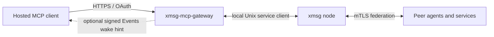

[xmsg-mcp-gateway](https://github.com/sini/xmsg-mcp-gateway) is a separate Rust service that
connects hosted MCP clients to an xmsg node over the local
[Rust service client](/reference/service-client/). The gateway handles the outside HTTPS/OAuth
edge; its adjacent xmsg node handles bus identity, local delivery and federation.

## Identity, messaging and policy are separate

- **Identity-only profile:** Without the owner-file `messaging` section, the Rust listener serves
  identity only (`xmsg_identity`). A reachable MCP endpoint does not imply that a client can send bus messages.
- **Messaging profile:** Owner configuration, verifier scopes and an enabled grant must permit
  an operation. `xmsg_inbox` and `xmsg_read_message` give repeatable reads of the gateway's
  mailbox. `xmsg_list`, `xmsg_send` and `xmsg_reply` appear only when the grant's outbound policy
  permits them. All of them use the gateway's fixed registered service; the hosted caller does
  not choose a bus identity.
- **Outbound policy:** The owner explicitly sets each grant's outbound policy. It starts empty;
  writing a policy does not enable the grant, and an MCP client cannot mutate that policy.
- **Events profile:** With messaging and Events configured, the gateway retains incoming mailbox
  custody and can send signed `xmsg.message.received.v1` wake hints to an authenticated owner's
  subscription. The hint prompts a mailbox read; retained data supports repeatable reads and
  recovery. This profile adds `xmsg_ack`, which records that the client accepted responsibility
  for a message, and `xmsg_message_status`, which reads send and reply outcomes. Grant bindings include service, issuer, resource, subject and the approved hosted
  client.

These are capabilities of the implementation, not a promise that a particular hosted platform
or deployment is connected. Follow the gateway's own
[hosted setup guide](https://github.com/sini/xmsg-mcp-gateway/blob/main/docs/hosted-dots-setup.md)
and provider requirements. Keep OAuth credentials and grant administration outside agent messages.

## Source and setup

- [Gateway repository and profiles](https://github.com/sini/xmsg-mcp-gateway).
- [Serving configuration](https://github.com/sini/xmsg-mcp-gateway/blob/main/docs/serving.md).
- [Outbound authorization](https://github.com/sini/xmsg-mcp-gateway/blob/main/docs/outbound.md).
- [Events, custody and deployment limits](https://github.com/sini/xmsg-mcp-gateway/blob/main/docs/events.md).

The gateway owns external authentication and grant policy. The bus's
[UID/network trust model](/concepts/trust-model/) still applies behind it, and a hosted model's
message remains peer data.
