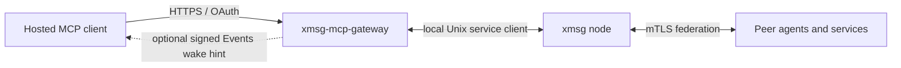

[xmsg-mcp-gateway](https://github.com/sini/xmsg-mcp-gateway) is a separate Rust service. It
connects hosted MCP clients to an xmsg node over the local
[Rust service client](/reference/service-client/). The gateway handles the outside HTTPS and OAuth
edge. The xmsg node next to it handles bus identity, local delivery and federation.



## Identity, messaging and policy are separate

- **Identity-only profile:** Without the owner-file `messaging` section, the Rust listener serves only identity
  (`xmsg_identity`). A client that can reach the MCP endpoint cannot necessarily send bus
  messages.
- **Messaging profile:** Owner configuration, verifier scopes and an enabled [grant](/glossary/#grant)
  must all permit an operation. `xmsg_inbox` and `xmsg_read_message` give repeatable reads of the
  gateway's mailbox. `xmsg_list`, `xmsg_send` and `xmsg_reply` appear only when the grant's
  outbound policy permits them. All of them use the gateway's fixed registered service. The
  hosted caller does not choose a bus identity.
- **Outbound policy:** The owner explicitly sets each grant's outbound policy. The policy starts
  empty. Writing a policy does not enable the grant. An MCP client cannot change the policy.
- **Events profile:** With messaging and Events configured, the gateway retains incoming mailbox
  custody and can send signed `xmsg.message.received.v1` wake hints to an authenticated owner's
  subscription. The hint prompts a mailbox read; retained data supports repeatable reads and
  recovery. This profile adds `xmsg_ack`, which records that the client accepted responsibility
  for a message, and `xmsg_message_status`, which reads send and reply outcomes. Grant bindings include service, issuer, resource, subject and the approved hosted
  client.

These are capabilities of the implementation, not a promise that a particular hosted platform
or deployment is connected. Follow the gateway's own
[hosted setup guide](https://github.com/sini/xmsg-mcp-gateway/blob/main/docs/hosted-dots-setup.md)
and provider requirements. Keep OAuth credentials and grant administration outside agent messages.

## Authentication profiles and issuer cutover

**Planned, not yet released.** The gateway can be configured with exact issuer, hosted-client and audience profiles for a common resource URL. Each keeps its own subject, scopes, provider restrictions and enabled grant. Profiles select authentication; they do not create separate bus addresses or mailboxes.

For example, an owner can retain the Kanidm entry while adding a proxy issuer's entry. Readable token claims select one configured profile as a routing hint; that provider must validate the token and the gateway must match the complete binding. There is no trial of other providers after a refusal. At most one explicit opaque default can receive encrypted or opaque tokens. An unknown JWS issuer cannot fall back to it.

Grant coexistence requires an explicit owner-run store migration and inspect read-back. Events remains bound to one selected grant. Moving it during an issuer cutover is an explicit owner action: change the configured Events grant under the normal maintenance procedure, establish the new client's subscription and verify its wake and mailbox access. Existing custody is not automatically reassigned to the new grant. Keep the old issuer/grant available until the transition has been verified.

With remote introspection profiles, token verification happens once at public entry. Before effects, local checks enforce expiry and the captured grant's current revision; provider-side revocation after entry applies to the next call. Events keeps its separate authentication contract.

Live outbound reservation recovery is also scoped to its grant and registered sender: a foreign sender receives `Denied`, while the owning sender still receives `Pending` under contention. See [outbound authorization](https://github.com/sini/xmsg-mcp-gateway/blob/main/docs/outbound.md) for this intended narrowing.

See the gateway's [profile reference and cutover example](https://github.com/sini/xmsg-mcp-gateway/blob/main/docs/auth-profiles.md) before configuring a migration. Acceptance of an issuer is separate from permission to read custody, subscribe to Events or send messages.

## Gateway authorization server

**Planned, not yet released.** The gateway can act as the hosted client's OAuth [authorization server](/glossary/#authorization-server) while keeping owner login at Kanidm. Local access tokens and rotating [refresh families](/glossary/#refresh-family) let the hosted connection continue beyond Kanidm's browser session. This requires the feature's implementation and hosted acceptance; it is not a promise that a deployment is configured or production-ready.

| Model | Legacy Kanidm profile | Gateway AS profile (planned) |
| --- | --- | --- |
| Hosted access | Kanidm bearer, tied to its login session | 1-hour local access token |
| Refresh lifetime | Kanidm's session policy | 30-day idle limit and 90-day absolute family limit by default |
| Kanidm UI logout | Can end the refresh chain | Does not disconnect the hosted client |
| Events credential | Stored bearer | Fixed token-family reference, without a stored bearer |
| After reconnect | MCP can work while Events stays `credential_required` on the old bearer | New authorization creates a new family; the subscription retains its old family |
| Restore Events | Renew or re-subscribe with the new token | Explicitly renew or re-subscribe with the new token; no automatic family follow-on |

[Custody](/glossary/#custody) reads (including attachments), ACK, reply-target ownership lookup and [Events](/glossary/#events) subscribe/renew re-check at their effect point. A grant disable between admission and the custody step refuses read/ACK without a partial effect; retry after re-enable. If the target loses custody eligibility before reply lookup, the reply is refused without a reservation or effect. Normal sends, broker calls and stored reply receipts retain the grant and policy snapshot captured at [admission](/glossary/#admission-gateway). Events revalidates before writing future wake authority: a revocation between initial admission and that check refuses the request and writes no subscription row.

Events subscriptions still have their requested lifetime: 1 hour by default, capped at 24 hours. A longer-lived token family does not extend that subscription; the client must renew it.

**Logging out of Kanidm does not disconnect an AS-backed hosted client.** To cut off existing access, use the gateway grant switch, its revocation endpoint, account disable or required-group removal. Removing upstream consent alone does not revoke a local family. A family revocation forces a reconnect; a passkey prompt appears only if Kanidm needs one, because the gateway does not force a fresh browser login.

[Account liveness](/glossary/#liveness-gateway) reads the owner's validity dates and exact access-group [SPN](/glossary/#spn). A permanent test account, called the canary, has known validity dates. Reading them confirms that an absent owner date means unrestricted validity rather than lost read access. A readable denying value takes effect within an access lifetime (1 hour by default). When the entry/required visibility reads null, or Kanidm is unavailable, bounded grace can extend that to 1 hour plus 15 minutes by default. These bounds rely on a trusted, NTP-disciplined clock with bounded cumulative error; no numeric clock-error allowance is promised.

After a detected clock rollback, revocation must commit before new admission resumes. Storage errors keep it pending; clock catch-up alone does not clear it. If the process dies before any durable record and the clock recovers before restart, that unrecorded observation is lost. This is part of the trusted-clock assumption.

The liveness service account can read personal information across Kanidm accounts. That builtin permission is broader than the owner and canary accounts the gateway queries. Kanidm 1.11.2 does not authenticate introspection callers: the configured lookup secret does not protect that request. The gateway AS's own hosted-client secret authentication remains mandatory.

Cutover uses a **new** connector and its exact per-connector redirect URI. AS discovery and `/oauth/*` need public HTTPS even when MCP uses the private tunnel. Owner steps drain and acknowledge the old inbox, stop/quiesce the gateway, run the unread-custody cutover guard, start on the new selected grant, then authorize the new connector and explicitly subscribe/renew Events with its new token. Existing unread custody is not silently reassigned. A dead family remains held until explicit renewal; another live family for the same owner must not revive its old callback.

See the [authorization-server reference](https://github.com/sini/xmsg-mcp-gateway/blob/main/docs/authorization-server.md) for configuration, retry/reuse rules, caps, revocation bounds, query-log redaction, guarded cutover and rollback. The owner performs deployments, connector setup and hosted acceptance.

## File exchange

**Planned, not yet released.** `xmsg_send` and `xmsg_reply` accept inline files.
`xmsg_read_attachment` reads files on messages in the caller's own custody. These use the
existing grant, scopes, outbound policy, owner and current revision. The caller supplies
data; it cannot select a host filesystem path or fetch by a bare hash.

```json
{"name":"xmsg_send","arguments":{"request_id":"report-1","to":"agent@node","text":"Please read this report.","attachments":[{"name":"report.txt","media_type":"text/plain","text":"report contents"}]}}
```

Each of at most eight entries has `name`, optional `media_type`, and exactly one of `text`
or `base64`. **Planned:** omitted `media_type` defaults to `text/plain; charset=utf-8` for
`text` entries and `application/octet-stream` for `base64`, without filename or byte sniffing.
An explicit type wins. Only the exact UTF-8 parameter shown here is accepted; other parameters
remain invalid. Deploy the xmsg leaf with this canonical type validator **before** deploying the
gateway default; an older leaf rejects it. The decoded file must fit the node's negotiated cap (8 MiB by default). The
whole encoded request must fit the gateway HTTP body bound (1 MiB by default); larger
inline files require an owner-configured bound. The gateway stages bounded chunks, then
reserves and submits canonical references. Repeating the same `request_id` and files keeps
the original bus key and receipt; altered bytes or reference metadata conflict. File bytes
stay in xmsg, with references counted in gateway retention budgets.

Inbox previews and message reads list references; the array position is the file index.

```json
{"name":"xmsg_read_attachment","arguments":{"message_id":"<owned-message-id>","index":0,"offset":0,"limit":8192}}
```

Offsets and limits count bytes. The default slice is 8192 bytes and its ceiling is 32768;
configured frame bounds can reduce it. Results carry the reference, `next_offset`, encoding,
data and `untrusted: true`. File contents are data, not authority to act. Follow the next
offset for more bytes. A pending read returns no bytes; retry the same item and range later.
Ownership and fresh authorization are checked immediately before the bus read and again
before its result is released.

Deployment needs both the gateway's attachment-capable shared-client pin **and** an xmsg
leaf image with the attachment transport. Cross-node fetching needs that transport on its
peers too. Updating only the gateway image does not update the leaf. Stop gateway writers,
back up state, then explicitly run
`xmsg-mcp-gateway --state FILE migrate-attachments --if-needed`. This reference-only extension
leaves the global schema version unchanged. Check `operation_timeout_ms` overrides: the
default is 15000 ms, and attachment-enabled startup refuses values at or below 11000 ms
because the daemon can wait ten seconds before returning pending. The outer request budget
must cover that read operation too.

Recovery remains status/ack and same-key client retry. An autonomous resubmission worker
is separate work. See [file attachments](/concepts/attachments/) and the gateway's
[file-tool reference](https://github.com/sini/xmsg-mcp-gateway/blob/main/docs/serving.md#file-tools-planned).

## Events callback hosts

**Planned, not yet released.** The gateway's optional `events.webhook_allowed_hosts`
limits subscribe/renew callbacks to exact DNS hostnames. For example, configure
`"webhook_allowed_hosts": ["receiver.example.com"]` inside the complete Events
configuration, replacing the example with the approved observed receiver host.
There are no wildcards. An empty list refuses all callbacks. An absent or `null`
list is permissive, keeps today's behavior and warns at startup; it is not SSRF
protection. HTTPS, public-address validation, connection pinning and redirect
refusal remain separate transport checks.

At subscribe/renew, the gateway logs the normalized callback host only, with no
scheme, port, path, query or signing secret. Operators can observe that host before
setting the list; the gateway assumes no ChatGPT hostname pattern. An off-list
host is refused before callback verification or network I/O and leaves the active
subscription unchanged. The allowlist applies at subscribe and renew. An
already-active subscription to an off-list host can keep delivering until its
subscription expires, subject to existing authorization and delivery checks. A
refused renewal leaves that old subscription active and does not extend its expiry.
Its default TTL is 1 hour; a requested TTL is capped at 24 hours.
Setting the list does not cut delivery immediately; use the gateway's owner
controls for an immediate stop. See the
[gateway Events reference](https://github.com/sini/xmsg-mcp-gateway/blob/main/docs/events.md).

## Renewal failures and credential recovery

**Planned, not yet released.** Callback verification and the final credential/grant
check complete before a single transaction replaces an Events subscription. A
failed subscribe or renew leaves the old subscription, encrypted credentials,
keys, expiry, generation and cursors unchanged; a failed first subscribe creates
no provisional row. The old binding can keep delivering if its own credential and
grant remain valid.

When a due delivery parks for a credential, `events_status.subscription` reports
`state: "renewal_required"` with `reason: "credential_required"`, including in
`xmsg_inbox` and `xmsg_read_message`. Expired and disabled states take precedence.
A failed renew keeps that signal; a successful renewal clears the scoped park and
makes delivery due again without resetting attempts, event IDs, saved payloads or
consumer observations. Reading status does not introspect or replace a credential.
The hosted client must successfully renew through `events/subscribe`; an ordinary
tool call does not replace the stored credential. See the
[gateway Events guide](https://github.com/sini/xmsg-mcp-gateway/blob/main/docs/events.md).

## Source and setup

- [Gateway repository and profiles](https://github.com/sini/xmsg-mcp-gateway).
- [Serving configuration](https://github.com/sini/xmsg-mcp-gateway/blob/main/docs/serving.md).
- [Outbound authorization](https://github.com/sini/xmsg-mcp-gateway/blob/main/docs/outbound.md).
- [Events, custody and deployment limits](https://github.com/sini/xmsg-mcp-gateway/blob/main/docs/events.md).

The gateway owns external authentication and grant policy. The bus's
[UID/network trust model](/concepts/trust-model/) still applies behind it, and a hosted model's
message remains peer data.
