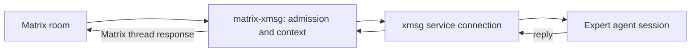

[matrix-xmsg](https://github.com/sini/matrix-xmsg) connects Matrix support rooms to a dedicated
expert agent session behind xmsg. It registers with the bus as the `matrix-xmsg`
[service](/glossary/#service). xmsg messages and replies carry the conversation.

## A bridge, with its own admission policy

The bridge handles these tasks: room and sender admission, mention and thread triggers, size and
rate limits, context assembly and response placement. It has a trusted admission mode and a
public admission mode. Public-room content carries sender and tier provenance. A Matrix user's
text does not become an authorized local instruction only because the bridge delivered it.

The attested bus sender identifies the bridge service. The bridge's envelope identifies the
Matrix participants and the context inside that message. Configure the bridge's outside-facing
security and the expert's permissions with care. xmsg does not authenticate individual Matrix
accounts.

For triggers, admission modes, guard integration, encryption and deployment, read the
[Matrix bridge README](https://github.com/sini/matrix-xmsg#readme) and its
[configuration sources](https://github.com/sini/matrix-xmsg/tree/main/src).
See also [provenance versus authority](/concepts/trust-model/#provenance-is-not-instruction-authority).
