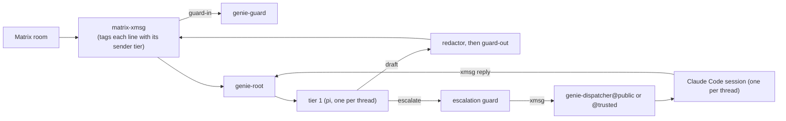

import { Aside, CardGrid, LinkCard } from '@astrojs/starlight/components';

[`genie-agent`](https://github.com/sini/genie-agent) is the support agent behind the `@genie` bot
in Matrix. People ask it questions about Nix, NixOS, den and the gen libraries, often in public
rooms. It answers in the thread.

Genie is built on xmsg. Each of its parts is a separate process. Each part registers on an xmsg
bus as a [service](/concepts/sessions-services-subagents/#services-namenode). The parts send xmsg
messages and [replies](/concepts/replies/) to each other.

## Terms used in these pages

| Term | Meaning |
|---|---|
| **Matrix bot** | [`matrix-xmsg`](https://github.com/sini/matrix-xmsg), a separate program. It reads the Matrix room, decides which messages to forward, and posts genie's answers back. |
| **Sender tier** | `trusted` or `public`. The Matrix bot computes it from the authenticated Matrix sender id: senders on its trusted list are `trusted`, everyone else is `public`. Message text never sets it. |
| **Thread tier** | The lowest sender tier among everyone whose text is in the thread. One public line makes the thread public. |
| **Guard** | A separate model session that screens text. `guard-in` screens text coming in; `guard-out` screens answers going out. See [Guard model](/genie/guard-model/). |
| **Redactor** | Deterministic code (no model) that removes credential-shaped strings from anything genie posts. |
| **Tier 1** | The first answering model. It runs as one [pi](/harnesses/pi/) process per thread against a local, OpenAI-compatible model endpoint. |
| **Expert tier** | A stronger model (Claude Code) that tier 1 can escalate to. There are two experts, `@public` and `@trusted`, chosen by the thread tier. |
| **Root** | `genie-root`, the composition root. It owns tier 1's processes, the thread state, the credentials and every call to the guards. |
| **Dispatcher** | `genie-dispatcher`, one per expert tier. It receives escalations over xmsg and runs one Claude Code session per thread. |
| **Broker** | The only component holding the GitHub token. Models ask it for gists and pull requests by proposal; they never hold the token. |

## The flow of one question

1. Someone mentions `@genie` in a room. The Matrix bot admits the message, tags every line with
   its sender's tier, and sends it to `genie-guard` for review.
2. The bot forwards the reviewed text to `genie-root` over xmsg. Root reads the tiers from the raw
   envelope and sets the thread tier. If the bot did not already screen the text, root sends it to
   the guard itself.
3. Root finds or starts the thread's tier-1 process. Tier 1 reads public sources. It can
   evaluate a Nix configuration in a sandbox. It writes a draft: an answer, a confidence between
   0 and 1, and a list of gaps.
4. Root runs the redactor over the draft, then sends the redacted text to `guard-out`. Only a
   passed draft is posted, with its confidence line.
5. Root escalates in three cases: the draft's confidence is low, a hard trigger fires, or the
   asker reacts 🔍 (or types `!deeper`). Root builds an escalation package and screens its
   untrusted parts. It sends the package over xmsg to the expert that the thread tier selects.
   The expert's answer returns as an xmsg reply. It passes the redactor and `guard-out`. Then the
   bot posts it, marked "expert review".
6. The asker reacts ✅ to accept. The thread closes after acceptance or 24 hours idle.

## What genie will not do

- It **evaluates** Nix configurations; it never builds them on the untrusted path.
- It never asks anyone for a secret. When a secret blocks an evaluation, it stubs the secret or
  says what the secret blocked.
- No model holds a credential. The model key, the GitHub token and the expert tokens stay with
  the processes that need them.
- No model decides trust. Tiers come from Matrix authentication, never from text or a tool
  argument.

<Aside type="note" title="Built and planned">
These pages describe the code on genie-agent's `main` branch. Where the design describes
something the code does not yet do, the page says **planned**.
</Aside>

## Read next

<CardGrid>
  <LinkCard title="Install & configure" href="/genie/install-and-configure/" description="Packages, the NixOS module, and the settings that matter." />
  <LinkCard title="Guard model" href="/genie/guard-model/" description="What is screened, where, what happens on refusal, and what the guard does not cover." />
  <LinkCard title="Tiers & experts" href="/genie/tiers-and-experts/" description="Tier 1, escalation, the dispatcher and the two expert tiers." />
  <LinkCard title="Credentials & isolation" href="/genie/credentials-and-isolation/" description="Who holds which credential, the sandboxes, and the portable fallback." />
  <LinkCard title="Operations" href="/genie/operations/" description="Thread lifecycle, limits, failure behaviour and memory admission." />
  <LinkCard title="Case study" href="/case-studies/genie-agent/" description="Why genie is shaped this way, and what went wrong on the way." />
</CardGrid>
