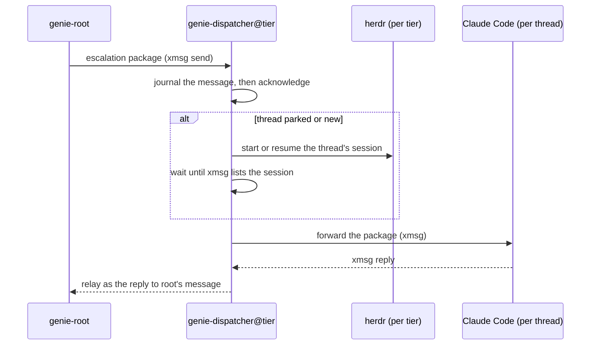

import { Aside } from '@astrojs/starlight/components';

Genie answers in two stages. **Tier 1** is a local model that fields every question. The
**expert tier** is a frontier model that tier 1 escalates to when it is unsure, or when the asker
asks for it. The two stages are separate programs, joined by xmsg.

## Trust tiers

Every line the Matrix bot forwards carries its sender's tier, computed from the authenticated
Matrix sender id:

- `trusted`: the sender is on the bot's trusted list (`trusted_mxids` or `owner_mxid`).
- `public`: any other admitted sender.

Root reads the tiers from the raw envelope **before** the guard sees it. It records the
**thread tier**: the lowest tier among the senders whose text is in the thread. A thread becomes
public the moment a public sender's text enters it. Only a trusted sender typing `!trust` in the
thread raises it again. Text, a tool argument or a guard rewrite can never change the tier.

Each capability that depends on trust reads the thread tier from root's state:

| Capability | Public thread | Trusted thread |
|---|---|---|
| Evaluation | Pure eval, import-from-derivation (IFD) off | May request the trusted path (IFD on remote builders, if configured) |
| Escalation | `genie-expert@public` | `genie-expert@trusted` |
| Expert memory | `experts.public.memoryDir`: the curated support memory | `experts.trusted.memoryDir`: by design the owner's private memory; the module's default is the support memory |

## Tier 1

Tier 1 is one [pi](/harnesses/pi/) process per thread, started by root. Each thread gets its own
process and context, so a fact from one thread does not reach another. The model is any
OpenAI-compatible endpoint (`model.baseUrl`, `model.id`).

### Tools

Tier 1 has no shell. Its tools are:

| Tool | What it does |
|---|---|
| `eval` | Evaluates one attribute of one repository at one revision, in a sandbox. Returns `{exit, stdout_tail, stderr_tail, limit_hit}`. |
| `recall` | Searches genie's curated memory banks. |
| `clone`, `read`, `grep`, `find`, `ls` | Clone a public repository into the thread's worktree and read it. |
| `git`, `gh_read` | Read-only `git` queries, and reads of public GitHub issues, pull requests, runs and gists. |
| `web_fetch`, `web_search` | Fetch a public URL, or search through a configured SearXNG. Internal addresses are refused. Results pass `guard-web` before tier 1 sees them. |
| `room_context` | Fetch more of the current room: recent messages, one event, or a thread. The bot binds the room; tier 1 cannot pick another. |
| `escalate` | Hand the thread to the expert tier. |
| `propose` | Ask the broker for a gist or pull request. |
| `reply` | Post a draft. |

### The eval trust clamp

`eval` takes a `trusted` argument, but that argument is only a **request**. Root runs a trusted
evaluation only when the request is set **and** the thread tier is trusted. A model can lower
trust but never raise it.

On a public thread, a request for a trusted evaluation is refused. Root then posts an approval
request. If a trusted sender approves it, root runs that one evaluation once with trusted
capability. The thread tier does not change.

### Drafts and escalation

Tier 1's `reply` takes a draft, in the shape of
[`schemas/draft.json`](https://github.com/sini/genie-agent/blob/main/schemas/draft.json):

```json
{
  "answer": "Set `den.aspects.<name>.includes` ...",
  "confidence": 0.62,
  "gaps": ["did not evaluate the user's flake"],
  "escalate_forced": false
}
```

Root posts a passed draft with its confidence and gaps, then decides whether to escalate:

- **Hard triggers** set `escalate_forced`. Tier 1 sets it when an evaluation reproduced an error
  it cannot explain, when the answer needs code it cannot read, when the question goes beyond its
  skills, or when the user asked for the expert.
- Otherwise a **confidence below 0.8** escalates.
- Otherwise the thread escalates only if the asker (or a trusted sender) reacts 🔍 or types
  `!deeper`. A 🔍 from anyone else is ignored.

The asker always gets tier 1's answer first. The expert's answer follows in the same thread,
marked "expert review".

## The escalation package

Root builds the package from its own record of the thread: the cleaned question, the draft, the
gaps, and transcripts of the evaluations and reads tier 1 made. Tier 1 cannot write the
destination or the thread id.

Before the package leaves, root screens the parts that carry untrusted text: evaluation output,
and any `git` or GitHub read output that was not already screened. Each piece is screened in a
fresh guard session. If any piece is refused, nothing is sent.

Root then picks the destination from the thread tier, and from nothing else. A state that is not
exactly `trusted`, or no state at all, routes to `@public`. The package is sent with an xmsg
[idempotency key](/concepts/replies/#idempotency-idempotency_key): the thread plus the draft's
sequence number. A repeated 🔍 or a retry after a lost response therefore delivers nothing new.

## The expert dispatcher

Each expert tier runs one resident `genie-dispatcher@<tier>`. It registers on its xmsg bus as a
[service](/concepts/sessions-services-subagents/#services-namenode), `genie-expert`, attested by
its executable and its user id. Root addresses it as `genie-expert@<node>`.



- **One session per thread.** Each escalated thread is its own interactive Claude Code session,
  in a pane of the tier's herdr session. herdr is a terminal-session manager. It can start, close
  and resume agent panes. The dispatcher keeps a map from thread id to session id.
- **Messages go over xmsg; herdr only manages lifecycle.** herdr starts, parks and resumes
  sessions. The end of a turn is the session's xmsg reply, not a herdr state.
- **A journal survives restarts.** The dispatcher writes each message to a journal before it
  acknowledges it to xmsg. On start, it reconciles the journal against herdr and xmsg, so a
  restart loses no message and no reply.
- **Park and resume.** A thread with no outstanding message is parked after an idle threshold:
  its pane closes, and the conversation stays resumable. A message to a parked thread is
  buffered, the session is resumed with `--resume`, and buffered messages are delivered in order
  once xmsg lists the session.
- **Reply timeout.** A turn with no reply in time ends as "expert unavailable". A late reply is
  dropped, not posted.
- **96 hours idle.** The transcript is handed to the archiver and the entry is removed. A later
  escalation of that thread starts fresh from its package.

### Tiers only drop

Each dispatcher holds only its own tier's map. A thread that falls from trusted to public is
routed to `@public`, which has never seen it, so it starts fresh from the guarded package. It
never returns to `@trusted`. A trusted expert reply that `guard-out` blocks is dropped from the
thread, so it cannot reach `@public` through a later package either.

### Expert tokens

Each tier authenticates with its **own** Claude subscription token, created with
`claude setup-token`, never with an API key. The token file is named by
`experts.<tier>.tokenEnvironmentFile`. How the token reaches the session without entering a model
context, an argv or a shared environment is on
[Credentials & isolation](/genie/credentials-and-isolation/#expert-tokens).

When a tier's token runs out of quota, that tier answers "expert unavailable". Nothing falls back
to another token or tier.

<Aside type="note" title="Planned: token pools">
The design gives each tier a pool of tokens: contributors' tokens for `@public`, and the owner's
token under a daily cap on public escalations. Each thread would stay pinned to the token it
started on. The dispatcher today takes one token per tier; the pool is **planned**.
</Aside>

<Aside type="note" title="Planned: reply-only MCP in expert sessions">
xmsg has a reply-only MCP mode (`xmsg mcp --reply-only`, see
[CLI & MCP](/reference/cli-and-mcp/#xmsg-mcp)), which offers only `reply` and `replies`, with no `list` and no `send`. The design runs every
expert session in that mode. The NixOS module currently starts the plain `xmsg mcp`; the switch
is **planned**.
</Aside>
