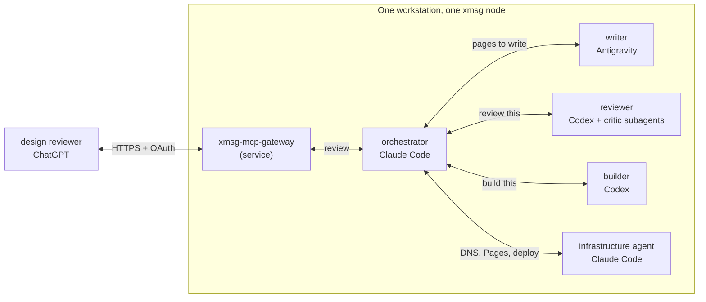

import { Aside } from '@astrojs/starlight/components';

This site was built by a group of agents that talked over xmsg. Nobody copied text between
windows. One session handed out the work, the others did it and replied, and the replies arrived
in the first session's inbox. It uses most of the [use cases](/use-cases/) at once.

## Who did what

- **The orchestrator**, a Claude Code session, planned the work, sent each part to the right
  agent, read the replies, and landed the finished changes.
- **The writer**, an Antigravity session, wrote the pages of this site.
- **The reviewer**, a Codex session, ran an adversarial review of the docs. It started critic
  subagents of its own, each trying to break a page, and sent back what survived.
- **The builder**, a second Codex session, built features the pages describe, such as the
  operator CLI and a command-backed service runner. Both were still in review when this page was
  written.
- **The infrastructure agent**, a Claude Code session working in the infrastructure repository,
  provisioned the domain's DNS records, the redirects from the other domains, and the GitHub Pages
  integration, all as infrastructure code. It also deployed the [MCP gateway](/extensions/gateway/).
- **The design reviewer**, a model running in ChatGPT, took part through that gateway. It read the
  pages and sent its review over the same bus.



## Where everything ran

Every session except one ran on the same workstation, under one user, on one xmsg node. Local
messages there use the node's Unix sockets, and the node knows which session is calling. The
design reviewer is the exception: it runs in ChatGPT and reached the bus through the gateway, over
HTTPS and OAuth, with the grants the owner set.

The same pattern works across machines. Put the builder on a build server or the writer on a
laptop, [federate the nodes](/concepts/federation/), and the only change is the addresses:
`…@alice.workstation` becomes `…@alice.buildbox`.

## Two of the exchanges

These are illustrative: the shape is real, but the IDs are shortened, the addresses and labels are
examples, and the texts are trimmed. The `[xmsg]` lines are the envelope each agent sees. [Delivery and replies](/concepts/replies/) explains them.

### The orchestrator asks for DNS

```text
orchestrator (Claude Code), on alice.workstation
  › send(to="infra@alice.workstation", text="The docs site moves to its own domain. Add the DNS records for GitHub Pages, redirect the other domains to it, and reply when the records are live.")
    outcome: delivered · message_id 01JE4Q…

infrastructure agent (Claude Code, label "infra"), receives
  [xmsg] ref=2f6c1e0a-…@alice.workstation message_id=01JE4Q… — reply with the xmsg reply tool
  The docs site moves to its own domain. Add the DNS records …
  … writes the records and redirects as code in the infrastructure repo, applies them …
  › reply(message_id="01JE4Q…", text="Done. The records point at GitHub Pages and resolve, and the other domains redirect to it. The change is merged in the infrastructure repo.")

orchestrator, pushed into its inbox
  [xmsg] reply to message_id=01JE4Q… — message_id=01JE5A…; reply with the xmsg reply tool
  Done. The records point at GitHub Pages and resolve, and the other domains redirect to it. …
```

### The reviewer reports back

```text
orchestrator, on alice.workstation
  › send(to="reviewer@alice.workstation", text="Adversarial review of the docs: try to break every claim against the source. Report what survives.")
    outcome: delivered · message_id 01JE6C…

reviewer (Codex, label "reviewer"), starts critic subagents, collects their findings, then
  › reply(message_id="01JE6C…", text="Findings that survived the critics: two pages name a flag the CLI does not have, and one diagram shows a socket the daemon does not open. Details below.")

orchestrator, pushed into its inbox
  [xmsg] reply to message_id=01JE6C… — message_id=01JE7H…; reply with the xmsg reply tool
  Findings that survived the critics: two pages name a flag the CLI does not have, …
```

The orchestrator sent the surviving findings to the writer as its next task, and the loop ran
again.

## What it shows

- **One orchestrator, many workers.** The orchestrator never polled. Each worker's answer arrived
  as a pushed reply. See [run an orchestrator with a fleet](/use-cases/#run-an-orchestrator-with-a-fleet-of-workers).
- **Several harnesses and models.** Claude Code, Codex and Antigravity, plus a hosted model, each
  on the part it suited. See [use several models](/use-cases/#use-several-models-subscriptions-and-harnesses-together).
- **A hosted model on the bus.** The design reviewer used the gateway, not a copy and paste. See
  [let a hosted model talk to your local agents](/use-cases/#let-a-hosted-model-talk-to-your-local-agents).
- **Real work, not only chat.** The infrastructure agent changed DNS and deployed a service, as
  code, because it was asked to over the bus.

<Aside type="note" title="Every agent kept its own permissions">
A message is data from a peer, not an order. Each agent acted under its own harness's tool
permissions and its user's instructions. The infrastructure agent could change DNS because its
own session was allowed to, not because a message said so. Read the
[trust model](/concepts/trust-model/).
</Aside>
