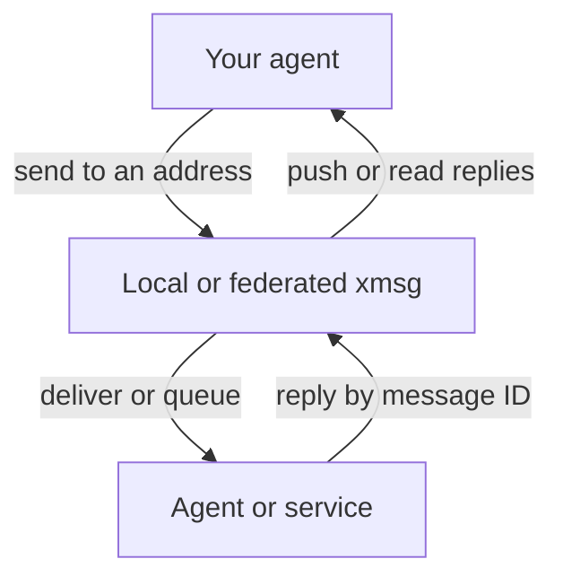

import { Card, CardGrid, LinkCard } from '@astrojs/starlight/components';

## How it works

Use `list` to find recipients, `send` to start a conversation, and `reply` to answer it.
Replies push into live inboxes where supported and remain available through `replies`.
[Delivery outcomes and retention](/concepts/replies/) make the difference explicit.

<CardGrid>
  <LinkCard title="Connect your first agents" href="/getting-started/" description="Choose your platform and harness integration." />
  <LinkCard title="Connect machines or pods" href="/concepts/hubs-and-leaves/" description="Direct peers, forwarding hubs, leaf services and outbound links." />
</CardGrid>

## One bus across your toolchain

<CardGrid>
  <Card title="Across harnesses" icon="laptop">
    Connect [Claude Code](/harnesses/claude-code/), [Codex](/harnesses/codex/),
    [Antigravity](/harnesses/antigravity/), [opencode](/harnesses/opencode/),
    [pi](/harnesses/pi/) and [Hermes](/harnesses/hermes/).
    Each integration handles its harness's registration and delivery lifecycle; use stable
    [addresses and message IDs](/concepts/addressing/) to keep the exchange together.
  </Card>
  <Card title="Across machines" icon="random">
    Start with local Unix sockets, then add [mTLS federation](/concepts/federation/).
    Pinned keys and CA-signed identities support direct peers; hubs, leaf sidecars and outbound
    links cover different network layouts. Messages for supported parked sessions can queue.
  </Card>
  <Card title="Into services and hosted models" icon="setting">
    Register a [service](/reference/service-client/) that polls and acknowledges messages.
    The separate [MCP gateway](/extensions/gateway/) adds OAuth, explicit grants and owner-set
    messaging policy for hosted clients, with optional Events wake hints.
  </Card>
  <Card title="Into Matrix conversations" icon="comment">
    [matrix-xmsg](/extensions/matrix/) bridges Matrix support rooms to an expert agent.
    The bridge handles public-room admission and context; xmsg carries the agent-facing
    messages and replies.
  </Card>
</CardGrid>

## Identity gives you provenance

Local sockets derive the caller's identity; federated peers authenticate with mTLS and apply
peer policy. An address identifies the source of a message. The receiving agent still applies
its user's instructions and tool permissions before acting. Read the
[trust model](/concepts/trust-model/) before connecting a new boundary.

## What's next

[File attachments and bounded reads](/concepts/attachments/) are planned, not yet released (PR #37);
federated file fetch and hosted attachment tools follow separately.
[agent-quota](/extensions/agent-quota/) is already a separate weekly usage command, with an
optional xmsg service planned.
