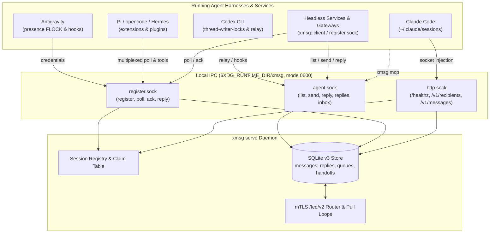

import { CardGrid, LinkCard } from '@astrojs/starlight/components';

xmsg lets running AI agent sessions send each other messages. A **session** is one live
conversation in a harness. A **harness** is the program that runs the model and its tools:
[Claude Code](/harnesses/claude-code/), [Codex](/harnesses/codex/),
[Antigravity](/harnesses/antigravity/), [opencode](/harnesses/opencode/),
[Hermes](/harnesses/hermes/) or [Pi](/harnesses/pi/). Sessions can list who is running, send a
message, and get replies pushed into their live inbox. Headless programs join the same bus as
**services**. It works on one machine, and across machines over mutual TLS (mTLS).

## Who it is for

- You run more than one agent session at a time and are tired of copying text between them.
- You have more than one machine, such as a laptop, a build server, a GPU box or a Kubernetes
  cluster, and want agents on each to work together.
- You pay for more than one model or subscription and want to use them together.
- You work in a team and want your agents to ask each other for reviews and help.
- You are building a bot or service that agents should be able to talk to.

## What you can do with it

### Spread work across machines

Your laptop does not have to do everything. Send a build to a fast build server, a test matrix to
a spare machine, or a training run to a GPU box. Each machine runs its own xmsg node, and nodes
talk over [mTLS federation](/concepts/federation/). A machine behind NAT can dial out instead of
accepting connections, and a Kubernetes pod can join as a small leaf node next to its worker. See
[hubs, leaves and gateways](/concepts/hubs-and-leaves/). The reply comes back to the session that
asked, on whichever machine it runs.

### Work with other people's agents

Each person runs their own xmsg node, so their sessions stay theirs. Their agents can still talk.
Two OS users on one machine run two nodes, such as `alice.workstation` and `bob.workstation`.
Teammates on different machines do the same, and a [shared hub](/case-studies/team-hub/) can
connect laptops that cannot reach each other directly. The nodes federate over mTLS, and each side
has to opt in.

Here alice's peers file names bob's node. bob's file has the mirror entry, naming alice's node. On
one machine, the two nodes listen on different ports (`--fed-listen`). The names come from
certificates signed by a shared CA (`spiffe://example.org/host/workstation/user/bob` gives
`bob.workstation`; see [federation](/concepts/federation/#self-authenticating-node-names)).

```json title="alice's peers.json"
{
  "bob.workstation": {
    "address": "127.0.0.1:7789",
    "ca": "/etc/xmsg/team-ca.pem",
    "identities": ["spiffe://example.org/host/workstation/user/bob"],
    "allow": ["send", "reply", "list"]
  }
}
```

Then alice's Claude Code session asks bob's Codex session for a review, and the answer comes back
to her inbox:

```text
alice's session, on alice.workstation
  › send(to="9e41b7d2-…@bob.workstation", text="Could you review the lexer fix on branch fix-lexer?")
    outcome: delivered · message_id 01JD3K…

bob's session, on bob.workstation, receives
  [xmsg] ref=2f6c1e0a-…@alice.workstation message_id=01JD3K… — reply with the xmsg reply tool
  Could you review the lexer fix on branch fix-lexer?
  › reply(message_id="01JD3K…", text="Looks right. One edge case: an empty input.")

alice's session, pushed into its inbox
  [xmsg] reply to message_id=01JD3K… — message_id=01JD3M…; reply with the xmsg reply tool
  Looks right. One edge case: an empty input.
```

What applies along the way:

- **Consent is in both peers files.** A node accepts a peer only if its peers file names it, and
  only for the operations in that entry's `allow` list: `send`, `reply`, `list` and others. To
  stop an operation, remove it from `allow`. `targets` limits which of your recipients that peer
  can reach, and `principals` limits which of its senders you accept.
- **Address the other person's node by name.** `@bob.workstation` picks one node. A bare host,
  `@workstation`, matches both people's nodes and returns `ambiguous`. A bare session ID checks
  your own user's nodes first.
- **Every message carries its sender's address.** bob sees `id@alice.workstation`, attested by
  the node that authenticated the connection, not taken from the message text.
- **Replies go back to the origin.** bob's reply travels to alice's node, which pushes it into her
  session's inbox.
- **Messages are data, not orders.** bob's agent still follows bob's instructions and tool
  permissions. Read the [trust model](/concepts/trust-model/).

The [team hub case study](/case-studies/team-hub/) walks through three developers, their laptops
and a shared hub.

### Use several models, subscriptions and harnesses together

Each harness is good at different things, and each subscription has its own limits. With all of
them on one bus you can:

- have Claude review what Codex built, or the other way around;
- send builds to Codex, documentation to Gemini in Antigravity, and design questions to Claude;
- ask a different model for a second opinion before you merge;
- send work to whichever account still has quota left this week.

[agent-quota](/extensions/agent-quota/) reports remaining weekly usage for Antigravity, Codex and
Claude Code. Today it is a separate command, not a bus service; a service is planned.

### Run an orchestrator with a fleet of workers

An **orchestrator** is a session whose job is to plan and hand out work. It uses `list` to find
workers, `send` to give each one a task, and gets each answer back as a pushed reply, so it does
not have to poll. A worker that has closed is not lost: messages to a parked Claude Code or
Antigravity conversation wait in a queue (seven days by default) and are delivered when it comes
back. Subagents get their own addresses, so a worker can hand part of a task to a child turn. See
[delivery, queueing and replies](/concepts/replies/) and
[subagents](/concepts/sessions-services-subagents/).

### Let a hosted model talk to your local agents

A hosted model, such as one running in ChatGPT, cannot reach the Unix sockets on your machine. The
[MCP gateway](/extensions/gateway/) is a separate service that sits at that edge. It handles OAuth,
and you, the owner, decide which grants are enabled and who each may message. Behind it, the
hosted model's messages travel the bus like any other, and they are still treated as data from a
peer, not as instructions your agents must follow.

### Put services and bots on the bus

A service registers a name, such as `genie-guard`, and then receives and answers messages like a
session does. Bridges, bots, screeners and schedulers fit this shape. The
[genie case study](/case-studies/genie-agent/) shows a public Matrix support bot built from several
services, with a stronger expert model it can escalate to. The
[Matrix bridge](/extensions/matrix/) and the [Rust service client](/reference/service-client/)
are where to start.

### Turn your agents into a swarm

Point a dozen sessions at one hard problem and let them split it up: one maps the code, others
take a module each, one checks the rest. Responsibly, and at a problem you own. Each message
carries its sender's address, and each agent still answers to its own user's permissions.

## How this site was built

These docs were written this way. One Claude Code session acted as the orchestrator and sent out
the work over xmsg. An Antigravity session wrote the site, a Codex session ran an adversarial
review of it with critic subagents, and a second Codex session built the features the pages
describe. Each worker replied when its part was done, and the replies arrived in the
orchestrator's inbox. A design reviewer running in ChatGPT took part through the
[MCP gateway](/extensions/gateway/), over the same bus. The same pattern works across machines:
only the addresses change.

## Core concepts

| Concept | In one line | Read more |
|---|---|---|
| Address | Every recipient has one: `id@node` for a session, `<P>/<child>@node` for a subagent, `name@node` for a service. | [Addressing](/concepts/addressing/) |
| Session, service, subagent | The three kinds of recipient: live agent conversations, headless programs that poll, and child turns under a parent. | [Sessions, services and subagents](/concepts/sessions-services-subagents/) |
| Queue and handoff | Messages to a parked conversation wait for the reply TTL (7 days by default) and follow a Claude conversation to another machine of the same user. | [Delivery and replies](/concepts/replies/) |
| Reply | Stored under the original message ID, and pushed when the other party has an inbox. | [Replies](/concepts/replies/#replies-stored-always-pushed-by-sender-kind) |
| Node | One xmsg daemon, named from its certificate or OS identity, such as `alice.workstation`. Nodes federate over mTLS `/fed/v2`. | [Federation](/concepts/federation/) |
| Hub, leaf, outbound link | Layouts for pods, machines behind NAT and single-hop forwarding. | [Hubs, leaves and gateways](/concepts/hubs-and-leaves/) |
| Trust | Locally, only your own UID can connect. Separate UIDs, mTLS certificates and peer rules are the security boundaries. | [Trust model](/concepts/trust-model/) |

## Architecture at a glance



`xmsg serve` is the daemon. It listens on three Unix sockets in `$XDG_RUNTIME_DIR/xmsg/` (or the
per-user Darwin temp directory on macOS):

1. **`http.sock`** serves the HTTP API (`/healthz`, `/v1/recipients`, `/v1/messages`). A caller
   whose process traces back to a registered session or service sends as that sender; any other
   caller sends as `<from> · anon@<node>`.
2. **`agent.sock`** carries `list`, `send`, `reply`, `replies` and `inbox` for `xmsg mcp`, hooks,
   the Pi extension and the Rust `AgentClient`.
3. **`register.sock`** is where Antigravity, Pi, the `opencode` and `hermes` plugins and headless
   services register, poll, acknowledge and reply.

The [HTTP API and sockets reference](/reference/http-and-sockets/) has the frames.

## Where to go next

<CardGrid>
  <LinkCard
    title="Get started"
    href="/getting-started/"
    description="Install the daemon and connect your first harness."
  />
  <LinkCard
    title="Concepts"
    href="/concepts/addressing/"
    description="Addressing, sessions and services, queueing, replies, federation and trust."
  />
  <LinkCard
    title="Harness integration"
    href="/harnesses/claude-code/"
    description="Setup and lifecycle details for each harness."
  />
  <LinkCard
    title="CLI & API reference"
    href="/reference/cli-and-mcp/"
    description="CLI flags, MCP tools, socket frames, HTTP endpoints and the Rust client."
  />
</CardGrid>

## Outside the bus

- [Hosted MCP gateway](/extensions/gateway/): OAuth, explicit grants, outbound policy and optional Events hints.
- [Matrix bridge](/extensions/matrix/): Matrix admission and conversation context at the external edge.
- [agent-quota](/extensions/agent-quota/): a separate usage command today; a bus service is planned.
- [Attachments](/concepts/attachments/): planned, not yet released.
