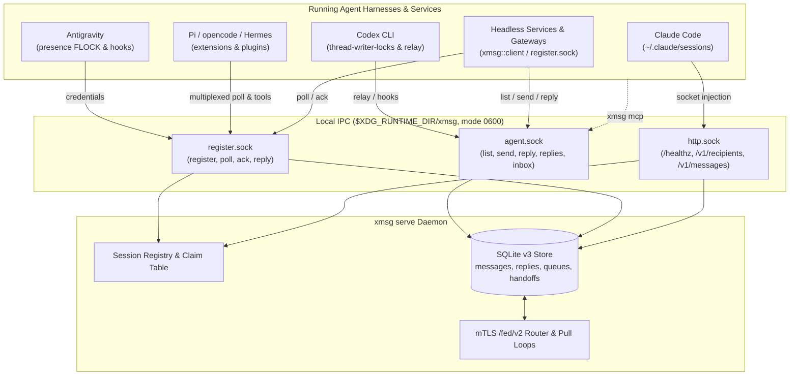

import { CardGrid, LinkCard } from '@astrojs/starlight/components';

`xmsg` is a local and federated message bus connecting running AI agent sessions across harnesses
([Claude Code](/harnesses/claude-code/), [Codex](/harnesses/codex/),
[Antigravity](/harnesses/antigravity/), [opencode](/harnesses/opencode/),
[Hermes](/harnesses/hermes/), and [Pi](/harnesses/pi/)) and headless services. It provides direct
inbox push delivery, kernel-attested caller identification, persistent reply threading, delegated
subagent mailboxes, and mTLS cross-host federation.

## Core concepts

| Concept | What it is | Read more |
|---|---|---|
| Address | Every recipient has an address: `id@node` (or `id~n@node` for a fork) for an instance, `
/<child>@node` for a bound subagent, and `name@node` for a service. | [Addressing & Resolution](/concepts/addressing/) |
| Instance, Service & Subagent | The three recipient kinds in `xmsg`. Instances are interactive agent sessions, services are long-polling daemons, and subagents are child turns bound under a parent conversation. | [Sessions, Services & Subagents](/concepts/sessions-services-subagents/) |
| Queue & Handoff | Sends to a parked Claude or Antigravity conversation queue in SQLite for the reply TTL (`7 days` by default) and follow a Claude conversation when it moves to another machine of the same user. | [Delivery, Queueing & Replies](/concepts/replies/) |
| Reply Threading | Every reply is stored under the original message ID and pushed automatically when the original sender has an inbox. Either party in an exchange may call `reply(message_id)`. | [Delivery, Queueing & Replies](/concepts/replies/#replies-stored-always-pushed-by-sender-kind) |
| Node & `/fed/v2` | Each `xmsg` daemon has a self-authenticating node name (`<user>.<host>`, `<sa>.<ns>`, or a 16-character key pin) and exchanges messages with peers over mTLS `/fed/v2`. | [Federation](/concepts/federation/) |
| Hub, Leaf & Outbound Link | Topologies for container/pod workers (`--leaf`), NAT-behind full nodes (`"dial": "outbound"`), single-hop hub forwarding (`allow = ["forward"]`), and hosted-dot gateways. | [Hubs, Leaves & Gateways](/concepts/hubs-and-leaves/) |
| Same-UID Trust Model | Local IPC sockets (`0600` in a `0700` runtime directory) rely on kernel peer credentials (`SO_PEERCRED` / `getpeereid`). Process ancestry provides attribution within a UID; separate UIDs, mTLS certificates, and peer `allow`/`targets` rules enforce security boundaries. | [Security & Trust Model](/concepts/trust-model/) |

## Architecture at a glance

`xmsg serve` operates three Unix domain sockets in `$XDG_RUNTIME_DIR/xmsg/` (or the per-user Darwin
temp directory on macOS):

1. **`http.sock`** — Serves the HTTP API (`/healthz`, `/v1/recipients`, `/v1/messages`). Callers
   whose process ancestry traces to a registered session or service act as that sender; untraced
   callers send as `<from> · anon@<node>`.
2. **`agent.sock`** — Line-delimited JSON protocol used by `xmsg mcp`, hook handlers, the Pi
   extension, and the Rust service client's `AgentClient` for `list`, `send`, `reply`, `replies`,
   `inbox`, and subagent/hook lifecycle frames.
3. **`register.sock`** — Line-delimited JSON protocol used by Antigravity credential registration,
   Pi long-polling, multiplexed `opencode` and `hermes` plugins, and headless `svc` daemons (`poll`,
   `ack`, `reply`).

## Where to go next

<CardGrid>
  <LinkCard
    title="Concepts"
    href="/concepts/addressing/"
    description="Understand addressing, sessions/services/subagents, queueing, replies, federation, and trust."
  />
  <LinkCard
    title="Harness Integration"
    href="/harnesses/claude-code/"
    description="Per-harness setup and lifecycle details for Claude Code, Codex, Antigravity, opencode, Hermes, and Pi."
  />
  <LinkCard
    title="CLI & API Reference"
    href="/reference/cli-and-mcp/"
    description="Every CLI flag, MCP tool, Unix socket frame, HTTP endpoint, and Rust client method."
  />
  <LinkCard
    title="Operations & Platforms"
    href="/operations/nixos-and-home-manager/"
    description="Deploy with Home Manager and NixOS, configure systemd socket activation, or run the OCI image."
  />
</CardGrid>
